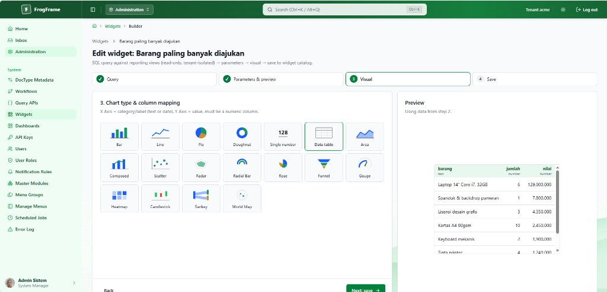
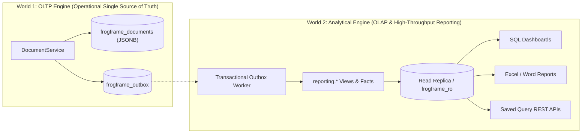

# FrogFramework — Metadata-Driven .NET Business Application Framework

<p align="center">
  
</p>

[](https://dotnet.microsoft.com/)
[](LICENSE)
[]()
[](docs/index.md)
[](https://codespaces.new/frogframework-admin/frogframe)

**FrogFramework** is an extensible, metadata-driven business application framework built on **.NET 10**, **ASP.NET Core**, **Blazor Server (Interactive)**, and **[Blazor Blueprint UI](https://blazorblueprintui.com)** (shadcn/ui-styled components for Blazor).

Engineered around **The "Two Worlds" Architecture**, FrogFramework establishes a strict separation of concerns between **World 1 (OLTP operational workflows)** and **World 2 (OLAP analytical reporting)**:
- **World 1 (OLTP)** guarantees single-document transactional agility, optimistic concurrency, dynamic schema validation, and atomic multi-step mutations.
- **World 2 (OLAP)** offloads heavy historical aggregations, interactive SVG dashboards, and large spreadsheet exports to dedicated read replicas (`frogframe_ro`) with zero contention on primary operational tables.

Storage can be seamlessly toggled via configuration: **in-memory** (for development, demos, and testing) or **PostgreSQL** (production-grade persistence with advisory locks, partial expression indexes, and analytical read replicas). Both backends pass the same test suites.

---

## The "Two Worlds" Architecture

A foundational architectural design of FrogFramework is the strict segregation between transactional OLTP operations and analytical OLAP reporting workloads:



### Why Segregate?
1. **World 1 (OLTP Operational Layer)**:
   - Preserved as the frozen single source of truth in `frogframe_documents`.
   - Optimized for single-document reads/writes, atomic validations, optimistic locking (`version = @expected`), and dynamic metadata-driven lifecycle hooks.
   - Analytical reporting queries are never permitted to lock or degrade operational tables.
2. **World 2 (OLAP Analytical Layer)**:
   - Real-time projections and `reporting.<doctype>` views populated via the transactional outbox (`occurredAt`, document snapshot, and `version`).
   - Read-replica offloading: queries execute through a dedicated read-only database user (`frogframe_ro`) in `READ ONLY` transactions with strict execution timeouts.
   - Powers interactive SVG dashboards, cross-DocType aggregation facts, and heavy OpenXML exports without transactional contention.

For deep-dive architectural specifications, benchmarks, and indexing strategies, see the [Analytical Engine (World 2 OLAP) Guide](docs/guides/analytics-engine.md) and [Project Structure Reference](docs/PROJECT_STRUCTURE.md).

---

## Current Status (v19)

### Completed and Verified
- **Data Import**: Multi-step Excel/CSV import engine with validation simulations and failure reporting.
- **Reporting Engine**: OpenXML template generation for Excel and Word documents (`.xlsx`, `.docx`) without external third-party dependencies.
- **API Extensibility**: Integration API Keys, custom `IApiMethod` endpoints, and Saved Query APIs.
- **Master Roles & Permissions**: Single-source-of-truth master roles, strict tenant isolation, and field-level permission hierarchies (`permLevel`).
- **Module Hierarchies**: Mandatory module categorization per DocType with uppercase immutable module codes and navigation menus.
- **Global Search**: Unified Awesomebar (`Ctrl+K` / `Alt+Q`) indexing DocTypes, pages, actions, and modules.
- **Security & Reliability**: Startup metadata audits, orphan file cleanup, and PostgreSQL advisory locking for distributed cron jobs.

### In Progress & Planned Roadmap
- Static link filters from metadata (e.g., leaf accounts only in General Ledger).
- Singleton DocType per tenant for application-wide settings.
- Separation of database migration owner role from runtime application role.
- Excel/CSV import upsert modes (Update and Add-or-Update).

---

## Quick Start

### Instant Cloud Demo (GitHub Codespaces)
Run and explore FrogFramework directly in your browser without local setup:

[](https://codespaces.new/frogframework-admin/frogframe)

Once the Codespace opens, start the application via terminal:
```bash
dotnet run --project src/Apps.Sample
```
Codespaces will automatically forward port `5080` and launch the web portal.

### Prerequisites (For Local Setup)
- [.NET 10 SDK](https://dotnet.microsoft.com/download/dotnet/10.0) (v10.0.100 or later).
- [Docker & Docker Compose](https://www.docker.com/) (optional, for PostgreSQL mode).

### Running Locally (In-Memory Mode)

```bash
# Run the host sample application (opens on http://localhost:5080)
dotnet run --project src/Apps.Sample

# Run the automated test suite
dotnet test
```

Demo seed data is generated automatically upon startup. Seeding executes through the standard `DocumentService` pipeline, ensuring that validations and workflows are verified during application boot.

### Running with PostgreSQL

```bash
# 1. Create .env from the template and replace every "change-me-..." value
cp .env.example .env

# 2. Start PostgreSQL 17 (the demo override publishes port 5432 on localhost only)
docker compose -f docker-compose.yml -f docker-compose.demo.yml up -d postgres

# 3. Run the application with PostgreSQL provider
#    (use POSTGRES_PASSWORD / FROGFRAME_RO_PASSWORD from .env in the connection strings)
dotnet run --project src/Apps.Sample --Persistence:Provider=PostgreSql
```

### Running with Docker Compose

```bash
cp .env.example .env   # fill in passwords, FROGFRAME_PUBLIC_BASE_URL and FROGFRAME_ALLOWED_HOSTS

# Production baseline: no demo data, no demo accounts, PostgreSQL not exposed to the host
docker compose up -d

# Demo: adds sample data, demo accounts on the login page, and PostgreSQL on 127.0.0.1:5432
docker compose -f docker-compose.yml -f docker-compose.demo.yml up -d
```

Outside the Development environment the application refuses to start unless `App:PublicBaseUrl` is an absolute URL and `AllowedHosts` lists explicit host names (not `*`).

---

## Architecture & Subsystems

FrogFramework is divided into four cleanly decoupled projects:

```text
FrogFramework/
├── src/
│   ├── Framework.Core/               # Pure domain & metadata compiler (no web dependencies)
│   ├── Framework.Persistence.PostgreSql/ # Production storage, index sync & analytics
│   ├── Framework.Web/                # Blazor UI, Identity, REST endpoints & Adapters
│   └── Apps.Sample/                  # Sample application host & Procurement/HR pilot
├── tests/
│   └── Framework.Tests/              # Unit, integration, and benchmark test suite
└── docs/                             # Technical documentation & guides (DocFX)
```

### 1. Pure Domain Engine (`Framework.Core`)
- **Expressions Engine**: Custom lexer, AST parser, and sandboxed interpreter with resource limits and an allowlist of built-in functions (`empty`, `len`, `sum`, `round`, `abs`, `coalesce`, `today`, `has_role`).
- **Metadata Compiler**: Strongly-typed definitions for DocTypes, fields, permissions, list views, and workflows. Performs topological sorting on computed fields to detect circular dependencies.
- **Document Service**: The unified, canonical save pipeline: authorize → load & verify version → normalize → reject mass assignment → run hooks → compute formula fields → validate rules → commit atomically (document + audit + outbox).
- **Security**: Granular permission resolution (`all`, `owner`, `match:field=attribute`) and multi-tenant scoping.

### 2. UI System (`Framework.Web`)
Built using Blazor Blueprint components styled with OKLCH theme variables:
- Dynamic schema-driven document form rendering (`BbTabs`, `BbCard`, `BbField`, `BbInput`, `BbSelect`, `BbCombobox`).
- Server-side searchable Link dropdowns.
- Real-time workflow state badges and status stamp components.
- Generic organizational tree visualizations (`OrgTree`).

### 3. The "Two Worlds" Persistence & Analytics (`Framework.Persistence.PostgreSql`)
- **World 1 (OLTP Operational Store)**: Unified `frogframe_documents` JSONB store with optimistic concurrency checks (`version = @expected`) and sub-millisecond atomic transactions.
- **World 2 (OLAP Analytical Layer)**: Dynamic `reporting.<doctype>` views and projection facts queried via `frogframe_ro` read replica connections.
- **Transactional Outbox**: Guaranteed at-least-once event delivery bridging World 1 mutations to World 2 analytical projections.
- **Metadata Index Synchronizer**: Automatically creates and drops B-tree, partial, and GIN trigram indexes based on `listView` configurations concurrently.

---

## Authentication & User Accounts

Authentication is powered by **ASP.NET Core Identity** (cookie-based for browsers, Bearer tokens for REST APIs). Claims map immutably to `UserContext`:

| Claim Type | Content | `UserContext` Property |
|---|---|---|
| `nameidentifier` | Unique Account ID | `Id` (Document owner) |
| `frogframe:tenant` | Tenant ID | `TenantId` |
| `frogframe:full_name` | Full Name | `FullName` |
| `role` | Assigned Roles | `Roles` |
| `frogframe:department` | Department Code | `Attributes["department"]` |
| `frogframe:employee` | Linked Employee ID | `Attributes["employee"]` |

Claims missing a tenant are rejected immediately (fail-closed). Accounts lock automatically for 15 minutes after 5 consecutive failed attempts.

---

## SQL Dashboards & Saved Query APIs

FrogFramework allows administrators to build live dashboards and publish read-only SQL queries as secure REST endpoints:

- **Isolated Read-Only User**: Analytical queries execute under a dedicated `frogframe_ro` role with restricted privileges and per-connection session isolation.
- **Visual Chart Widgets**: Bar, Line, Pie, Doughnut, Single Value KPI, and Data Grid widgets rendered using lightweight, pure SVG.
- **Saved Query APIs**: Published at `/api/query/{slug}` with strict parameter allowlists, CSV/JSON outputs, and response caching.

```bash
# Querying a published SQL endpoint
curl -H "Authorization: ApiKey dfk_k1a2b3....<secret>" \
     "http://localhost:5080/api/query/procurement-by-dept?Dept=IT"
```

---

## Extensibility: Hooks, Form Actions & Scheduler

Extend business logic cleanly without monkey-patching:

1. **Document Lifecycle Hooks**: Implement `IDocumentHook` for stages such as `BeforeValidate`, `BeforeSave`, `AfterSave`, `BeforeSubmit`, `BeforeDelete`, etc.
2. **Custom Form Actions**: Register toolbar actions using `IFormAction<TDoc>`.
3. **Background Scheduler**: Register periodic jobs using `AddScheduledJob<TJob>()`, guaranteed to run with distributed advisory locks across nodes.

```csharp
// Example: Registering a periodic background sync job
builder.Services.AddScheduledJob<DailySyncJob>();

// Example: Registering a custom lifecycle hook
builder.Services.AddDocHook<PurchaseRequest, PurchaseRequestApprovalHook>();
```

For detailed architecture and code examples, see [Architecture Guide: Hooks, Actions & Scheduler](docs/hooks-formactions-scheduler.md).

---

## REST API Overview

FrogFramework provides auto-generated REST endpoints for every API-enabled DocType:

```bash
# 1. Obtain an access token
TOKEN=$(curl -s -X POST -H "Content-Type: application/json" \
  -d '{"userName":"andi","password":"FrogFrame#2026"}' \
  http://localhost:5080/api/auth/login | jq -r .accessToken)

# 2. Query documents with filters and sorting
curl -H "Authorization: Bearer $TOKEN" \
  "http://localhost:5080/api/data/PurchaseRequest?filters=[[\"priority\",\"=\",\"High\"]]&sort=total&dir=desc"

# 3. Transition document workflow
curl -X POST -H "Authorization: Bearer $TOKEN" -H "If-Match: 1" \
  -H "Content-Type: application/json" -d '{}' \
  "http://localhost:5080/api/data/PurchaseRequest/PR-2026-00001/actions/Submit"
```

All errors conform to RFC 7807 `application/problem+json`.

---

## Documentation & Website

The complete technical documentation, architecture specifications, and .NET API references are built with **DocFX**:

- **Local Preview**:
  ```powershell
  dotnet docfx --serve
  ```
  Visit `http://localhost:8080` to browse guides, architecture blueprints, and API documentation.
- **Guides Index**: [docs/index.md](docs/index.md)
- **Frequently Asked Questions (FAQ)**: [docs/faq.md](docs/faq.md)
- **Project Structure Blueprint**: [docs/PROJECT_STRUCTURE.md](docs/PROJECT_STRUCTURE.md)
- **Security Baseline (OWASP Top 10)**: [docs/security-baseline.md](docs/security-baseline.md)
- **Observability Guide**: [docs/observability.md](docs/observability.md)
- **Backup & Disaster Recovery Runbook**: [docs/backup-disaster-recovery.md](docs/backup-disaster-recovery.md)

---

## License

FrogFramework is licensed under the [GNU Affero General Public License v3.0](LICENSE).
