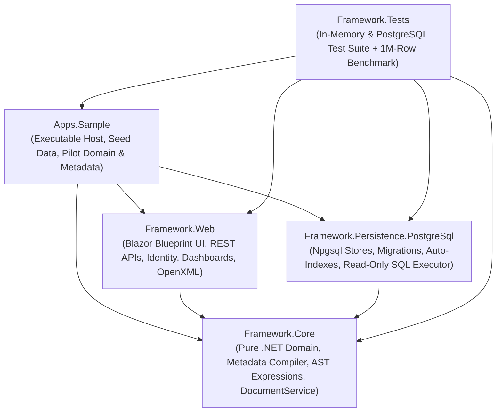

# DocFrame — Architecture & Project Structure Reference

> **Purpose of this Document**: This is the authoritative engineering and architectural reference for **DocFrame**, a metadata-driven .NET 10 business application framework inspired by the Frappe Framework. It consolidates the core RFC v2 design, the "Two Worlds" (Operational vs. Analytical) architecture, the 4-project solution structure, security invariants, database schema, API contracts, and developer extension playbooks to serve as the primary blueprint for all future development.

---

## Table of Contents

1. [Executive Summary & Core Philosophy](#1-executive-summary--core-philosophy)
2. [Non-Negotiable Architectural Principles](#2-non-negotiable-architectural-principles)
3. [The "Two Worlds" Architecture (World 1 OLTP vs. World 2 OLAP)](#3-the-two-worlds-architecture-world-1-oltp-vs-world-2-olap)
4. [Solution Overview & Dependency Graph](#4-solution-overview--dependency-graph)
5. [Detailed Project Breakdown (`src/`, `tests/`, `deploy/`)](#5-detailed-project-breakdown-src-tests-deploy)
   - [5.1 `Framework.Core` — Pure Domain & Metadata Engine](#51-frameworkcore--pure-domain--metadata-engine)
   - [5.2 `Framework.Persistence.PostgreSql` — Production Storage & Analytics Engine](#52-frameworkpersistencepostgresql--production-storage--analytics-engine)
   - [5.3 `Framework.Web` — Blazor Blueprint UI, Identity & REST Adapters](#53-frameworkweb--blazor-blueprint-ui-identity--rest-adapters)
   - [5.4 `Apps.Sample` — Host Application & Procurement/HR Pilot](#54-appssample--host-application--procurementhr-pilot)
   - [5.5 `Framework.Tests` — Verification & Benchmark Suite](#55-frameworktests--verification--benchmark-suite)
6. [Deep-Dive into Core Subsystems](#6-deep-dive-into-core-subsystems)
   - [6.1 Metadata Compiler, Versioning & Risk Classification](#61-metadata-compiler-versioning--risk-classification)
   - [6.2 Safe AST Expression Engine](#62-safe-ast-expression-engine)
   - [6.3 Identity, Master Roles & 3-Tier Permission Model](#63-identity-master-roles--3-tier-permission-model)
   - [6.4 Document Lifecycle, Save Pipeline & Workflow Engine](#64-document-lifecycle-save-pipeline--workflow-engine)
   - [6.5 Master Navigation Menu](#65-master-navigation-menu)
   - [6.6 Generic Lookup Dialog & Self-Link Hierarchy (`OrgTree`)](#66-generic-lookup-dialog--self-link-hierarchy-orgtree)
   - [6.7 Secure File & Image Storage (`IFileStore`)](#67-secure-file--image-storage-ifilestore)
   - [6.8 Print Format Engine & Server-Side PDF Generation](#68-print-format-engine--server-side-pdf-generation)
   - [6.9 Excel/CSV Data Import Engine](#69-excelcsv-data-import-engine)
   - [6.10 SQL Dashboard, Saved Query APIs & OpenXML Excel/Word Reports](#610-sql-dashboard-saved-query-apis--openxml-excelword-reports)
   - [6.11 Integration API Keys & Custom `IApiMethod`](#611-integration-api-keys--custom-iapimethod)
   - [6.12 PostgreSQL Performance, Automatic Indexing & Transactional Outbox](#612-postgresql-performance-automatic-indexing--transactional-outbox)
   - [6.13 Background Scheduler & Distributed Job Execution](#613-background-scheduler--distributed-job-execution)
   - [6.14 Custom Form Actions & Document Toolbar Extensions](#614-custom-form-actions--document-toolbar-extensions)
7. [Database Schema & Migrations Reference](#7-database-schema--migrations-reference)
8. [HTTP REST API & Blazor Route Reference](#8-http-rest-api--blazor-route-reference)
9. [Configuration & Deployment Reference](#9-configuration--deployment-reference)
10. [Developer Playbook: How to Extend DocFrame](#10-developer-playbook-how-to-extend-docframe)

---

## 1. Executive Summary & Core Philosophy

**DocFrame** is a metadata-driven business application framework built on **.NET 10**, **ASP.NET Core**, **Blazor Server (Interactive Server)**, **Blazor Blueprint UI 4.1.0**, and **PostgreSQL** (via raw **Npgsql** without Entity Framework Core).

In traditional CRUD applications, adding a new business entity requires hand-coding database tables, DTOs, repositories, service layers, validation rules, REST controllers, list pages, and form UIs. DocFrame replaces this repetitive boilerplate with a single declarative artifact: the **DocType**.

```text
DocType (Declarative Metadata)
  ├──► Data Normalization & Storage (JSONB + Auto-Managed Expression Indexes)
  ├──► Dynamic Form UI (Tabs, Multi-Column Sections, Child Tables, Lookups, Live Expressions)
  ├──► Dynamic List View (Pagination, Search, Allowlisted Filters, Sorting)
  ├──► Generic REST API (/api/data/{DocType} with If-Match Optimistic Concurrency)
  ├──► Multi-Level Permissions (Role Actions + Row Scope + Field PermLevel)
  ├──► Workflow State Machine (States, Role/Condition Transitions, Mandatory Comments)
  ├──► Lifecycle Hooks & Transactional Outbox (Atomic Commit with Audit & Notifications)
  ├──► Print & PDF Engine (A4 Print Layout, Electronic Workflow Signatures, Watermarks)
  ├──► Excel/CSV Import Wizard (Template Generator, Dry-Run Simulation, Atomic/Partial Import)
  └──► Reporting Views & Analytics Projection (reporting.<doctype> & World 2 Star Schema)
```

---

## 2. Non-Negotiable Architectural Principles

Every feature built on or added to DocFrame must adhere to the following **8 core invariants** (established in RFC v2):

1. **Metadata First, Code for Exceptions**: Standard forms, lists, CRUD APIs, permissions, workflows, and basic validations are declared in JSON metadata or via the visual admin editors. C# code is written strictly for domain-specific business rules (`IDocumentHandler`), custom validators (`IFieldValidator`), custom RPC endpoints (`IApiMethod`), and complex coded reports (`IReport`).
2. **Single Choke Point (`DocumentService`)**: Every document mutation—whether triggered from a Blazor form, a REST API call, an Excel/CSV import row, a custom `IApiMethod`, or startup seed data—**must** pass through `DocumentService`. There is no "backdoor" or separate validation ruleset for APIs or imports.
3. **Zero `eval`, Zero Arbitrary Code Execution**: Metadata expressions (`requiredWhen`, `visibleWhen`, `readOnlyWhen`, `compute`, `validationRules`, and workflow transition conditions) are parsed by a custom AST interpreter (`Expressions.cs`) with an explicit function allowlist and strict length, depth, and step limits. Dynamic C# compilation (Roslyn) or arbitrary SQL interpolation from metadata is strictly forbidden.
4. **Never Trust Client-Computed Values**: Although `DocumentEvaluator` runs live in the Blazor UI for instant user feedback, the server **discards** any client-supplied values for `compute` or `fetchFrom` fields, recalculating them in topological order on the server during save.
5. **Fail-Closed Security & Anti-IDOR**:
   - Missing tenant claim (`docframe:tenant`) immediately denies access, even for `System Manager` / `Administrator`.
   - Unauthorized access to a specific document (out of row scope or cross-tenant) throws `DocumentNotFoundException` (`404 Not Found`), preventing Insecure Direct Object Reference (IDOR) enumeration.
   - Restricted fields (`permLevel > 0`) that a user lacks permission to read are stripped before sending data to the client, blocked on write (mass-assignment protection), excluded from audit diffs for that user, and omitted from `reporting.*` views.
6. **Monotonic Document Lifecycle (`DocStatus`)**: Documents progress strictly forward: `0 (Draft)` → `1 (Submitted / Locked)` → `2 (Cancelled)`. A locked (`Submitted`) or `Cancelled` document can never transition back to `Draft`. Revisions to a rejected or cancelled document must create a new linked document via **Amend** (`PR-2026-00001-1`).
7. **Atomic Persistence (Document + Audit + Outbox)**: Every save or workflow transition commits the document row, the `docframe_audit` entry, and the `docframe_outbox` event(s) inside a **single database transaction**. Optimistic concurrency (`version = @expected`) guarantees no lost updates across multiple web instances.
8. **Separation of Operational (World 1) and Analytical (World 2) Workloads**: Heavy reporting and dashboard queries must never lock, slow down, or compromise transactional tables.

---

## 3. The "Two Worlds" Architecture (World 1 OLTP vs. World 2 OLAP)

DocFrame explicitly separates operational processing from analytical reporting into two distinct worlds connected by the transactional outbox.

```mermaid
flowchart TB
    subgraph W1["World 1 — Operational (OLTP / Single Source of Truth)"]
        UI["Blazor UI / REST API / Excel Import"] --> DS["DocumentService Pipeline"]
        DS -->|Single ACID Transaction| DOC[("docframe_documents\n(JSONB + Metadata Indexes)")]
        DS -->|Single ACID Transaction| AUD[("docframe_audit")]
        DS -->|Single ACID Transaction| OUT[("docframe_outbox\n(payloadVersion = 2 + Snapshot)")]
    end

    subgraph Bridge["The Bridge — Outbox & Projection Engine"]
        OUT -->|Near-Real-Time Stream\n(Seconds Latency)| PROJ["Projection Engine\n(Idempotent by doctype, name, version)"]
        DOC -.->|Scheduled Batch Jobs\n(Backfill / Rebuild / Reconcile / Snapshot)| PROJ
    end

    subgraph W2["World 2 — Analytical (OLAP / Read-Only Reporting)"]
        PROJ --> VIEWS[("Current Foundation:\nreporting.<doctype> Views\n+ Native Casts")]
        PROJ --> STAR[("Target Scale Architecture:\nfact_<process> & dim_<entity>\n(Native Columns + Time/Tenant Partitions)")]
        VIEWS --> EXEC["DashboardSqlExecutor\n(docframe_ro User + READ ONLY + Timeout)"]
        STAR --> EXEC
        EXEC --> CONSUMERS["SQL Dashboards · Excel/Word Reports · /api/query/{slug}"]
    end
```

### 3.1 World 1: Operational Layer (Frozen as Single Source of Truth)
- Stored in `docframe_documents` using standard relational columns (`tenant_id`, `doctype`, `name`, `owner`, `docstatus`, `workflow_state`, `version`, `schema_version`, `created`, `modified`) plus a flexible `data JSONB` payload.
- Optimized for single-document reads/writes, schema agility, optimistic locking, and filtered list pagination (accelerated by `DocumentIndexSync` partial expression indexes and `QueryLimits.CountCap = 10_000`).
- **Frozen Rule**: Analytical requirements never force structural changes onto World 1 tables. The only touchpoint in World 1 is ensuring `docframe_outbox` carries a rich event payload (`payloadVersion = 2`), including the authoritative `occurredAt` timestamp, actor, document `version`, and the complete **point-in-time JSON snapshot (`data`)** at the exact moment of the event.

### 3.2 World 2: Analytical Layer (Current Foundation & Target Scale Design)
As documented in the *World 2 Analytics Layer Architecture Specification*, JSONB extraction on `docframe_documents` works well up to hundreds of thousands of rows (~0.8s for 1M rows using direct `::numeric` / `::date` casts in `reporting.*` views), but tens of millions of rows and complex multi-DocType historical aggregations require dedicated analytical modeling:

1. **Golden Rule of Workload Isolation**:
   - Reporting queries execute through a dedicated, verified read-only database user (`docframe_ro` via `ConnectionStrings:DocFrameReadOnly`) inside a `READ ONLY` transaction with a strict `statement_timeout`.
   - When `ConnectionStrings:DocFrameAnalytics` is configured, analytical reads and tenant-session pinning can be routed to a **PostgreSQL Logical Replica** so OLTP primary CPU/IO is completely untouched.
2. **Three Locked Architectural Decisions for World 2**:
   - **Decision 1 — Dual Historical Strategy**:
     - **A. Periodic Snapshots** (populated by scheduled batch jobs at end-of-day/month): Fast, compact tables for answering *"What was the pending total per department at the end of each month?"*
     - **B. Event-Grained SCD Type 2** (populated near-real-time from the outbox with `valid_from` and `valid_to`, where current rows have `valid_to IS NULL`): Answers point-in-time queries (*"What was the exact state at timestamp X?"*) and cycle-time/transition analysis (*"Average duration from Submitted to Approved"*).
     - **Retention Policy**: Full event-grained history is retained for **1 year**, after which monthly partitions are summarized into periodic snapshots and pruned.
   - **Decision 2 — Point-in-Time Dimension Values**:
     - Historical reports must reflect dimension attributes **at the time the event occurred** (e.g., if Andi submitted a Purchase Request while in `IT` and later transferred to `Operations`, last year's report must still count that request under `IT`).
     - Achieved via **Dimension Freezing on Facts** (copying high-frequency attributes like `department_at_event`, `job_title_at_event` directly onto the fact row at projection time) combined with **SCD2 Dimension Tables** (`dim_employee`, `dim_department` with `valid_from`/`valid_to`) for `AS-OF` joins on secondary attributes.
   - **Decision 3 — Dual Report Definition Paths**:
     - **Path 1 (Auto-Generated Per-DocType Facts)**: Automatically derived from DocType metadata (numeric fields become measures, `Link` fields become dimension keys, `Date` fields map to `dim_date`). This allows seamlessly promoting `reporting.<doctype>` from a thin SQL view to an indexed projection table without breaking existing SQL dashboards or reports.
     - **Path 2 (Analyst-Assembled Cross-DocType Facts)**: JSON-configured wide fact definitions joining multiple DocTypes (e.g., `PurchaseRequest` + `Items` + `Employee` + `Department`) with explicit grain, measures, and frozen dimensions, processed by the exact same projection engine.
3. **Idempotency, Ordering & Projection Security**:
   - Because the outbox guarantees *at-least-once* delivery, projection workers deduplicate on `(doctype, name, version)` and reject out-of-order events where `event.version <= projected.version`.
   - **Security Shift**: Unlike live views, projected tables store copies of data; therefore, stripping restricted fields (`permLevel > 0`) and `Image` fields is strictly enforced **at projection time** as well as read time.

---

## 4. Solution Overview & Dependency Graph

The solution (`DocFrame.sln`) is organized into **4 source projects** under `src/`, **1 test & benchmark project** under `tests/`, and deployment artifacts under `deploy/`.



| Project | Target SDK | Layer / Role | External Dependencies |
| :--- | :--- | :--- | :--- |
| **[Framework.Core](file:///d:/Side%20Projects/DocFrame/src/Framework.Core/Framework.Core.csproj)** | `Microsoft.NET.Sdk` (`net10.0`) | Pure Core Domain & Engine | **None** (Zero NuGet packages; pure BCL) |
| **[Framework.Persistence.PostgreSql](file:///d:/Side%20Projects/DocFrame/src/Framework.Persistence.PostgreSql/Framework.Persistence.PostgreSql.csproj)** | `Microsoft.NET.Sdk` (`net10.0`) | PostgreSQL Persistence & Analytics | `Npgsql` (10.0.3), `Microsoft.Extensions.Logging.Abstractions` |
| **[Framework.Web](file:///d:/Side%20Projects/DocFrame/src/Framework.Web/Framework.Web.csproj)** | `Microsoft.NET.Sdk.Razor` (`net10.0`) | Web UI (Blazor Server) & HTTP APIs | `BlazorBlueprint.Components` (4.1.0), ASP.NET Core shared framework |
| **[Apps.Sample](file:///d:/Side%20Projects/DocFrame/src/Apps.Sample/Apps.Sample.csproj)** | `Microsoft.NET.Sdk.Web` (`net10.0`) | Runnable Host & Sample Pilot App | References `Core`, `Persistence.PostgreSql`, and `Web` |
| **[Framework.Tests](file:///d:/Side%20Projects/DocFrame/tests/Framework.Tests/Framework.Tests.csproj)** | `Microsoft.NET.Sdk` (`net10.0`) | Automated Tests & Benchmarks | References all 4 `src/` projects |

---

## 5. Detailed Project Breakdown (`src/`, `tests/`, `deploy/`)

### 5.1 `Framework.Core` — Pure Domain & Metadata Engine
Located at [src/Framework.Core](file:///d:/Side%20Projects/DocFrame/src/Framework.Core), this project contains all core business mechanics and persistence contracts. It has **zero web or database driver dependencies** and ships with complete in-memory transactional stores for fast unit testing and demo mode.

```text
src/Framework.Core/
├── Documents/
│   ├── DataImport.cs            # 4-step Excel/CSV import engine, template builder, dry-run & commit
│   ├── Document.cs              # Document entity, DocStatus enum (0/1/2), StandardFields, Exceptions
│   ├── DocumentService.cs       # The single pipeline for Get, List, Insert, Update, Delete, ApplyAction, Amend
│   ├── Hooks.cs                 # Lifecycle hook interfaces (IBeforeValidate..IAfterCancel), DocumentHandlerBase
│   └── WorkflowEngine.cs        # State machine evaluation, transition authorization, condition checking
├── Expressions/
│   └── Expressions.cs           # Lexer, recursive-descent AST parser, safe bounded evaluator, allowlisted functions
├── Identity/
│   ├── AccountModels.cs         # UserAccount, AccountLoginStatus, IUserAccountStore, ClaimsUserMapper
│   ├── ApiKeys.cs               # ApiKeyRecord, SHA-256 hashing, wildcard scope matcher, CIDR/IP check, IApiKeyStore
│   ├── InMemoryApiKeyStore.cs   # In-memory API key store
│   ├── InMemoryRoleStore.cs     # In-memory Master Role store (seeds Administrator, User, HR, Purchasing)
│   ├── InMemoryUserAccountStore.cs # In-memory user account store
│   └── Roles.cs                 # RoleDef, RoleDefaults (mandatory system roles), IRoleStore contract
├── Jobs/
│   ├── Outbox.cs                # OutboxMessage (v2 snapshot payload), IOutboxHandler, OutboxProcessor
│   └── Reports.cs               # IReport contract, ReportService, CSV exporter with formula-injection protection
├── Metadata/
│   ├── Compiler.cs              # Full metadata validator, topological sort for compute fields, PrintFormat compiler
│   ├── Definitions.cs           # JSON POJOs: DocTypeDef, FieldDef, WorkflowDef, PermissionRuleDef, PrintFormatDef
│   ├── FieldTypes.cs            # IFieldType, FieldTypeRegistry (Data, Int, Currency, Date, Select, Check, Link, Table, Image)
│   └── MetadataRegistry.cs      # Immutable snapshots, MetadataDiffEngine (Safe/Transform/Risky), FileMetadataLoader
├── Navigation/
│   ├── InMemoryNavigationMenuStore.cs # In-memory store for hierarchical sidebar menus
│   └── NavigationMenu.cs        # NavigationMenuItem model & INavigationMenuStore contract
├── Persistence/
│   ├── DashboardModels.cs       # DashboardWidget, DashboardLayout, SqlParameterExtractor, IDashboardSqlExecutor
│   ├── FileStore.cs             # StoredFile, FileUploadValidator (magic bytes for PNG/JPEG/WebP/GIF), IFileStore
│   ├── InMemoryStores.cs        # Full ACID-like in-memory transaction & store implementations
│   ├── QueryApi.cs              # QueryApiDef, QueryApiInput, QueryApiValidation, QueryApiCsv, IQueryApiStore
│   ├── ReportTemplates.cs       # ReportTemplate, OoxmlTemplateValidator, ReportTemplateService
│   ├── Spreadsheets.cs          # Pure-BCL OpenXML (.xlsx) & RFC 4180 (.csv) reader and writer (no 3rd-party libs)
│   └── Stores.cs                # Core contracts: IUnitOfWork, IDocumentStore, ISeriesStore, IAuditStore, QueryLimits
├── Printing/
│   ├── PrintModels.cs           # PrintModelBuilder, workflow signature extractor, watermark & verification code
│   └── Terbilang.cs             # Indonesian number-to-words converter ("Dua Juta Tujuh Ratus Lima Puluh Ribu Rupiah")
├── Security/
│   ├── PermissionService.cs     # 3-tier authorization (Role Action -> Row Scope -> Field PermLevel)
│   └── UserContext.cs           # Immutable caller identity (Id, FullName, TenantId, Roles, Attributes, IsAdmin)
└── Validation/
    ├── DocumentEvaluator.cs     # Shared UI/Server evaluator for defaults, fetchFrom, topological compute, visibility
    └── ValidationEngine.cs      # Field constraints (min/max/regex/options), link existence, cross-field AST rules
```

### 5.2 `Framework.Persistence.PostgreSql` — Production Storage & Analytics Engine
Located at [src/Framework.Persistence.PostgreSql](file:///d:/Side%20Projects/DocFrame/src/Framework.Persistence.PostgreSql), this project implements all `Framework.Core` storage contracts against PostgreSQL using parameterized raw SQL over `Npgsql`.

```text
src/Framework.Persistence.PostgreSql/
├── Migrations/                  # Embedded SQL schema migrations (001_initial.sql .. 014_roles.sql)
│   ├── 001_initial.sql          # Core tables: documents, series, audit, outbox, notifications, metadata_versions
│   ├── 002_user_accounts.sql    # docframe_users (Identity accounts, password hash, security stamp, lockout)
│   ├── 003_workflows.sql        # docframe_workflow_versions (versioned workflow definitions)
│   ├── 004_files.sql            # docframe_files (binary image blobs, sha256, content_type)
│   ├── 005_dashboards.sql       # docframe_dashboard_widgets, docframe_dashboards, docframe_reporting_sessions
│   ├── 006_report_templates.sql # docframe_report_templates (.xlsx/.docx binary templates + JSON config)
│   ├── 007_api_keys.sql         # docframe_api_keys (SHA-256 secret hash, scopes, allowed_ips)
│   ├── 008_query_apis.sql       # docframe_query_apis (saved SQL endpoints, linked source widget/report)
│   ├── 009_imports.sql          # docframe_imports (Excel/CSV import history & failed-row file blob)
│   ├── 010_list_sort_index.sql  # Composite index (tenant_id, doctype, modified DESC, name)
│   ├── 011_outbox_retention_index.sql # Partial index on processed_at for fast hourly retention cleanup
│   ├── 012_AnalyticsLogicalReplica.sql # Reference script for logical replica setup
│   ├── 013_navigation_menus.sql # docframe_navigation_menus + hierarchical seed items
│   └── 014_roles.sql            # docframe_roles + seed roles (Administrator, User, HR, Purchasing)
├── DashboardSqlExecutor.cs      # 6-layer secured read-only SQL executor (verifies docframe_ro privileges)
├── DocumentIndexSync.cs         # Builds/drops CONCURRENTLY partial B-tree & pg_trgm GIN indexes from metadata
├── MigrationRunner.cs           # Advisory-locked (pg_advisory_lock) transactional SQL migration runner
├──OutboxRetentionCleaner.cs     # Background service pruning processed outbox messages older than RetentionDays
├── PostgresApiKeyStore.cs       # PostgreSQL store for integration API keys
├── PostgresDashboardStore.cs    # PostgreSQL store for dashboard widgets and layouts
├── PostgresFileStore.cs         # PostgreSQL binary store for uploaded images with reference verification
├── PostgresImportStore.cs       # PostgreSQL store for import logs and error workbooks
├── PostgresMetadataStore.cs     # Persists immutable DocType & Workflow versions across restarts
├── PostgresNavigationMenuStore.cs # PostgreSQL store for dynamic sidebar navigation menus
├── PostgresOptions.cs           # Connection strings (Main, ReadOnly, Analytics) & statement timeouts
├── PostgresQueryApiStore.cs     # PostgreSQL store for published SQL Query APIs
├── PostgresReportTemplateStore.cs # PostgreSQL store for OpenXML report templates
├── PostgresRoleStore.cs         # PostgreSQL store for Master Roles (enforces is_system protection)
├── PostgresStores.cs            # Core stores: PostgresUnitOfWork, DocumentStore, SeriesStore, AuditStore, OutboxStore
├── PostgresUserAccountStore.cs  # PostgreSQL store for user accounts
├── ReportingViewManager.cs      # Auto-generates & updates reporting.<doctype> and reporting.<doctype>_<child> SQL views
└── ServiceCollectionExtensions.cs # AddDocFramePostgres() DI registration & startup initializer
```

### 5.3 `Framework.Web` — Blazor Blueprint UI, Identity & REST Adapters
Located at [src/Framework.Web](file:///d:/Side%20Projects/DocFrame/src/Framework.Web), this Razor Class Library (RCL) hosts the interactive Blazor Server UI, authentication endpoints, OpenXML template engine, headless browser PDF generator, and generic HTTP APIs.

```text
src/Framework.Web/
├── Api/
│   ├── ApiMethods.cs            # IApiMethod contract, parameter validator, and /api/method dispatcher
│   ├── DocFrameEndpoints.cs     # All /api/* minimal API endpoints, ProblemDetails mapper, rate limiter
│   └── OpenXmlReportEngine.cs   # Pure-BCL .xlsx & .docx template expander (tags, repeating rows, formula shifting)
├── Auth/
│   ├── AccountEndpoints.cs      # /account/login, /account/logout, and /api/auth/{login,me} bearer token issuer
│   ├── AccountService.cs        # Password policy validation, PBKDF2 hashing, lockout, user CRUD, security stamp
│   ├── ApiKeyAuthHandler.cs     # Authentication handler for "Authorization: ApiKey dfk_..."
│   └── BlazorIdentityRevalidator.cs # Revalidates security stamp every 60s for open Blazor Server circuits
├── Components/
│   ├── BbIndonesian.cs          # Indonesian localization for Blazor Blueprint components
│   ├── ChildTable.razor         # Inline editable child table + "Add from Lookup" multi-select integration
│   ├── DashboardChart.razor     # Pure SVG responsive charts (Bar, Line, Pie, Doughnut, KPI Number, Data Table)
│   ├── DeskLayout.razor         # Main application shell, dynamic hierarchical sidebar, user menu, notifications
│   ├── DocumentForm.razor       # Metadata-driven form renderer (tabs, sections, columns, live expressions, actions)
│   ├── FieldInput.razor         # Switches editor by field type (Data, Currency, Date, Select, Check, Link, Image)
│   ├── Fmt.cs                   # Culture-aware Indonesian formatting helpers (currency, dates, badges)
│   ├── ImageInput.razor         # Drag-and-drop / file picker image uploader with thumbnail preview
│   ├── LinkInput.razor          # Server-searched BbCombobox + optional LookupDialog trigger button
│   ├── LookupDialog.razor       # Generic modal table dialog driven by target DocType's listView metadata
│   ├── OrgTree.razor            # Generic collapsible hierarchical chart component for self-linking DocTypes
│   ├── PrintDocument.razor      # A4 print layout component (letterhead, items, Terbilang, workflow signatures)
│   ├── StatusStamp.razor        # Document header status pill
│   └── Workspaces.cs            # DeskMenuItem registration model
├── Pages/
│   ├── AccountPassword.razor    # /account/password — self-service password change
│   ├── ApiKeysAdmin.razor       # /admin/api-keys — API key & integration account management
│   ├── Dashboard.razor          # /dashboard — Interactive SQL dashboard with global filters
│   ├── DashboardWidgetWizard.razor # /dashboard/widgets/new & /{id}/edit — 4-step SQL widget builder
│   ├── Desk.razor               # / — Home workspace with module cards and inbox
│   ├── DocDetail.razor          # /app/{DocType}/{Name} — View/edit existing document
│   ├── DocImport.razor          # /app/{DocType}/import — 4-step Excel/CSV import wizard
│   ├── DocList.razor            # /app/{DocType} — Paginated list view with search & filters
│   ├── DocNew.razor             # /app/{DocType}/new — Create new document
│   ├── DocPrint.razor           # /print/{DocType}/{Name} — Clean A4 print preview page
│   ├── DocTypeEditor.razor      # /admin/metadata/{DocType}/editor — Visual drag-and-drop DocType studio
│   ├── DocTypeNew.razor         # /admin/metadata/new — Wizard to create a new DocType from templates
│   ├── Login.razor              # /account/login — Sign-in page
│   ├── MenuAdmin.razor          # /admin/menus — Master Navigation Menu management
│   ├── MetadataAdmin.razor      # /admin/metadata — DocType & Workflow version inspector, diff & publish
│   ├── OrgStructure.razor       # /hr/struktur-organisasi — Department & Supervisor organization charts
│   ├── OutboxAdmin.razor        # /admin/outbox — Outbox queue diagnostics & dead-letter inspector
│   ├── QueryApiAdmin.razor      # /admin/query-apis — Saved SQL Query API list
│   ├── QueryApiWizard.razor     # /admin/query-apis/new & /{id}/edit — Saved SQL Query API builder
│   ├── ReportTemplateRun.razor  # /report-templates/{Id} — Parameter form to generate & download .xlsx/.docx
│   ├── ReportTemplateWizard.razor # /report-templates/new & /{Id}/edit — 4-step OpenXML report builder
│   ├── ReportTemplates.razor    # /report-templates — Catalog of available Excel/Word reports
│   ├── ReportView.razor         # /reports/{Name} — Built-in C# report viewer & CSV export
│   ├── RoleAdmin.razor          # /admin/roles — Master Roles management (System vs. Custom roles)
│   ├── UsersAdmin.razor         # /admin/users — User management, role assignment, password reset
│   └── WorkflowEditor.razor     # /admin/workflows/{Name}/editor — Visual state-machine & SVG diagram editor
├── Printing/
│   └── PrintService.cs          # Renders PrintDocument.razor to HTML and invokes headless Chrome/Edge for PDF
├── Services/
│   ├── CurrentUser.cs           # Scoped wrapper resolving UserContext from HttpContext / AuthenticationState
│   └── DemoUsers.cs             # Demo personas (Andi, Sari, Budi, Maya, Dewi, Rina, Admin, Tono)
├── wwwroot/
│   ├── desk.css                 # Application layout, print A4 styles, org chart, and editor styles
│   └── theme.css                # OKLCH light/dark shadcn/ui theme variables for Blazor Blueprint
└── WebServiceCollectionExtensions.cs # AddDocFrameWeb() and MapDocFrame() setup
```

### 5.4 `Apps.Sample` — Host Application & Procurement/HR Pilot
Located at [src/Apps.Sample](file:///d:/Side%20Projects/DocFrame/src/Apps.Sample), this is the executable entry point that wires the framework together and implements the **Procurement (Pengajuan Pembelian)** and **HR (Karyawan & Departemen)** pilot modules.

```text
src/Apps.Sample/
├── Domain/
│   └── Procurement.cs           # PurchaseRequestHandler, NpwpValidator, SisaAnggaranMethod, AjukanMassalMethod,
│                                # PurchaseSummaryReport, PendingApprovalReport, and startup Seeder
├── Metadata/
│   ├── Department.doctype.json  # Self-linking hierarchical Department DocType (naming: field:code)
│   ├── Employee.doctype.json    # Employee DocType with supervisor self-link (atasan_id) and photo (Image)
│   ├── Product.doctype.json     # Product catalog DocType with image and standard price
│   ├── PurchaseRequest.doctype.json # Pilot header DocType with child table addFromLookup & printFormat
│   ├── PurchaseRequestApproval.workflow.json # 2-tier approval workflow (Manager <= 10M, Finance > 10M)
│   ├── PurchaseRequestItem.doctype.json # Child table DocType (qty * rate compute)
│   └── Vendor.doctype.json      # Vendor master DocType with custom NPWP validator
├── Pages/
│   └── App.razor                # Root HTML document shell loading theme.css, blazorblueprint.css, desk.css
├── Program.cs                   # Application bootstrapper (switches In-Memory vs. PostgreSQL via config)
├── appsettings.json             # Default configuration (Persistence, ConnectionStrings, Print, Reports, Import, Api)
└── appsettings.Development.json # Development overrides (Demo:SeedData = true)
```

### 5.5 `Framework.Tests` — Verification & Benchmark Suite
Located at [tests/Framework.Tests](file:///d:/Side%20Projects/DocFrame/tests/Framework.Tests), this console test runner executes deterministic functional, security, and concurrency suites against both In-Memory and PostgreSQL backends, plus a 1,000,000-row synthetic benchmark.

```text
tests/Framework.Tests/
├── ApiKeyTests.cs               # API key auth, scopes, IP allowlist, custom IApiMethod, rate limiting
├── DashboardTests.cs            # SQL parameter extraction, AST validation, reporting views, read-only user security
├── IdentityTests.cs             # Login, lockout, password policy, security stamp, cross-tenant isolation
├── ImportTests.cs               # Excel/CSV template generation, column mapping, dry-run simulation, child table import
├── NavigationMenuTests.cs       # Master Navigation Menu CRUD, hierarchy validation, cycle prevention
├── OrgAndImageTests.cs          # Self-link cycle detection (A -> B -> A), magic-byte image validation, file ACLs
├──PerfBench.cs                  # 1,000,000-row PostgreSQL benchmark (--bench 1000000) & index planner verification
├── PostgresTests.cs             # Multi-instance concurrency, parallel naming series, outbox SKIP LOCKED, SQLi checks
├── Program.cs                   # 22 core RFC scenarios (compiler, AST, permissions, workflow, amend, print/PDF)
├── QueryApiTests.cs             # Saved SQL Query APIs, claim-bound parameter enforcement, caching, CSV export
├── ReportTemplateTests.cs       # OpenXML .xlsx/.docx generation, formula shifting, zip-bomb/VBA macro rejection
├── RoleTests.cs                 # Master Roles CRUD, mandatory system role protection (Administrator & User)
└── WorkflowAndDocTypeUiTests.cs # Visual DocType & Workflow editor model round-tripping and risk diffing
```

---

## 6. Deep-Dive into Core Subsystems

### 6.1 Metadata Compiler, Versioning & Risk Classification
- **Startup & Live Compilation**: `MetadataCompiler` ([Compiler.cs](file:///d:/Side%20Projects/DocFrame/src/Framework.Core/Metadata/Compiler.cs)) validates all `*.doctype.json` and `*.workflow.json` definitions before any version can become active. It checks:
  - Identifier syntax (`PascalCase` for DocTypes, `snake_case` for fields, avoiding reserved `StandardFields`).
  - Field types against `FieldTypeRegistry`, `Link` targets, and `Table` child DocTypes (`isChild: true`).
  - `addFromLookup` mappings (verifying `linkField` and mapped fields exist on both child and source DocTypes).
  - All expressions (`requiredWhen`, `visibleWhen`, `readOnlyWhen`, `compute`, `validationRules`, workflow transition `condition`) via the AST parser.
  - **Dependency Graph & Cycle Detection**: Builds a directed graph of `compute` field references and performs a topological sort so derived fields are evaluated in deterministic dependency order (e.g., child `amount = qty * rate` before parent `total = sum(items, 'amount')`). Circular dependencies are rejected at compile time.
- **Immutable Versioning & Risk Diffing**:
  - Published metadata snapshots are immutable (`CompiledDocType` / `CompiledWorkflow`) and stored in `docframe_metadata_versions` and `docframe_workflow_versions`.
  - Before publishing a new version, `MetadataDiffEngine` compares the candidate against the active version and classifies every change into one of three risk levels:
    - `Safe`: Adding an optional field, changing a label, adding a workflow state/transition.
    - `RequiresTransformation`: Changing a field's data type, making an existing field unconditionally required, removing a workflow transition.
    - `Risky`: Removing a field, narrowing `permLevel`, changing permission rules, removing a workflow state, or changing transition roles/conditions. Publishing a `Risky` diff requires explicit confirmation (`ConfirmRisky = true`).

### 6.2 Safe AST Expression Engine
Implemented in [Expressions.cs](file:///d:/Side%20Projects/DocFrame/src/Framework.Core/Expressions/Expressions.cs), the expression engine provides spreadsheet-like reactivity without security risks:
- **Hard Resource Limits**: `MaxLength = 512` characters, `MaxDepth = 24` AST nodes, `MaxSteps = 1_000` evaluation steps per call.
- **Supported Syntax**: Literals (`string`, `number`, `true`/`false`, `null`), field identifiers, dotted context paths (`user.id`, `user.department`, `user.tenant`), arithmetic (`+`, `-`, `*`, `/`), comparisons (`==`, `!=`, `<`, `<=`, `>`, `>=`), boolean logic (`&&`/`and`, `||`/`or`, `!`/`not`), and parenthesized grouping.
- **Allowlisted Functions Only**:
  - `empty(x)`: Returns `true` if `null`, empty string, or empty list.
  - `len(x)`: String length or child table row count.
  - `sum(table, 'field')`: Sums a numeric field across all rows of a child table.
  - `round(n, digits)` / `abs(n)`: Numeric math.
  - `coalesce(a, b, ...)`: First non-null/non-empty value.
  - `today()`: Current date in `yyyy-MM-dd`.
  - `has_role('RoleName')`: Checks whether the current user holds the specified role.

### 6.3 Identity, Master Roles & 3-Tier Permission Model
1. **Authentication & Claims Mapping**:
   - Supports Cookie authentication (browser sessions), Bearer tokens (`/api/auth/login`), and Integration API Keys (`Authorization: ApiKey dfk_...`).
   - `ClaimsUserMapper` ([AccountModels.cs](file:///d:/Side%20Projects/DocFrame/src/Framework.Core/Identity/AccountModels.cs)) is the single place that maps `ClaimsPrincipal` into an immutable `UserContext`.
   - `BlazorIdentityRevalidator` checks the user's `SecurityStamp` every 60 seconds so role changes, department transfers, or account deactivation take effect in open browser tabs without waiting for cookie expiration.
2. **Master Roles (`IRoleStore`)**:
   - Managed at `/admin/roles` and persisted in `docframe_roles` (`014_roles.sql`).
   - System roles (`IsSystem = true`)—specifically **`Administrator`** (`System Manager`) and **`User`** (`Employee`)—are seeded automatically and **cannot be deleted**. Sample business roles (`HR`, `Purchasing`, `Manager`, `Finance`, `Procurement`) are also seeded.
   - `UserContext.IsAdmin` returns `true` when the user holds either `Administrator` or `System Manager`.
3. **3-Tier Permission Evaluation (`PermissionService`)**:
   - **Tier 1 — Action Check**: Does at least one of the user's roles grant the requested `DocAction` (`Read`, `Create`, `Write`, `Delete`, `Submit`, `Cancel`, `Amend`, `Report`, `Export`) on the DocType?
   - **Tier 2 — Row Scope Check**:
     - `all`: Access all documents within the user's `TenantId`.
     - `owner`: Access only documents where `doc.Owner == user.Id`.
     - `match:<doc_field>=<user_attr>`: Access documents where `doc.Data[doc_field] == user.Attributes[user_attr]` (e.g., `match:department=department`).
   - **Tier 3 — Field `PermLevel` Check**:
     - Fields default to `permLevel: 0`. Fields with `permLevel > 0` (e.g., procurement vendor evaluation notes at `permLevel: 1`) are only readable or writable if the user has a permission rule for that `permLevel`.

### 6.4 Document Lifecycle, Save Pipeline & Workflow Engine
Every call to `InsertAsync` or `UpdateAsync` on `DocumentService` ([DocumentService.cs](file:///d:/Side%20Projects/DocFrame/src/Framework.Core/Documents/DocumentService.cs)) executes this exact 10-step pipeline:
1. **Authorize Action**: Verify `Create` or `Write` permission for the caller.
2. **Load & Check Optimistic Concurrency**: For updates, verify tenant, check row scope (throwing `404` if out of scope), ensure `DocStatus == Draft`, and verify `expectedVersion == doc.Version` (throwing `409 Conflict` on mismatch).
3. **Reject Mass-Assignment on Restricted Fields**: If the payload attempts to set any field whose `PermLevel` is not writable by the user, throw `PermissionDeniedException` (`403`).
4. **Normalize & Apply Defaults**: Strip client-supplied `compute`/`fetchFrom` values, normalize raw inputs through each field's `IFieldType`, and apply defaults (`$today`, `$user`, `$department`, `$employee`) on insert.
5. **Resolve `fetchFrom` & Topological `compute` (`DocumentEvaluator`)**: Fetch denormalized display values from linked documents (within the same tenant) and compute derived fields in topological order.
6. **Execute `IBeforeValidate` Hooks**: Run registered C# domain handlers.
7. **Validate (`ValidationEngine` + Self-Link Cycle Check)**: Check required conditions (`requiredWhen`), numeric/string bounds, regex patterns, custom `IFieldValidator` plugins, link target existence, self-link hierarchy cycles (`EnsureNoSelfLinkCycleAsync`), and cross-field AST `validationRules`.
8. **Execute `IBeforeSave` Hooks & Allocate Naming Series**: Generate the document number (e.g., `PR-2026-00001` or `field:code`) only after all validations pass ( ensuring dry-runs or failed saves never burn sequence numbers).
9. **Atomic Unit-of-Work Commit**: Persist the document, field-level `AuditEntry` (diffing old vs. new values), and `OutboxMessage` (`payloadVersion = 2` with full document snapshot) in one transaction.
10. **Execute `IAfterSave` Hooks**: Run post-commit notifications or in-process triggers.

### 6.5 Master Navigation Menu
- Managed at `/admin/menus` ([MenuAdmin.razor](file:///d:/Side%20Projects/DocFrame/src/Framework.Web/Pages/MenuAdmin.razor)) and stored in `docframe_navigation_menus` (`013_navigation_menus.sql`) via `INavigationMenuStore`.
- Supports hierarchical parent/child groups (e.g., `Pengadaan`, `HR`, `Administrasi`) and leaf items with Lucide icons, sort order, active toggle, `RequiresReadOf` (DocType read check), `RequiredRole` (`System Manager` / `Administrator`), and `SystemKey` protection (`admin-menus` and `admin-roles` cannot be deleted).
- `DeskLayout.razor` dynamically renders the sidebar from `INavigationMenuStore` and subscribes to `OnChanged` so menu edits or newly created DocTypes appear immediately across active sessions.

### 6.6 Generic Lookup Dialog & Self-Link Hierarchy (`OrgTree`)
- **`LookupDialog.razor`**: A completely metadata-driven modal table selector. It reads columns, search fields, and default sort order from the target DocType's `listView` metadata and queries data through `DocumentService.ListAsync` (preserving tenant isolation, row scope, and field permissions).
  - **Single-Select on `Link` Fields**: Set `"lookupDialog": true` on any `Link` field to render a table-lookup button next to the combobox.
  - **Multi-Select Batch Add on `Table` Fields**: Configure `"addFromLookup": { "linkField": "product", "map": { "item_name": "product_name", "uom": "uom", "rate": "price" }, "multiple": true }` on a child table field to let users check multiple items and populate mapped child rows automatically (while greying out already-added items).
- **Generic Self-Link Cycle Detection & `OrgTree.razor`**:
  - Any DocType with a `Link` field pointing to itself (e.g., `Department.parent_department` or `Employee.atasan_id`) is automatically protected by `DocumentService.EnsureNoSelfLinkCycleAsync`, which walks the ancestor chain (up to 64 hops) and rejects self-references or loops with a clear path error (`IT → Infrastruktur → IT`).
  - `OrgTree.razor` renders interactive, collapsible organization charts (`/hr/struktur-organisasi`) for both departments and supervisor hierarchies, highlighting the logged-in user's position.

### 6.7 Secure File & Image Storage (`IFileStore`)
- Supports `Image` fields (e.g., Employee photo, Product image) stored in `docframe_files` (`004_files.sql`).
- **Magic-Byte Inspection**: `FileUploadValidator` inspects actual file header bytes (PNG, JPEG, WebP, GIF up to 2 MB) rather than trusting file extensions or `Content-Type`. SVG is explicitly blocked to prevent stored XSS.
- **Strict Reference ACL (`GET /files/{id}`)**:
  - Unauthenticated or cross-tenant requests return `404`.
  - Before an image is saved onto a document, only the uploader can view it.
  - Once linked to a document, the endpoint loads the document via `DocumentService.GetAsync`—enforcing the user's document read permission, row scope, and verifying that the document still references that file ID. Responses include `X-Content-Type-Options: nosniff` and a strict `Content-Security-Policy`.

### 6.8 Print Format Engine & Server-Side PDF Generation
- Every document form displays **Cetak** (browser A4 preview at `/print/{DocType}/{Name}`) and **PDF** (`GET /api/data/{DocType}/{Name}/pdf`) buttons.
- Both paths render the exact same Blazor component (`PrintDocument.razor`), ensuring 100% visual parity between browser print and server-generated PDF.
- **Features**: Tenant letterhead (`Print:OrganizationName`), status stamp, formatted child tables, Indonesian currency-in-words (`Terbilang.Rupiah`), automatic electronic signature boxes extracted from workflow approval history (`docframe_audit`), non-final watermarks (`DRAFT`, `BELUM DISETUJUI`, `DITOLAK`), and a deterministic verification footer code.
- **Zero-Dependency PDF Conversion**: `PrintService` invokes locally installed headless Chromium / Google Chrome / Microsoft Edge (`--headless --print-to-pdf`) in an isolated temporary profile with strict timeouts. Every print or PDF download is recorded in `docframe_audit`.

### 6.9 Excel/CSV Data Import Engine
- Accessible via the **Impor** button on any DocType list page (`/app/{DocType}/import`) for users with `Create` permission.
- **4-Step Wizard (`DataImport.cs` & `Spreadsheets.cs`)**:
  1. **Dynamic `.xlsx` Template Download & Upload**: Generates a tailored Excel workbook containing only fields the user is permitted to write, marking required columns with `*`, embedding Excel dropdown validations for `Select`/`Check` fields, adding one sheet per child table (linked via an arbitrary **`Kunci impor`** key column), and an instructions (`Petunjuk`) sheet.
  2. **Auto Column Mapping**: Matches headers by field label or technical name (case-insensitive) with manual override.
  3. **Dry-Run Simulation**: Validates every row through `DocumentService` inside a rolled-back transaction without consuming naming series numbers. Reports exact Excel row numbers for any errors.
  4. **Commit (`SkipFailed` vs. `AllOrNothing`) & Failed-Row Workbook**: Creates documents with audit trail `"Dibuat lewat impor #imp_..."` and generates a downloadable `.xlsx` of failed rows with an appended `"Alasan"` (Reason) column for easy correction and re-upload.

### 6.10 SQL Dashboard, Saved Query APIs & OpenXML Excel/Word Reports
All three analytical features share `DashboardSqlExecutor` ([DashboardSqlExecutor.cs](file:///d:/Side%20Projects/DocFrame/src/Framework.Persistence.PostgreSql/DashboardSqlExecutor.cs)) and query `reporting.<doctype>` views:
- **6-Layer Read-Only SQL Security**:
  1. Dedicated `docframe_ro` connection (`ConnectionStrings:DocFrameReadOnly`) verified at runtime: must not be superuser, must have zero write privileges, and must be denied direct `SELECT` on `docframe_documents`, `docframe_users`, and `docframe_reporting_sessions`.
  2. **Unhijackable Tenant Isolation**: Before running a query, the app registers `(backend_pid, tenant_id)` in `docframe_reporting_sessions` using the main connection. The `reporting.*` views filter by `tenant_id = pg_Temp/session lookup for pg_backend_pid()`. Because `docframe_ro` cannot modify `docframe_reporting_sessions`, SQL queries cannot spoof another tenant via `SET` or `set_config`.
  3. `BEGIN TRANSACTION READ ONLY` + `SET LOCAL statement_timeout` (5s for dashboards/APIs, 30s for reports) + always `ROLLBACK`.
  4. Subquery row-limit wrapper: `SELECT * FROM (<user_sql>) AS __q LIMIT n`.
  5. Lexer-based `@Param` extraction (ignoring `@` inside string literals or comments) bound as strongly-typed native Npgsql parameters (`$1, $2`).
  6. Statement validator allowing only a single `SELECT` or `WITH` query and rejecting dollar-quoting (`$$`).
- **OpenXML Report Templates (`OpenXmlReportEngine.cs`)**:
  - Processes `.xlsx` and `.docx` files directly as ZIP/XML streams (`System.IO.Compression` + `System.Xml.Linq`) without third-party libraries.
  - Supports scalar tags (`{{Param}}`, `{{HeaderCol}}`, `{{Today}}`, `{{User}}`), aggregates (`{{Sum:Col}}`, `{{Avg:Col}}`, `{{Count}}`), repeating detail rows (`[[Col]]`, `[[No]]`), and Indonesian format specifiers (`{{Tanggal|dd MMMM yyyy}}`, `[[Harga|N0]]`).
  - In Excel, shifts formulas below expanding tables, widens aggregate ranges (`=SUM(D6:D6)` → `=SUM(D6:D105)`), adjusts merged cells/autofilters, and prevents formula injection by writing data values strictly as typed cells or literal strings.
- **Saved SQL Query APIs (`/api/query/{slug}`)**:
  - Can be created standalone (`/admin/query-apis`) or by checking **"Terbitkan juga sebagai API"** directly inside the Dashboard Widget Wizard or Report Template Wizard.
  - Supports JSON rows, single KPI object, or CSV output, optional response caching (`0–3600s`), and **claim-bound parameters** (`user:department`, `user:id`) that cannot be overridden by caller query strings.

### 6.11 Integration API Keys & Custom `IApiMethod`
- **Integration API Keys (`/admin/api-keys`)**:
  - Format: `Authorization: ApiKey dfk_<id>.<secret>`. Only the SHA-256 hash of the 256-bit secret is stored (`docframe_api_keys`), verified in constant time.
  - Tied to a user account (typically a passwordless **Integration Account**).
  - Supports granular wildcard scopes (`doc:{DocType}:{list|read|create|update|delete|action}`, `method:{name}`, `report:{id}`, `query:{slug}`), expiration dates, and IP/CIDR allowlists. Endpoints without an explicit scope annotation reject API keys (fail-closed).
- **Custom `IApiMethod` (`/api/method/{name}`)**:
  - Strongly-typed C# RPC endpoints (equivalent to `@frappe.whitelist()`).
  - Declares allowed `Roles` and `Parameters` (`text`, `number`, `date`, `boolean`, `list`). Unknown parameters are rejected to prevent mass assignment.

### 6.12 PostgreSQL Performance, Automatic Indexing & Transactional Outbox
- **`DocumentIndexSync`**: Runs at startup and after every metadata publish under a PostgreSQL advisory lock. Automatically builds (`CREATE INDEX CONCURRENTLY`) and prunes partial indexes (`WHERE doctype = '...'`) named `ix_df_<doctype>_<kind>_<hash>`:
  - B-tree expression indexes matching `listView.defaultSort` + `name`.
  - B-tree expression indexes matching `listView.filters`.
  - GIN trigram (`pg_trgm`) indexes matching `listView.searchFields` for fast `ILIKE '%term%'` searches.
- **`QueryLimits.CountCap = 10_000`**: List queries cap `COUNT(*)` using `SELECT COUNT(*) FROM (SELECT 1 FROM ... LIMIT 10001) s`, avoiding expensive full-table scans on million-row tables while displaying `10.000+` in the UI.
- **Outbox v2 & Retention**: `OutboxProcessor` claims batches using `FOR UPDATE SKIP LOCKED` with a 2-minute lease, exponential backoff, and dead-lettering after 5 attempts. `OutboxRetentionCleaner` prunes processed messages older than `Outbox:RetentionDays` (default 7 days) every hour.

### 6.13 Background Scheduler & Distributed Job Execution
- **Distributed Cron Architecture**:
  - `IScheduledJob`: Defines `Name`, `Schedule` (cron format or aliases like `@hourly`, `@daily`, `@every_15m`), and `ExecuteAsync(context, ct)`.
  - `IDistributedLock` & `InMemoryDistributedLock`: Acquires non-blocking key leases (`docframe:scheduler:{job}:{tenant}`) to ensure that in multi-instance cluster deployments, jobs run exactly once per scheduled interval.
  - `CronSchedule`: Comprehensive evaluator supporting standard 5-part cron syntax with duplicate execution suppression within the same minute.
  - `ScheduledJobContext`: Injects `TenantId`, `SystemUser` (`UserContext.System(tenant)` with `Administrator` and `System Manager` roles), `DocumentService`, and `IServiceProvider`.
  - `SchedulerWorker`: `BackgroundService` polling on a configurable interval (`Scheduler:PollIntervalSeconds`, default 15s) executing due jobs across all active tenants discovered via `ITenantProvider`.

### 6.14 Custom Form Actions & Document Toolbar Extensions
- **Custom Form Actions (`IFormAction<TDoc>`)**:
  - Safe, server-executed alternative to client-side JavaScript injection (`frm.add_custom_button`).
  - Implements `ActionId`, `Label`, `Icon`, `Tone` (`neutral`, `positive`, `negative`, `pending`), `IsVisible(user, doc)`, and `ExecuteAsync(context, ct)`.
  - Dynamically injected into `FormPage.razor` toolbar alongside standard workflow transition buttons based on caller role and document state.
  - Returns structured `FormActionResult` (`Ok`, `NavigateTo`, `Fail`) with automatic toast feedback and document reload.

---

## 7. Database Schema & Migrations Reference

All migrations live in `src/Framework.Persistence.PostgreSql/Migrations/` and are executed automatically on startup by `MigrationRunner`.

| Migration File | Table(s) / Objects Created | Purpose |
| :--- | :--- | :--- |
| `001_initial.sql` | `docframe_documents`, `docframe_series`, `docframe_audit`, `docframe_outbox`, `docframe_notifications`, `docframe_metadata_versions` | Core operational tables (World 1), optimistic concurrency, audit log, transactional outbox, and versioned DocType metadata. |
| `002_user_accounts.sql` | `docframe_users` | User accounts, PBKDF2 password hashes, security stamps, lockout counters, tenant, department, employee link, and roles JSONB. |
| `003_workflows.sql` | `docframe_workflow_versions` | Immutable published versions of workflows. |
| `004_files.sql` | `docframe_files` | Uploaded binary files (images), SHA-256 hash, MIME type, uploader, and tenant. |
| `005_dashboards.sql` | `docframe_dashboard_widgets`, `docframe_dashboards`, `docframe_reporting_sessions`, ` SCHEMA reporting` | SQL dashboard widgets, per-tenant dashboard layout, PID-keyed tenant session isolation table, and `reporting` schema. |
| `006_report_templates.sql` | `docframe_report_templates` | OpenXML `.xlsx` and `.docx` binary templates and JSON query/parameter configurations. |
| `007_api_keys.sql` | `docframe_api_keys` | Integration API keys (`dfk_...`), SHA-256 secret hashes, scopes, IP allowlists, and last-used tracking. |
| `008_query_apis.sql` | `docframe_query_apis` | Saved SQL Query API definitions (`/api/query/{slug}`) and links to source widgets/reports. |
| `009_imports.sql` | `docframe_imports` | Excel/CSV import history logs and downloadable failed-row `.xlsx` blobs. |
| `010_list_sort_index.sql` | `ix_docframe_documents_list_default` | Composite index `(tenant_id, doctype, modified DESC, name)` for sub-10ms default list pagination. |
| `011_outbox_retention_index.sql` | `ix_docframe_outbox_processed_at` | Partial index on `processed_at` for hourly outbox retention cleanup (`pg_trgm` extension also enabled). |
| `012_AnalyticsLogicalReplica.sql` | *(Comments / Reference)* | Documentation pointer to `deploy/sql/analytics-logical-replica.sql`. |
| `013_navigation_menus.sql` | `docframe_navigation_menus` | Master Navigation Menu hierarchy with seeded parent groups and menu items. |
| `014_roles.sql` | `docframe_roles` | Master Roles table seeded with mandatory `Administrator` & `User` (`is_system = true`) plus `HR`, `Purchasing`, `Manager`, `Finance`, `Procurement`. |
| `015_modules_and_menu_groups.sql` | `docframe_navigation_modules`, `docframe_navigation_menu_groups` | Dynamic navigation modules and parent menu groups. |
| `016_user_avatar.sql` | `docframe_users` avatar column | User avatar image reference support. |
| `017_workflow_doctype_optional.sql` | `docframe_workflow_versions` | Makes doctype column nullable for standalone workflow templates. |
| `018_scheduled_jobs.sql` | `docframe_scheduled_job_runs` | Persistent scheduled job run audit trail, duration, status, and error logs with fast lookup indexes. |
| `019_data_protection_keys.sql` | `docframe_data_protection_keys` | Persisted ASP.NET Core Data Protection XML key ring for persistent session cookies across deployments. |

**Auxiliary DBA SQL Scripts (`deploy/sql/`)**:
- [reporting-readonly-user.sql](file:///d:/Side%20Projects/DocFrame/deploy/sql/reporting-readonly-user.sql): Creates the `docframe_ro` PostgreSQL role with `SELECT` access restricted exclusively to the `reporting` schema and `reporting_current_tenant()` function.
- [analytics-logical-replica.sql](file:///d:/Side%20Projects/DocFrame/deploy/sql/analytics-logical-replica.sql): Setup guide for PostgreSQL Logical Replication (`CREATE PUBLICATION` / `CREATE SUBSCRIPTION`) when offloading World 2 analytical queries to a dedicated analytics database (`ConnectionStrings:DocFrameAnalytics`).

---

## 8. HTTP REST API & Blazor Route Reference

### 8.1 Blazor UI Routes

| Route | Component | Access / Role | Description |
| :--- | :--- | :--- | :--- |
| `/account/login` | `Login.razor` | Anonymous | Sign in with username & password |
| `/account/password` | `AccountPassword.razor` | Authenticated | Change own password |
| `/` | `Desk.razor` | Authenticated | Main workspace, module shortcuts, and notification inbox |
| `/app/{DocType}` | `DocList.razor` | DocType `Read` | Paginated list view, search, filters, and Import button |
| `/app/{DocType}/new` | `DocNew.razor` | DocType `Create` | Dynamic creation form |
| `/app/{DocType}/{Name}` | `DocDetail.razor` | DocType `Read` | Dynamic detail form, workflow action buttons, print/PDF, audit timeline |
| `/app/{DocType}/import` | `DocImport.razor` | DocType `Create` | 4-step Excel/CSV import wizard |
| `/print/{DocType}/{Name}` | `DocPrint.razor` | DocType `Read` | Clean A4 HTML print preview |
| `/hr/struktur-organisasi` | `OrgStructure.razor` | `Employee` `Read` | Interactive Department & Supervisor organization charts |
| `/dashboard` | `Dashboard.razor` | Authenticated | Interactive SQL dashboard with global date/department filters |
| `/dashboard/widgets/new` | `DashboardWidgetWizard.razor` | `Administrator` / `System Manager` | 4-step SQL dashboard widget wizard |
| `/report-templates` | `ReportTemplates.razor` | Authenticated | OpenXML Excel/Word report catalog |
| `/report-templates/new` | `ReportTemplateWizard.razor` | `Administrator` / `System Manager` | 4-step OpenXML Excel/Word report template wizard |
| `/report-templates/{Id}` | `ReportTemplateRun.razor` | Template Role | Fill report parameters and download `.xlsx` / `.docx` |
| `/reports/{Name}` | `ReportView.razor` | Report Role | Built-in C# report viewer with CSV export |
| `/admin/menus` | `MenuAdmin.razor` | `Administrator` / `System Manager` | Master Navigation Menu management |
| `/admin/roles` | `RoleAdmin.razor` | `Administrator` / `System Manager` | Master Roles management (`Administrator` & `User` locked) |
| `/admin/users` | `UsersAdmin.razor` | `Administrator` / `System Manager` | User account management, roles, password reset, unlock |
| `/admin/metadata` | `MetadataAdmin.razor` | `Administrator` / `System Manager` | DocType & Workflow registry, version diff, publish |
| `/admin/metadata/new` | `DocTypeNew.razor` | `Administrator` / `System Manager` | Create new DocType from templates |
| `/admin/metadata/{DocType}/editor` | `DocTypeEditor.razor` | `Administrator` / `System Manager` | Visual drag-and-drop DocType studio |
| `/admin/workflows/{Name}/editor` | `WorkflowEditor.razor` | `Administrator` / `System Manager` | Visual workflow state-machine editor |
| `/admin/api-keys` | `ApiKeysAdmin.razor` | `Administrator` / `System Manager` | Integration API keys & passwordless integration accounts |
| `/admin/query-apis` | `QueryApiAdmin.razor` | `Administrator` / `System Manager` | Saved SQL Query API management |
| `/admin/outbox` | `OutboxAdmin.razor` | `Administrator` / `System Manager` | Outbox queue & dead-letter diagnostics |

### 8.2 HTTP REST API Endpoints (`DocFrameEndpoints.cs`)

> **CSRF & Auth Rule**: `GET` endpoints accept Bearer tokens, Integration API Keys, or browser cookies. State-changing requests (`POST`, `PATCH`, `DELETE`) **require** `Authorization: Bearer <token>` or `Authorization: ApiKey dfk_...` (browser cookies are rejected with `403 Forbidden` to prevent CSRF).

| Method & Path | Scope Annotation | Description |
| :--- | :--- | :--- |
| `GET /health` | Public | Health check & PostgreSQL connectivity status |
| `POST /api/auth/login` | Public | Exchanges `{ userName, password }` for a 1-hour Bearer token |
| `GET /api/auth/me` | Authenticated | Returns current mapped `UserContext` |
| `GET /api/meta/{doctype}` | `doc:{DocType}:read` | Returns active DocType & Workflow definition |
| `GET /api/meta/{doctype}/versions[/{v}]` | Admin only | Lists immutable published versions of a DocType |
| `POST /api/admin/metadata/{preview\|publish}` | Admin only | Computes risk diff or publishes a new DocType version |
| `GET /api/links/{target}?q=` | Authenticated | Server-side search for `Link` field comboboxes |
| `GET /api/data/{doctype}` | `doc:{DocType}:list` | Paginated list (`?filters=[...]&search=...&sort=...&dir=...&page=1&pageSize=20`) |
| `GET /api/data/{doctype}/{name}` | `doc:{DocType}:read` | Loads a single document (strips fields above caller's `permLevel`) |
| `POST /api/data/{doctype}` | `doc:{DocType}:create` | Creates a new document through `DocumentService` |
| `PATCH /api/data/{doctype}/{name}` | `doc:{DocType}:update` | Updates a draft document (**requires `If-Match: <version>` header**) |
| `DELETE /api/data/{doctype}/{name}` | `doc:{DocType}:delete` | Deletes a draft document (**requires `If-Match: <version>` header**) |
| `POST /api/data/{doctype}/{name}/actions/{action}` | `doc:{DocType}:action` | Applies a workflow action, `Submit`, `Cancel`, or `Amend` (**requires `If-Match`**) |
| `GET /api/data/{doctype}/{name}/audit` | `doc:{DocType}:read` | Returns field-filtered audit history for the document |
| `GET /api/data/{doctype}/{name}/pdf` | `doc:{DocType}:read` | Renders and downloads server-generated A4 PDF |
| `GET /files/{id}` | Authenticated + ACL | Downloads an uploaded image after verifying document read permission |
| `GET /api/method` | `method:*` | Lists custom `IApiMethod` endpoints callable by the current user |
| `POST /api/method/{name}` | `method:{name}` | Invokes a custom `IApiMethod` with strict parameter validation |
| `GET /api/query` | `query:*` | Lists published SQL Query APIs callable by the current user |
| `GET /api/query/{slug}` | `query:{slug}` | Executes a saved read-only SQL Query API (returns JSON, single object, or CSV) |
| `POST /api/report-templates/{id}/generate` | `report:{id}` | Generates and streams an `.xlsx` or `.docx` report from template |
| `GET /api/reports/{name}[/export.csv]` | Admin / Cookie / Bearer | Executes a built-in C# `IReport` and returns JSON or safe CSV |

---

## 9. Configuration & Deployment Reference

### 9.1 `appsettings.json` Configuration Keys

| Key | Default | Description |
| :--- | :--- | :--- |
| `Persistence:Provider` | `"InMemory"` | `"InMemory"` (demo/test) or `"PostgreSql"` (pilot/production) |
| `ConnectionStrings:DocFrame` | `Host=localhost;...` | Primary read-write PostgreSQL connection (World 1) |
| `ConnectionStrings:DocFrameReadOnly` | `""` | Read-only PostgreSQL connection (`docframe_ro`) for SQL Dashboards, OpenXML Reports, and Query APIs |
| `ConnectionStrings:DocFrameAnalytics` | `""` | Optional logical replica connection string for World 2 analytical queries |
| `Demo:SeedData` | `false` (`true` in Dev) | Seeds 8 demo accounts and sample Procurement/HR documents when DB is empty |
| `Demo:Password` | `"DocFrame#2026"` | Password for seeded demo accounts |
| `Bootstrap:AdminUserName` | `""` | Production bootstrap admin username (used only when 0 accounts exist) |
| `Bootstrap:AdminPassword` | `""` | Production bootstrap admin password (min 10 chars, upper/lower/digit) |
| `Bootstrap:TenantId` | `"default"` | Tenant ID assigned to the bootstrap admin account |
| `Print:OrganizationName` | `"PT Contoh Nusantara"` | Organization name displayed in print/PDF letterheads |
| `Print:OrganizationSubtitle` | `"..."` | Address/subtitle displayed in print/PDF letterheads |
| `Print:BrowserPath` | `""` (Auto-detect) | Explicit path to Chromium/Chrome/Edge executable for server-side PDF rendering |
| `Print:PdfTimeoutSeconds` | `15` | Timeout in seconds for headless browser PDF generation |
| `Dashboard:StatementTimeoutSeconds` | `5` | SQL `statement_timeout` for dashboard widgets and `/api/query/{slug}` |
| `Reports:StatementTimeoutSeconds` | `30` | SQL `statement_timeout` for OpenXML Excel/Word report queries |
| `Reports:MaxRowsExcel` | `50000` | Maximum detail rows allowed when generating an `.xlsx` report |
| `Reports:MaxRowsWord` | `5000` | Maximum detail rows allowed when generating a `.docx` report |
| `Import:MaxRows` | `10000` | Maximum rows allowed per Excel/CSV import |
| `Import:MaxFileMb` | `10` | Maximum file upload size (MB) for Excel/CSV import |
| `Api:RateLimitPerMinute` | `300` | Per-minute request limit per API key / user / IP across `/api/*` |
| `Outbox:RetentionDays` | `7` | Days to retain processed outbox messages before hourly batch cleanup |

### 9.2 Local Development & Docker Redeployment Workflow
- **Run Locally (In-Memory)**:
  ```powershell
  dotnet run --project src/Apps.Sample
  ```
- **Run Automated Tests**:
  ```powershell
  dotnet run --project tests/Framework.Tests
  ```
- **Update & Redeploy Docker Container (`http://localhost:5080`)**:
  Because the Docker container runs a compiled release image (`Dockerfile` copies from `./publish`), editing source code on the host requires publishing and rebuilding the container via [redeploy.ps1](file:///d:/Side%20Projects/DocFrame/redeploy.ps1):
  ```powershell
  .\redeploy.ps1
  ```
  *(Under the hood, `redeploy.ps1` runs `dotnet publish src/Apps.Sample/Apps.Sample.csproj -c Release -o ./publish --no-restore -m:1 /p:UseSharedCompilation=false` followed by `docker compose up -d --build app`.)*

---

## 10. Developer Playbook: How to Extend DocFrame

### 10.1 Adding a New DocType
1. **Via UI (Recommended for System Managers)**:
   Navigate to `/admin/metadata/new`, enter the title and module, choose a template (*Dengan persetujuan*, *Sederhana*, or *Kosong*), design fields in `/admin/metadata/{DocType}/editor`, preview changes, and click **Publikasikan**. The DocType is immediately saved to `docframe_metadata_versions`, registered in the Master Navigation Menu, indexed by `DocumentIndexSync`, and exposed as `reporting.<doctype>`.
2. **Via JSON File (For Version-Controlled Base Modules)**:
   Create `src/Apps.Sample/Metadata/<Name>.doctype.json` (and optional `<Name>Approval.workflow.json`). On startup, `FileMetadataLoader` compiles and publishes any file whose `version` is newer than the database version.

### 10.2 Adding Custom C# Document Lifecycle Logic (`IDocumentHandler`)
Create a class inheriting `DocumentHandlerBase` (which implements `IBeforeValidate`, `IBeforeSave`, `IAfterSave`, `IBeforeSubmit`, `IAfterSubmit`, `IBeforeCancel`, `IAfterCancel`) and register it in `Program.cs`:

```csharp
public sealed class PurchaseRequestHandler : DocumentHandlerBase
{
    public override string DocType => "PurchaseRequest";

    public override Task BeforeValidateAsync(DocumentHookContext ctx, CancellationToken ct)
    {
        // Example: Enforce domain-specific rule before standard validation
        if (ctx.Document.GetString("priority") == "Tinggi" && string.IsNullOrWhiteSpace(ctx.Document.GetString("justification")))
            throw new ValidationFailedException([new FieldError("justification", "Prioritas Tinggi wajib menyertakan alasan.")]);
        return Task.CompletedTask;
    }
}

// In Program.cs:
builder.Services.AddDocumentHandler<PurchaseRequestHandler>();
```

### 10.3 Adding a Custom Field Validator (`IFieldValidator`)
Implement `IFieldValidator` and reference its `Name` in the field's `"validators": ["npwp"]` array in metadata:

```csharp
public sealed class NpwpValidator : IFieldValidator
{
    public string Name => "npwp";
    public string? Validate(object? value, CompiledField field, Document doc, UserContext user)
        => value is string s && s.Replace(".", "").Replace("-", "").Length != 15
            ? "NPWP harus terdiri dari 15 digit angka."
            : null;
}

// In Program.cs:
builder.Services.AddFieldValidator<NpwpValidator>();
```

### 10.4 Adding a Custom Integration RPC Endpoint (`IApiMethod`)
Implement `IApiMethod` to expose custom business operations at `POST /api/method/{name}`:

```csharp
public sealed class SisaAnggaranMethod : IApiMethod
{
    public string Name => "sisa-anggaran";
    public string Description => "Hitung sisa anggaran departemen.";
    public IReadOnlyList<string> Roles => ["Finance", "Manager"];
    public IReadOnlyList<ApiMethodParam> Parameters =>
    [
        new("departemen", ArgTypes.Text, Required: true),
        new("tahun", ArgTypes.Number, Required: false)
    ];

    public async Task<object?> InvokeAsync(ApiMethodContext ctx, CancellationToken ct)
    {
        var dept = ctx.GetString("departemen")!;
        // Always query via ctx.Documents (DocumentService) so caller permissions & tenant isolation apply
        var list = await ctx.Documents.ListAsync(ctx.User, "PurchaseRequest",
            new ListRequest([new FilterClause("department", "=", dept)], null, null, null, 1, 500), ct);
        return new { departemen = dept, count = list.Total };
    }
}

// In Program.cs:
builder.Services.AddApiMethod<SisaAnggaranMethod>();
```

### 10.5 Adding a Database Schema Migration
1. Create the next numbered SQL file in `src/Framework.Persistence.PostgreSql/Migrations/` (e.g., `015_my_feature.sql`). Because `Framework.Persistence.PostgreSql.csproj` embeds `Migrations\*.sql` via wildcard, no `.csproj` edit is needed.
2. Write idempotent DDL (`CREATE TABLE IF NOT EXISTS ...`).
3. Create the matching contract in `Framework.Core` (with an `InMemory*Store` implementation) and the PostgreSQL implementation in `Framework.Persistence.PostgreSql`, registering both in `WebServiceCollectionExtensions.cs` and `ServiceCollectionExtensions.cs`.
4. Add unit/integration tests in `tests/Framework.Tests` covering both In-Memory and PostgreSQL stores.

### 10.6 Adding a Custom Form Action (`IFormAction<TDoc>`)
Implement `IFormAction<TDoc>` to display custom action buttons in the document toolbar:

```csharp
public sealed class DuplicatePurchaseRequestAction : IFormAction<PurchaseRequest>
{
    public string ActionId => "duplicate";
    public string Label => "Duplicate Request";
    public string Icon => "copy";
    public string Tone => "neutral";

    public bool IsVisible(UserContext user, Document doc) =>
        doc.DocStatus != DocStatus.Draft && user.Roles.Contains("Employee");

    public async Task<FormActionResult> ExecuteAsync(FormActionContext context, CancellationToken ct)
    {
        var cloneData = new Dictionary<string, object?>(context.Doc.Data);
        cloneData.Remove("name");
        var copy = await context.Docs.InsertAsync(context.User, context.Doc.DocType, cloneData, ct: ct);
        return FormActionResult.NavigateTo($"/app/purchaserequest/{copy.Name}", $"Duplicated to {copy.Name}");
    }
}

// In Program.cs:
builder.Services.AddFormAction<PurchaseRequest, DuplicatePurchaseRequestAction>();
```

### 10.7 Adding a Background Scheduled Job (`IScheduledJob`)
Implement `IScheduledJob` to run distributed background cron routines:

```csharp
public sealed class StaleDocumentCleanupJob : IScheduledJob
{
    public string Name => "stale-cleanup";
    public string Schedule => "@daily"; // Standard cron syntax or shorthand aliases

    public async Task ExecuteAsync(ScheduledJobContext context, CancellationToken ct)
    {
        var cutoff = context.ScheduledTime.AddDays(-14);
        var stale = await context.Docs.ListAsync(context.SystemUser, "PurchaseRequest", new ListRequest(
            Filters: [
                new FilterClause("docstatus", "=", 0),
                new FilterClause("modified", "<", cutoff)
            ],
            PageSize: 100
        ), ct);

        foreach (var item in stale.Items)
        {
            var name = (string)item["name"]!;
            await context.Docs.RunActionAsync(context.SystemUser, "PurchaseRequest", name, "Batalkan", 
                Convert.ToInt32(item["version"]), "Auto-cancelled due to inactivity", ct);
        }
    }
}

// In Program.cs:
builder.Services.AddScheduledJob<StaleDocumentCleanupJob>();
```
