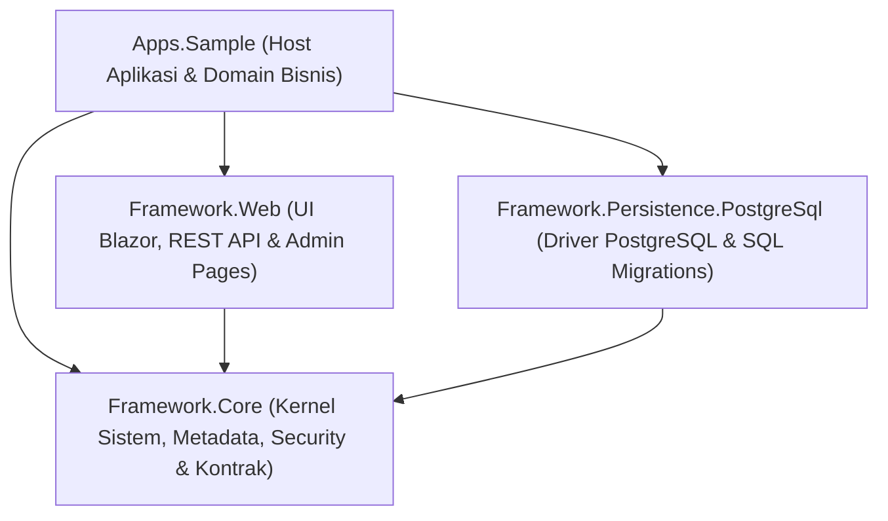

# Dokumentasi Arsitektur & Struktur Proyek DocFrame

Dokumen ini menjelaskan rancangan arsitektur, peran, dan pembagian tanggung jawab dari 4 proyek utama dalam solusi **DocFrame** (.NET 10).

---

## 1. Diagram Ketergantungan Antar Proyek

Solusi ini menerapkan prinsip **Clean Architecture / Hexagonal Architecture**:
- **Core** berdiri sendiri tanpa dependensi ke database (PostgreSQL) maupun framework presentasi (Blazor/HTTP).
- **Persistence** dan **Web** bertindak sebagai *adapters* yang mengimplementasikan kontrak interface dari **Core**.
- **Apps.Sample** adalah *composition root* (host eksekusi) yang merangkai seluruh modul menjadi aplikasi utuh.

---

## 2. Rincian & Fungsi Masing-Masing Proyek

### A. `Framework.Core` (Kernel & Domain Engine)
Proyek ini adalah jantung dari DocFrame yang bersifat murni (*pure .NET class library* tanpa dependensi library eksternal basis data atau web).

**Tanggung Jawab Utama:**
1. **Metadata Engine (`Metadata/`)**:
   - Membaca, mengompilasi, dan memvalidasi definisi skema DocType (`*.doctype.json`) dan Workflow (`*.workflow.json`).
   - Registry tipe data dinamis (`FieldTypeRegistry`) seperti teks, angka, link/relasi, child table, mata uang, dan tanggal.
2. **Dokumen & Mesin Transaksi (`Documents/`)**:
   - Model dokumen generik (`Document`), nomor seri dokumen otomatis (*naming pattern*), audit trail riwayat perubahan, dan diff versi skema.
3. **Keamanan & Kontrol Akses (`Security/`)**:
   - `UserContext`: identitas pengguna terautentikasi (Id, Tenant, Role, Atribut).
   - `IPermissionService`: evaluasi hak akses multi-level (DocType level, Row-level security / data scope `match:department`, dan Field-level permission `permlevel`).
   - Kontrak Master Role (`IRoleStore`, `RoleDef`, `RoleDefaults`).
   - Validasi dan hashing Kunci API (`IApiKeyStore`, `ApiKey`).
4. **Navigasi Sidebar (`Navigation/`)**:
   - Model `NavigationMenuItem`, default seeding menu universal (`Beranda`, `Dashboard`, `Kotak Masuk`), menu wajib sistem, dan kontrak `INavigationMenuStore`.
5. **Expression Evaluator (`Expressions/`)**:
   - Parser ekspresi logika aman (*sandboxed*) untuk kalkulasi nilai field dinamis (*computed fields*) dan kondisi transisi workflow tanpa `eval()` berbahaya.
6. **Pelaporan & Template (`Reports/`)**:
   - Mesin pemrosesan template dokumen OpenXML (Word `.docx` dan Excel `.xlsx`) dengan substitusi tag dan perulangan baris data.
7. **Penyimpanan Abstrak (`Persistence/`)**:
   - Kontrak interface penyimpanan: `IDocumentStore`, `IOutboxStore`, `INotificationStore`, `IMetadataVersionStore`, serta spesifikasi query `StoreQuery`.
8. **Pola Outbox Transaksional (`Jobs/`)**:
   - Penjaminan pengiriman event notifikasi dan integrasi secara andal (*at-least-once delivery*).

---

### B. `Framework.Persistence.PostgreSql` (Lapisan Data PostgreSQL)
Proyek ini adalah implementasi nyata dari kontrak penyimpanan `Framework.Core` dengan basis data relasional **PostgreSQL 17** menggunakan driver resmi `Npgsql`.

**Tanggung Jawab Utama:**
1. **Migrasi Basis Data Tersemat (`Migrations/` & `SchemaMigrator.cs`)**:
   - Eksekusi otomatis migrasi SQL berurutan (`001_initial.sql` hingga `014_roles.sql`) menggunakan PostgreSQL Advisory Lock sehingga aman dijalankan pada lingkungan *multi-replica/multi-instance*.
2. **Penyimpanan Dokumen & Data (`PostgresStores.cs`)**:
   - `PostgresDocumentStore`: menyimpan data dokumen dinamis dalam format JSONB yang diindeks, riwayat audit, dan event outbox dalam satu transaksi database atomik (ACID).
3. **Penyimpanan Master & Fitur Spesifik**:
   - `PostgresRoleStore`: master role dengan proteksi penghapusan role `Administrator`.
   - `PostgresNavigationMenuStore`: master navigasi sidebar dengan deteksi menu wajib dan auto-seed.
   - `PostgresApiKeyStore`: menyimpan identitas integrasi sistem luar (hanya menyimpan hash secret).
   - `PostgresQueryApiStore` & `PostgresReportTemplateStore`: penyimpanan definisi API query dan template pelaporan.
   - `PostgresUserAccountRepository`: penyimpanan akun pengguna ASP.NET Core Identity.
4. **Optimasi Indeks Dinamis (`DocumentIndexSync.cs`)**:
   - Membangun indeks PostgreSQL secara konkuren (`CREATE INDEX CONCURRENTLY`) berdasarkan metadata field yang sering dicari atau difilter, tanpa mengunci tabel.
5. **Eksekutor Dashboard Analitik Read-Only (`Reporting.cs`)**:
   - Pool koneksi khusus read-only (`docframe_ro`) untuk mengeksekusi query agregasi dashboard dan analitik dengan batasan waktu eksekusi (*statement timeout*) dan kuota baris agar tidak membebani transaksi operasional.

---

### C. `Framework.Web` (Lapisan Antarmuka & Layanan Web)
Proyek ini berisi pustaka antarmuka berbasis **Blazor Server** (menggunakan pustaka komponen BlazorBlueprint/shadcn) dan REST API HTTP endpoints.

**Tanggung Jawab Utama:**
1. **Layout & Navigasi Aplikasi (`Layout/`)**:
   - `DeskLayout.razor`: kerangka antarmuka utama (Sidebar responsif dinamis, Dark Mode toggle, info tenant, avatar profil pengguna, dan badge notifikasi inbox real-time).
   - `AuthLayout.razor` & `PrintLayout.razor`: tata letak halaman otentikasi dan dokumen cetak.
2. **Halaman Administrasi Sistem (`Pages/`)**:
   - `RoleAdmin.razor` (`/admin/roles`): manajemen Master Role dan proteksi role sistem.
   - `MenuAdmin.razor` (`/admin/menus`): manajemen Master Menu sidebar, grup, urutan, ikon Lucide, dan filter peran.
   - `UserAdmin.razor` (`/admin/users`): manajemen akun pengguna, reset password sementara, buka kunci lockout, dan penugasan peran.
   - `MetadataAdmin.razor`, `DocTypeEditor.razor`, `WorkflowEditor.razor`: desainer visual skema DocType dan alur persetujuan workflow.
   - `ApiKeysAdmin.razor` (`/admin/api-keys`): penerbitan dan pencabutan kunci API integrasi.
3. **Halaman Operasional Dokumen (`Pages/`)**:
   - `ListPage.razor` (`/app/{DocType}`): tabel daftar dokumen dengan pencarian, filter kolom, pagination, dan ekspor data.
   - `FormPage.razor` (`/app/{DocType}/{Name}`): formulir pengisian dokumen, validasi dinamis, eksekusi tombol workflow (*Submit, Approve, Reject*), dan timeline jejak audit.
   - `Inbox.razor` (`/inbox`): kotak masuk notifikasi dan daftar dokumen yang menunggu persetujuan pengguna saat ini.
4. **Dashboard & Analitik Visual (`Dashboards/`)**:
   - Pembuat widget SQL grafis (bar chart, line chart, number card, table grid), pinning widget ke dashboard pengguna, dan filter tanggal.
5. **Layanan REST API (`Api.cs`)**:
   - Endpoint CRUD dokumen: `GET/POST/PUT/DELETE /api/data/{DocType}`.
   - Eksekusi method kustom: `POST /api/method/{Name}`.
   - API Query SQL berparameter: `GET/POST /api/query/{Slug}`.
   - Autentikasi ganda: Cookie (browser) dan Bearer API Key (sistem luar) dengan proteksi *Rate Limiting* terintegrasi.
6. **Percetakan & Ekspor (`Printing/`, `ReportTemplates/`)**:
   - Pembuatan format cetak HTML/PDF resmi dengan tanda air (*watermark*) status dokumen dan tanda tangan elektronik jejak alur kerja.

---

### D. `Apps.Sample` (Aplikasi Host & Solusi Bisnis Contoh)
Proyek ini adalah *executable project* (`Program.cs`) yang mengonsumsi ketiga modul framework di atas untuk membentuk aplikasi bisnis nyata (contoh: Sistem Pengadaan Barang / Procurement & HR).

**Tanggung Jawab Utama:**
1. **Entry Point & Konfigurasi Aplikasi (`Program.cs`)**:
   - Mengonfigurasi dependensi injeksi (*Dependency Injection*): mendaftarkan metadata, koneksi database PostgreSQL, Identity, dan layanan pelaporan.
   - Menjalankan migrasi database otomatis saat startup dan inisialisasi auto-seeding.
   - Konfigurasi middleware: Autentikasi, Otorisasi, Antiforgery, Rate Limiting, dan Lokalisasi Bahasa Indonesia (`id-ID`).
   - Endpoint pemantauan kesehatan aplikasi (`GET /health`).
2. **Definisi Metadata Bisnis (`Metadata/`)**:
   - Dokumen master: `Department.doctype.json`, `Employee.doctype.json`, `Vendor.doctype.json`, `Product.doctype.json`.
   - Dokumen transaksi: `PurchaseRequest.doctype.json` dan `PurchaseRequestItem.doctype.json`.
   - Alur persetujuan: `PurchaseRequestApproval.workflow.json` (Draft → Menunggu Atasan → Menunggu Finance → Disetujui/Ditolak).
3. **Logika Domain Khusus C# (`Domain/`)**:
   - `Procurement.cs`: handler validasi saat pengajuan (`PurchaseRequestHandler`), aturan batasan pagu anggaran departemen, dan inisialisasi data akun demo (*Andi, Budi, Dewi, Admin*).
   - `ApiMethods.cs`: API kustom untuk pengecekan sisa anggaran dan pengajuan dokumen massal.
   - `DemoDashboard.cs`: inisialisasi awal widget analitik pengadaan belanja per departemen.
4. **Halaman Tambahan Kustom (`Components/Pages/`)**:
   - `OrgChart.razor` (`/hr/struktur-organisasi`): halaman visual bagan organisasi per departemen dan hierarki atasan-bawahan.
5. **Pengemasan Kontainer (`Dockerfile` & `docker-compose.yml`)**:
   - Mengorkestrasi aplikasi bersama PostgreSQL 17 Alpine dalam satu perintah terpadu.

---

## 3. Matriks Perbandingan 4 Proyek

| Kriteria | `Framework.Core` | `Framework.Persistence.PostgreSql` | `Framework.Web` | `Apps.Sample` |
| :--- | :--- | :--- | :--- | :--- |
| **Tipe Output** | Class Library | Class Library | Razor Class Library | Executable (Web App) |
| **Ketergantungan UI** | Tidak ada | Tidak ada | Blazor, CSS, Razor | Blazor Host |
| **Ketergantungan DB** | Tidak ada (Interface) | Npgsql (PostgreSQL) | Tidak langsung | Terhubung via konfigurasi |
| **Fokus Utama** | Aturan bisnis & Domain Engine | Efisiensi & Keandalan Storage | Interaksi Pengguna & API | Perakitan Solusi Nyata |
| **Portabilitas** | Sangat Tinggi (Bisa ganti DB/UI) | Khusus PostgreSQL | Khusus Web/Blazor | Aplikasi akhir yang di-deploy |
