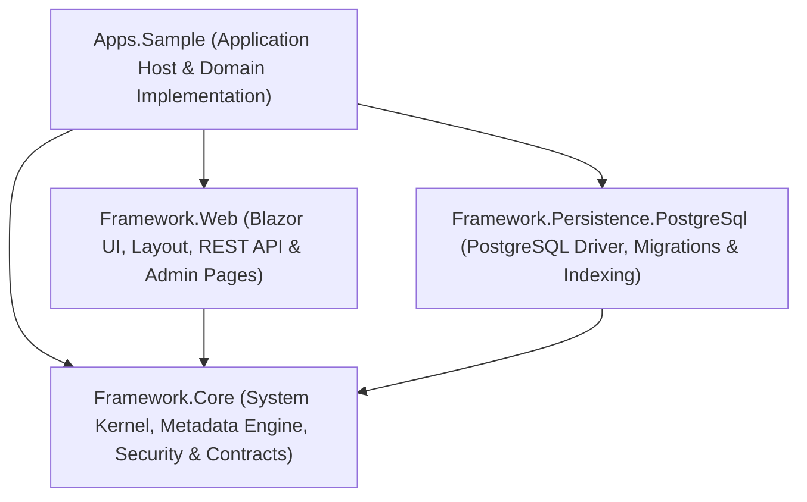

# DocFrame Architecture & Project Structure Documentation

This document provides a comprehensive overview of the architectural design, responsibilities, and relationships among the four primary projects within the **DocFrame** solution (.NET 10).

---

## 1. Project Dependency Graph

The solution follows **Clean Architecture / Hexagonal Architecture** principles:
- **`Framework.Core`** is the pure domain and kernel layer, free from any third-party UI or database dependencies.
- **`Framework.Persistence.PostgreSql`** and **`Framework.Web`** act as adapters that implement the abstractions and contracts defined in `Core`.
- **`Apps.Sample`** serves as the **Composition Root**, bootstrapping the services, database, authentication, and application domain logic into a deployable web application.

---

## 2. Detailed Responsibilities of Each Project

### A. `Framework.Core` (Kernel & Domain Engine)
The foundation of DocFrame. It is a pure, headless .NET class library containing zero database drivers and zero presentation-layer dependencies.

**Key Responsibilities:**
1. **Metadata Engine (`Metadata/`)**:
   - Parses, compiles, and validates declarative schemas for DocTypes (`*.doctype.json`) and Workflows (`*.workflow.json`).
   - Implements dynamic field registries (`FieldTypeRegistry`) supporting primitives, relational links, child tables, currency, and file attachments.
2. **Document & Transaction Engine (`Documents/`)**:
   - Manages generic document entities (`Document`), automated sequence numbering patterns (`NamingPattern`), schema version tracking, and immutable audit logs.
3. **Security & Access Control (`Security/`)**:
   - `UserContext`: Represents authenticated identity containing `Id`, `TenantId`, `Roles`, and custom attributes.
   - `IPermissionService`: Multi-tiered authorization evaluating DocType-level permissions, row-level data scoping (e.g., `match:department`), and field-level access (`permlevel`).
   - Role Management contracts: `IRoleStore`, `RoleDef`, and `RoleDefaults`.
   - API Key verification: `IApiKeyStore` with cryptographic hashing.
4. **Dynamic Navigation (`Navigation/`)**:
   - Model definitions for sidebar menus (`NavigationMenuItem`), default menu seeding logic (`NavigationMenuDefaults`), and store contracts (`INavigationMenuStore`).
5. **Expression Evaluator (`Expressions/`)**:
   - A safe, sandboxed expression evaluator for computed fields and workflow transition conditions without dynamic code generation or arbitrary code execution vulnerabilities.
6. **Reporting & Templating (`Reports/`)**:
   - OpenXML template engine (`OoxmlTemplates.cs`) for dynamically populating Word (`.docx`) and Excel (`.xlsx`) documents with tagged substitutions and repeating row blocks.
7. **Abstract Storage Contracts (`Persistence/`)**:
   - Common storage interfaces: `IDocumentStore`, `IOutboxStore`, `INotificationStore`, `IMetadataVersionStore`, and query specifications (`StoreQuery`).
8. **Transactional Outbox (`Jobs/`)**:
   - Guarantees reliable asynchronous event handling and notification dispatching with idempotent processing and retry mechanisms.

---

### B. `Framework.Persistence.PostgreSql` (PostgreSQL Infrastructure Layer)
The production-ready relational data layer implementing `Framework.Core` contracts on **PostgreSQL 17** using the high-performance `Npgsql` driver.

**Key Responsibilities:**
1. **Embedded Database Migrations (`Migrations/` & `SchemaMigrator.cs`)**:
   - Executes ordered SQL migration scripts (`001_initial.sql` to `014_roles.sql`) embedded in the assembly using PostgreSQL Advisory Locks for safe multi-replica startups.
2. **Document Storage & Transactional Integrity (`PostgresStores.cs`)**:
   - `PostgresDocumentStore`: Persists document state in indexed `JSONB` columns alongside audit trail entries and outbox events in a single atomic database transaction (ACID).
3. **Dedicated Stores**:
   - `PostgresRoleStore`: Manages custom and system roles with deletion protection for `Administrator`.
   - `PostgresNavigationMenuStore`: Persists dynamic sidebar menus with auto-sync and missing-menu injection.
   - `PostgresApiKeyStore`: Stores integration secrets in hashed form.
   - `PostgresQueryApiStore` & `PostgresReportTemplateStore`: Manages SQL API definitions and reporting templates.
   - `PostgresUserAccountRepository`: Persists user accounts for ASP.NET Core Identity.
4. **Dynamic Background Indexing (`DocumentIndexSync.cs`)**:
   - Automatically builds PostgreSQL indexes (`CREATE INDEX CONCURRENTLY`) for searchable metadata fields in the background without locking tables during runtime.
5. **Read-Only Reporting Executor (`Reporting.cs`)**:
   - Maintains a dedicated read-only database connection pool (`docframe_ro`) to run analytical queries and dashboard widgets with strict statement timeouts and row count limits.

---

### C. `Framework.Web` (Presentation & API Layer)
The user interface and public communication layer, implemented using **Blazor Server** (powered by BlazorBlueprint/shadcn components) and ASP.NET Core Minimal APIs.

**Key Responsibilities:**
1. **Application Shell & Layout (`Layout/`)**:
   - `DeskLayout.razor`: Main interactive application frame featuring dynamic role-based sidebar menus, theme toggling (Dark/Light mode), tenant indicator, user chip, and real-time inbox badges.
   - `AuthLayout.razor` & `PrintLayout.razor`: Specialized layouts for login and printable views.
2. **System Administration Portals (`Pages/`)**:
   - `RoleAdmin.razor` (`/admin/roles`): Management of user roles, descriptions, and system role safeguards.
   - `MenuAdmin.razor` (`/admin/menus`): Sidebar navigation management with live Lucide icon previews, sort ordering, and role restrictions.
   - `UserAdmin.razor` (`/admin/users`): User lifecycle management, temporary password generator, lockout toggling, and role assignment.
   - `MetadataAdmin.razor`, `DocTypeEditor.razor`, `WorkflowEditor.razor`: Visual IDE for editing metadata schemas and visual workflow diagrams.
   - `ApiKeysAdmin.razor` (`/admin/api-keys`): Issue and revoke API keys for external integrations.
3. **Operational Business Pages (`Pages/`)**:
   - `ListPage.razor` (`/app/{DocType}`): Generic list view with real-time search, column filtering, pagination, and data export.
   - `FormPage.razor` (`/app/{DocType}/{Name}`): Dynamic document editor, workflow action buttons (*Submit, Approve, Reject*), validation banners, and audit timelines.
   - `Inbox.razor` (`/inbox`): Approval queue displaying tasks pending the current user's review.
4. **Interactive Dashboards (`Dashboards/`)**:
   - SQL-driven visual dashboard engine supporting bar charts, line charts, numeric metric cards, and data tables.
5. **REST API Endpoints (`Api.cs`)**:
   - Complete document REST API (`/api/data/{DocType}`), custom methods (`/api/method/{Name}`), and saved query endpoints (`/api/query/{Slug}`).
   - Supports dual authentication: Browser session cookies and Bearer API keys, backed by sliding-window rate limiters.
6. **Printing & Document Generation (`Printing/`, `ReportTemplates/`)**:
   - Browser and server-side print renderer with status watermarks, print layout styling, and Excel/Word report generation.

---

### D. `Apps.Sample` (Executable Host & Business Solution)
The runnable application (`Program.cs`) that configures and unites the framework libraries into a working enterprise solution (Procurement & HR showcase).

**Key Responsibilities:**
1. **Composition Root & Startup Pipeline (`Program.cs`)**:
   - Configures Dependency Injection: registers metadata files, PostgreSQL connection strings, ASP.NET Identity, and reporting services.
   - Executes database schema migrations and auto-seeding on startup.
   - Configures middleware: Authentication, Authorization, Antiforgery, Rate Limiting, and Localization (`id-ID`).
   - Exposes application health check endpoint (`GET /health`).
2. **Business Metadata Schemas (`Metadata/`)**:
   - Master DocTypes: `Department.doctype.json`, `Employee.doctype.json`, `Vendor.doctype.json`, `Product.doctype.json`.
   - Transactional DocTypes: `PurchaseRequest.doctype.json` and `PurchaseRequestItem.doctype.json`.
   - Multi-step approval workflow: `PurchaseRequestApproval.workflow.json` (Draft → Pending Manager → Pending Finance → Approved / Rejected).
3. **C# Domain Logic & Extensions (`Domain/`)**:
   - `Procurement.cs`: Document submission lifecycle handlers (`PurchaseRequestHandler`), budget checking rules, and initial demo accounts (`Andi, Budi, Dewi, Admin`).
   - `ApiMethods.cs`: Custom endpoints for department budget queries and bulk workflow approvals.
   - `DemoDashboard.cs`: Initial analytics dashboard widgets.
4. **Custom Application Views (`Components/Pages/`)**:
   - `OrgChart.razor` (`/hr/struktur-organisasi`): Interactive department tree and supervisor-subordinate organizational hierarchy.
5. **Container Orchestration (`Dockerfile` & `docker-compose.yml`)**:
   - Multi-stage Docker packaging orchestrating the web application alongside PostgreSQL 17 Alpine with persistent volumes and healthchecks.

---

## 3. Comparative Summary Matrix

| Characteristic | `Framework.Core` | `Framework.Persistence.PostgreSql` | `Framework.Web` | `Apps.Sample` |
| :--- | :--- | :--- | :--- | :--- |
| **Output Type** | Class Library | Class Library | Razor Class Library | Executable (Web App) |
| **UI Dependency** | None (Headless) | None | Blazor Server, CSS, Lucide | Root Blazor Host |
| **Database Dependency** | None (Interfaces only) | PostgreSQL (`Npgsql`) | Indirect (via DI) | PostgreSQL (`docker-compose`) |
| **Architectural Role** | Domain Kernel & Contracts | Infrastructure Adapter | Primary Adapter (Web/API) | Composition Root |
| **Portability** | Universal | PostgreSQL-specific | Web/Blazor-specific | Deployable artifact |
| **Primary Focus** | Business rules & Schemas | Reliability & High Performance | User Experience & APIs | Business Value & Assembly |
