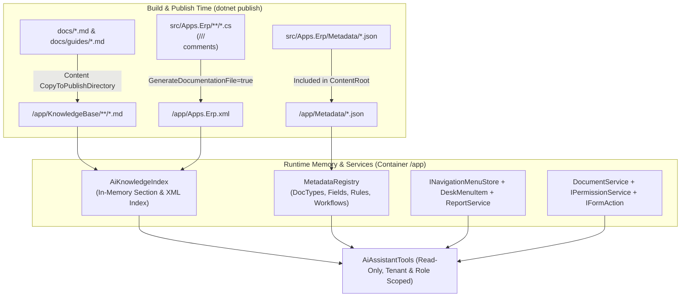

# AI Assistant & Knowledge Base (End-User ERP Q&A Copilot)

While the [AI Designer](ai-designer.md) assists System Managers in drafting DocTypes, workflows, and SQL queries, the **AI Assistant** is designed for **all authenticated ERP users** (`Finance`, `Purchasing`, `Stock`, `HR`, `Payroll`, `Sales`, `Manager`, `Employee`, and `System Manager`) to answer operational questions, explain business rules, locate menus/reports, and diagnose document or report states directly inside the application.

---

## 1. Core User Question Patterns

Analysis of real ERP user interactions shows four primary categories of questions:

| Category | Example User Question | Underlying Source Required at Runtime |
|---|---|---|
| **1. Navigation & Discovery** | *"Where is the organization structure page?"*<br>*"Where do I create Word/Excel report templates?"* | `INavigationMenuStore`, `IEnumerable<DeskMenuItem>`, `ReportService`, and `MetadataRegistry` routes filtered by the user's roles. |
| **2. SOP & How-To Guides** | *"How do I create a custom report?"*<br>*"What is the sequence for testing initial stock and invoices?"* | Bundled Markdown guides (`docs/ERP_README.md`, `docs/ERP_TEST_SCENARIOS.md`, `docs/guides/*.md`). |
| **3. Business Rules & Semantics** | *"Is Accounting Period generated automatically?"*<br>*"Why does `EMP-0001` show a `Draft` badge?"*<br>*"Kenapa muncul 'Only 1 of ITM-LAP-001 available'?"* | `MetadataRegistry` (`allowSubmit: false` master data vs submittable transactions, field `compute` formulas, `rules`, workflows) + compiled C# XML doc comments (`Apps.Erp.xml`) + rule catalog generated from hook code (`KnowledgeBase/rules/`, `explain_error`). |
| **4. Live Data & Diagnostics** | *"Why is my Trial Balance report showing all zeros?"*<br>*"What is the status of `JV-2026-000001`?"* | Read-only `DocumentService` queries (`docstatus = 0` Draft vs `1` Submitted, available workflow transitions, and custom `IFormAction` buttons) scoped to the user's tenant and permissions. |

---

## 2. How Knowledge Survives Compilation (`dotnet publish` / Docker)

In a production or Docker deployment (`FROM mcr.microsoft.com/dotnet/aspnet:10.0`), raw C# source files (`*.cs`) and the repository root `docs/` folder are not present in the container image. To ensure the AI Assistant has complete knowledge after compilation, FrogFrame packages five runtime knowledge sources:



1. **Bundled Markdown Documentation (`KnowledgeBase/`)**:
   - `Apps.Erp.csproj` copies `docs/*.md` and `docs/guides/*.md` into `KnowledgeBase/` inside both build and publish outputs (`CopyToOutputDirectory` and `CopyToPublishDirectory`).
2. **Compiled C# XML Documentation (`Apps.Erp.xml`)**:
   - `Apps.Erp.csproj` enables `<GenerateDocumentationFile>true</GenerateDocumentationFile>`. Every `/// <summary>` docstring on ERP hooks (e.g., `AccountingPeriodRulesHook`, `PayrollHooks`, `StockHooks`), form actions, and reports is compiled into `Apps.Erp.xml` alongside `Apps.Erp.dll`.
3. **In-Memory Metadata (`MetadataRegistry`)**:
   - All 146 DocTypes and 8 Workflows are compiled into `MetadataRegistry.Current` at startup, exposing field definitions, `allowSubmit` flags, `requiredWhen` expressions, `compute` formulas, validation rules, and workflow transitions.
4. **Live Navigation & Report Catalogs**:
   - `INavigationMenuStore`, `DeskMenuItem`, and `ReportService` hold every route and report available in the application.
5. **Permission-Checked Live Documents (`DocumentService`)**:
   - Live document state (`docstatus`, `workflow_state`, available transitions, and record counts) is queried through `DocumentService` under the calling user's `UserContext`.

---

## 3. Phased Implementation Roadmap

### Phase 1: Runtime Knowledge Packaging & In-Memory Indexing (`AiKnowledgeIndex`) — *Completed*
- [x] Configure `src/Apps.Erp/Apps.Erp.csproj` to emit `Apps.Erp.xml` (`GenerateDocumentationFile`) and bundle `docs/*.md` + `docs/guides/*.md` into `KnowledgeBase/`.
- [x] Implement `AiKnowledgeIndex` (`src/Framework.Web/AI/AiKnowledgeIndex.cs`):
  - Splits Markdown files by heading (`#`, `##`, `###`) into searchable chunks.
  - Parses compiled XML documentation files (`Apps.Erp.xml`, `Framework.*.xml`) to index hook, action, and report business rule summaries.
  - Provides fast, zero-dependency in-memory BM25/keyword scoring (`Search(query, maxResults)`).
- [x] Register `AiKnowledgeIndex` as a singleton in `Hosting.AddFrogFramework`.

### Phase 2: Read-Only Tenant-Scoped User Tools (`AiAssistantTools`) — *Completed*
- [x] Implement `AiAssistantTools` (`src/Framework.Web/AI/AiAssistantTools.cs`) bound to the calling user's `UserContext`:
  - `search_knowledge(query)`: Searches bundled Markdown guides, test scenarios, and C# XML hook documentation.
  - `explain_doctype(docType)`: Explains a DocType's purpose, lifecycle (`allowSubmit: false` Master Data vs submittable Transaction where Draft `docstatus = 0` means unposted), workflow states, custom form actions, rules, and readable fields.
  - `find_navigation(query)`: Finds accessible menus, desk pages (e.g., `/org-tree`, `/admin/report-templates`), DocType lists, and reports (`/reports/...`) visible to the user.
  - `inspect_document(docType, name)`: Reads a specific document via `DocumentService.GetAsync` (respecting tenant, role, row scope, and field `permLevel`), returning its status, next available workflow actions, and custom buttons.
  - `diagnose_doctype_records(docType, search)`: Summarizes record counts by `docstatus` (`Draft`, `Submitted`, `Cancelled`) and lists recent documents to answer diagnostic questions such as *"Why is Trial Balance zero?"* (because `JournalEntry` records are still in `Draft`).

### Phase 3: Context-Aware Conversational Service (`AiAssistantService`) — *Completed*
- [x] Create `AiAssistantService` on top of `IAiChatClientProvider` and `AiAssistantTools`.
- [x] Automatically attach **Active Page Context** (`currentUrl`, detected `docType` and `documentName` or `reportName`, authenticated roles, and department) so questions like *"Why is this draft?"* or *"Why is this report empty?"* work without typing document IDs. Query strings are excluded from context.
- [x] Enforce a shared per-user hourly AI request limit and a configurable conversation turn budget (`AI:MaxConversationTurns`, default `12`).

### Phase 4: Blazor Copilot Drawer UI (`AiAssistantDrawer.razor`) — *Completed*
- [x] Add an **"Ask AI"** button in the `DeskLayout` top bar and Awesomebar (`Ctrl+K`).
- [x] Build a non-blocking slide-over chat drawer using Blazor Blueprint's chat message and bubble components. The layout-level drawer preserves the conversation across page navigation and refreshes page context with each question.
- [x] Render Markdown answers as sanitized HTML so model-generated links remain clickable without allowing unsafe markup.

### Phase 5: Code Rule Catalog, `explain_error`, and Indonesian Glossary — *Completed*

Antigravity answers precisely because it reads the C# source; the published app does not ship `.cs` files, and most business rules
live inside method bodies (validation messages, `if` conditions, button visibility), not in `/// <summary>` comments. Phase 5 packages them:

- [x] **Rule catalog generator** `tools/generate_ai_rules.py` scans `src/Apps.Erp/Hooks` and `src/Apps.Erp/Accounting` and writes `docs/rules/`:
  - `<DocType>.md`: behaviour summary, every validation error (field, message, triggering C# condition, source file:line) grouped by event
    (save/submit, after submit, cancel, workflow action, button), warnings, failed-button messages, and each form button with its `IsVisible` condition.
  - `_shared-<Helper>.md`: rules in shared helpers (accounting periods, invoices, stock valuation, budgets, ledger guards), mapped transitively to
    the DocTypes whose hooks use them.
  - `error-catalog.json`: one entry per message with a regex where interpolations (`{item}`, `{balance}`) are wildcards.
  `Apps.Erp.csproj` copies `docs/rules/*` to `KnowledgeBase/rules/`; `AiKnowledgeIndex` indexes the Markdown as kind `Rule`.
- [x] **`explain_error(message, docType?)`** tool (`AiErrorCatalog`): the user pastes the message they saw ("Only 1 of ITM-LAP-001 available in
  Gudang Utama Cikarang"); the tool returns the rule, its field, when it runs, the triggering condition, and the related rule guide. The assistant
  then uses `inspect_document` to find the value that triggers it.
- [x] **Indonesian glossary** `docs/guides/glossary-id.md`: `AiKnowledgeIndex.Search` expands Indonesian terms with the app's DocType names
  ("cuti" → `LeaveApplication`, "faktur penjualan" → `SalesInvoice`, "tombol" → form actions), so Indonesian questions find English metadata and rules.

### How to Update & Regenerate the AI Rule Catalog

Whenever business logic, validation rules, error messages, or form action buttons in `src/Apps.Erp/Hooks/` or `src/Apps.Erp/Accounting/` are added or changed, the rule catalog must be regenerated so that the AI Assistant and CI remain in sync:

1. **Regenerate rules and error catalog**:
   ```bash
   python3 tools/generate_ai_rules.py
   ```
   This command scans the C# hook code, parses validation messages and conditions, and updates:
   - `docs/rules/<DocType>.md`
   - `docs/rules/_shared-*.md`
   - `docs/rules/error-catalog.json`

2. **Verify consistency (as run in CI)**:
   ```bash
   python3 tools/generate_ai_rules.py --check
   ```
   Exits with code `0` when `docs/rules/` exactly matches the hook implementation, or `1` with a diff if any rule is out of date.

3. **Rebuild or redeploy**:
   - Rebuilding the project (`dotnet build`) copies the refreshed `docs/rules/*` files to `KnowledgeBase/rules/` inside the build output.
   - For local container testing, execute `./redeploy.ps1`.

4. **Commit changes**:
   Commit both the C# hook modifications and the resulting updates in `docs/rules/` together in git.

**Maintenance**

```bash
python3 tools/generate_ai_rules.py           # after changing hook code; commit docs/rules/
python3 tools/generate_ai_rules.py --check   # CI: fails when docs/rules/ is stale
```

Add a glossary row whenever the assistant misses an answer because users call something by a different name. Write rule messages in hooks as
full sentences that say what to fix; they become the assistant's answer.

---

## 4. Security & Guardrails

1. **Strictly Read-Only**: `AiAssistantTools` never inserts, updates, submits, cancels, or deletes documents. The assistant guides the user and provides direct links, while the user performs actions in the UI.
2. **Tenant Isolation**: Every tool call executes within `user.TenantId`. Cross-tenant data is unreachable.
3. **RBAC, Row Scope & Field `permLevel`**:
   - DocType explanations check `IPermissionService.Can(user, meta, DocActions.Read)` and filter out fields where `!CanReadField(user, meta, field)` (protecting `permLevel >= 1` sensitive HR/Payroll fields).
   - Document inspections and list diagnostics go exclusively through `DocumentService.GetAsync` and `DocumentService.ListAsync`, which enforce both role permissions and row-level scopes (`match:employee=employee`, `match:sales_rep=employee`, etc.).
