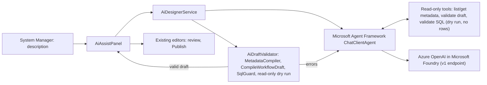

# AI Designer (DocTypes, Workflows, Reporting SQL)

System Managers can describe what they need in plain language and let AI draft it:

| Page | What the AI drafts | What happens next |
|---|---|---|
| **New DocType** (`/admin/metadata/new`) | DocType + new child-table DocTypes + optional approval workflow | Review the summary, press **Create from AI draft** |
| **DocType Editor** | Changes to the current DocType | Draft is replaced in the editor; **Review changes** → **Publish** |
| **Workflow Editor** | New workflow or changes to the current one | Draft is replaced in the editor and diagram; **Check changes** → **Publish** |
| **Widget Builder** (step 1) | SQL, parameters, suggested chart | Continue with parameters, preview, chart, save |
| **Query API Builder** (step 1) | SQL and parameters | Continue with parameters, preview, save |
| **Report Template Builder** (step 1) | Detail SQL, optional header SQL, parameters | Continue with parameters, template, preview, save |

The AI **never publishes or saves**. Every draft goes through the same compilers and guards as manual edits, and an administrator publishes it.

---

## 1. Architecture



- **Microsoft Agent Framework** (`Microsoft.Agents.AI`) runs the agent; **Microsoft.Extensions.AI** + the **OpenAI .NET SDK** talk to the Azure OpenAI v1 endpoint.
- The model must answer with a JSON object of a fixed shape (`DocTypeDesignAnswer`, `WorkflowDesignAnswer`, `QueryDesignAnswer`; structured output).
- The server validates every answer. Errors are sent back to the model for repair, up to `AI:MaxAttempts` (default 3). If the last answer is still invalid, the draft is shown with the remaining errors so the administrator can fix it by hand.

Code: `src/Framework.Web/AI/*`, `src/Framework.Web/Components/AiAssistPanel.razor`.

---

## 2. Configuration

Off by default. Example (`appsettings.Production.json` or environment variables `AI__...`):

```json
"AI": {
  "Enabled": true,
  "Provider": "AzureOpenAI",
  "Endpoint": "https://<resource>.openai.azure.com/openai/v1/",
  "Deployment": "<deployment name in Microsoft Foundry>",
  "Auth": "ManagedIdentity",
  "ManagedIdentityClientId": "",
  "MaxToolCalls": 8,
  "MaxAttempts": 3,
  "TimeoutSeconds": 90,
  "MaxPromptChars": 4000,
  "RequestsPerUserPerHour": 30
}
```

| Key | Meaning |
|---|---|
| `Auth` | `ManagedIdentity` (Azure-hosted, recommended; set `ManagedIdentityClientId` for a user-assigned identity), `DefaultCredential` (developer sign-in via Azure CLI / Visual Studio), `ApiKey` (set `AI__ApiKey` from a secret store, never in appsettings) |
| `TokenScope` | Entra ID scope, default `https://ai.azure.com/.default` |
| `MaxToolCalls` | Tool calls the model may make per attempt |
| `MaxAttempts` | Answer + repair rounds |
| `TimeoutSeconds` | Limit for the whole request |
| `RequestsPerUserPerHour` | Per-user limit (in memory, per app instance) |

The identity of the app needs the **Foundry User** role (or the equivalent "Cognitive Services OpenAI User") on the resource.

Docker: set `FROGFRAME_AI_ENABLED`, `FROGFRAME_AI_ENDPOINT`, `FROGFRAME_AI_DEPLOYMENT`, `FROGFRAME_AI_AUTH`, `FROGFRAME_AI_MANAGED_IDENTITY_CLIENT_ID`, `FROGFRAME_AI_API_KEY` in `.env`. These environment variables override appsettings.

When AI is off, every AI panel shows the reason (for example "AI:Enabled is false") to System Managers on all six pages.

---

## 3. Security and data

1. **Draft only.** No tool can save, publish, delete or execute. Publishing uses the existing editors and their risk confirmations.
2. **System Managers only**, checked in `AiDesignerService` (not only in the UI).
3. **Only metadata leaves the server**: DocType/workflow definitions, role and module names, reporting view names and columns, and SQL text. The SQL dry run returns **column names and types only**; result rows are discarded and never sent to the model.
4. **Generated SQL** goes through `SqlGuard` (single SELECT/WITH, no dollar quoting), must read `reporting.*` views, and runs only on the read-only reporting connection with the usual statement timeout.
5. **Generated metadata** is compiled with all active metadata and the tenant's role and module masters, exactly like a manual publish.
6. **Audit log**: every request is logged (`Framework.Web.AI.AiDesignerService`) with user, tenant, kind, result, attempts, token usage, duration and the first 500 characters of the description.
7. The description is treated as data: the system prompt tells the model it cannot change the rules, and the server checks do not depend on the model's cooperation anyway.

---

## 4. Limits

- Completions are only as good as the description; review every draft, especially permissions and workflow conditions.
- New DocType: child tables, the DocType and the workflow are published in that order. If a later step fails (for example a role was deleted in the meantime), the earlier ones stay published and the error lists them.
- DocType Editor: the AI cannot create new child DocTypes there; create them first, or use New DocType.
- The rate limit is per app instance; with several instances behind a load balancer the effective limit is higher.

---

## 5. Tests

`tests/Framework.Tests/AiDesignerTests.cs` uses a scripted `IChatClient`, so no Azure call is made: switch off by default, System Manager only, repair loop with compiler errors, nothing published, workflow modification, SQL validation (non-reporting tables, bindings), rate limit, read-only tool surface.
