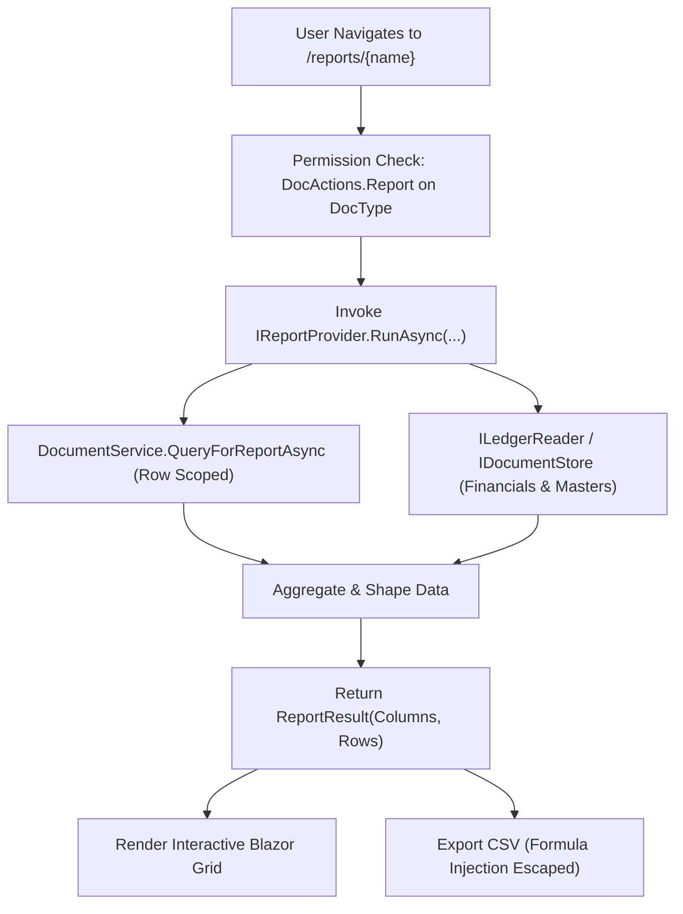

# Custom Code Reports Guide (IReportProvider)

FrogFramework provides a strongly typed, code-first reporting engine powered by the `IReportProvider` interface. Custom reports allow developers to implement complex data aggregation, multi-table joins, financial calculations, and domain logic in C# while automatically benefiting from built-in UI filtering, responsive grid rendering, role-based permissions, row-level security, and formula-injection-safe CSV exports.

---

## 1. Overview & Architecture

Code reports are hosted natively in the Blazor desk UI under the `/reports` route:
- **Gallery View (`/reports`)**: Automatically lists all reports available to the current user based on DocType permissions.
- **Report View (`/reports/{ReportName}`)**: Dynamically renders filter controls, an interactive data grid, and a CSV export action.



### Key Capabilities
- **Zero UI Boilerplate**: FrogFramework auto-generates filter controls (dates, dropdowns) and column headers from C# declarations.
- **Tenant & Row Scoping**: Utilizing `DocumentService.QueryForReportAsync` guarantees that tenant isolation and user-specific row scopes (e.g., a sales rep seeing only their assigned opportunities) are enforced automatically.
- **Formula Injection Mitigation**: CSV exports automatically sanitize values starting with `=+-@` by prepending `'`, preventing spreadsheet formula execution attacks.
- **Ledger Integration**: Financial reports can inject `ILedgerReader` to query immutable general ledger balances (`GetBalancesAsync`) directly.

---

## 2. The `IReportProvider` Contract

All custom code reports implement `IReportProvider` (from `Framework.Jobs`):

```csharp
namespace Framework.Jobs;

public interface IReportProvider
{
    /// <summary>Unique URL slug (e.g., 'erp-trial-balance', 'sales-pipeline').</summary>
    string Name { get; }

    /// <summary>Display title shown in headings and report cards.</summary>
    string Title { get; }

    /// <summary>Descriptive summary explaining the report content and scope.</summary>
    string Description { get; }

    /// <summary>Source DocType used for role-based permissions (report/export) and row scoping.</summary>
    string DocType { get; }

    /// <summary>Filter definitions dynamically rendered above the report grid.</summary>
    IReadOnlyList<ReportFilterDef> Filters { get; }

    /// <summary>Executes report logic and produces tabular columns and rows.</summary>
    Task<ReportResult> RunAsync(
        UserContext user,
        IReadOnlyDictionary<string, string?> filters,
        DocumentService documents,
        CancellationToken ct);
}
```

### Supporting Records

- **`ReportFilterDef(string Key, string Label, string Type, IReadOnlyList<string>? Options = null)`**:
  - `Type = "Date"`: Renders a date picker input.
  - `Type = "Select"`: Renders a dropdown selection with options.
- **`ReportColumn(string Key, string Label, string Type = "Data")`**:
  - Defines table headers. `Type` can specify semantic types such as `"Data"`, `"Currency"`, `"Int"`, etc.
- **`ReportResult(IReadOnlyList<ReportColumn> Columns, IReadOnlyList<Dictionary<string, object?>> Rows)`**:
  - Encapsulates the output dataset. Each row is represented as a dictionary mapping column keys to values.

---

## 3. Step-by-Step Implementation Guide

### Step 1: Create the Report Class

Place report classes under your application's `Reports/` directory (e.g., `src/Apps.Erp/Reports/`). Inject required services using C# primary constructors:

```csharp
using Framework.Accounting;
using Framework.Documents;
using Framework.Jobs;
using Framework.Persistence;
using Framework.Security;

namespace Apps.Erp.Reports;

public sealed class SalesPipelineReport : IReportProvider
{
    public string Name => "sales-pipeline";
    public string Title => "Sales Pipeline";
    public string Description => "Active pipeline stages, expected revenues, and win probabilities.";
    public string DocType => "Opportunity";

    public IReadOnlyList<ReportFilterDef> Filters { get; } =
    [
        new("from", "Closing From", "Date"),
        new("to", "Closing To", "Date"),
        new("status", "Status", "Select", ["Open", "Won", "Lost"])
    ];

    public async Task<ReportResult> RunAsync(
        UserContext user,
        IReadOnlyDictionary<string, string?> f,
        DocumentService documents,
        CancellationToken ct)
    {
        // ... query and process data
    }
}
```

---

### Step 2: Querying Data

#### Pattern A: Querying Documents with Automatic Row Scoping
When querying transactional business documents, always use `DocumentService.QueryForReportAsync`. This automatically applies tenant filters and row-level permission policies (such as `match:employee=employee` or `match:owner=user`):

```csharp
var clauses = new List<FilterClause>();

if (f.TryGetValue("status", out var status) && !string.IsNullOrWhiteSpace(status))
{
    clauses.Add(new FilterClause("status", FilterOp.Eq, status));
}

if (f.TryGetValue("from", out var fromStr) && DateOnly.TryParse(fromStr, out var fromDate))
{
    clauses.Add(new FilterClause("expected_closing", FilterOp.Gte, fromDate.ToString("yyyy-MM-dd")));
}

// Maximum default limit is 10,000 documents per report query
var docs = await documents.QueryForReportAsync(user, DocType, clauses, limit: 10000, ct);
```

#### Pattern B: Querying General Ledger Balances
For accounting and financial reports, inject `ILedgerReader` to access consolidated debit/credit balances across account hierarchies:

```csharp
public sealed class TrialBalanceReport(ILedgerReader ledger, IDocumentStore store, TimeProvider clock) : IReportProvider
{
    public string DocType => "Account";
    // ...
    public async Task<ReportResult> RunAsync(...)
    {
        var to = DateOnly.TryParse(f.GetValueOrDefault("to"), out var d) ? d : DateOnly.FromDateTime(clock.GetUtcNow().DateTime);
        var from = DateOnly.TryParse(f.GetValueOrDefault("from"), out var fd) ? fd : new DateOnly(to.Year, to.Month, 1);

        // Fetch balances before period (opening) and during period
        var opening = await ledger.GetBalancesAsync(user.TenantId, null, from.AddDays(-1), ct);
        var period = await ledger.GetBalancesAsync(user.TenantId, from, to, ct);
        // ...
    }
}
```

#### Pattern C: Accessing Master Lookups via `IDocumentStore`
If your report needs master records (such as `Account`, `Company`, or `Item`) that a user might not have direct document read permissions for, query master records via `IDocumentStore` using `user.TenantId`:

```csharp
var accounts = await store.QueryAsync("Account", user.TenantId, new QueryOptions
{
    Limit = 5000,
    OrderBy = "name"
}, ct);
```

---

### Step 3: Register the Report

Register the report as a singleton using the `AddReport<T>` extension method in your dependency injection setup (e.g., `ErpRegistration.cs` or `Program.cs`):

```csharp
using Framework.Web;

public static class ErpRegistration
{
    public static IServiceCollection AddErpReports(this IServiceCollection services)
    {
        services.AddReport<SalesPipelineReport>();
        services.AddReport<TrialBalanceReport>();
        services.AddReport<ProfitAndLossReport>();
        services.AddReport<StockBalanceReport>();
        return services;
    }
}
```

Behind the scenes, `AddReport<T>` registers the class as `IReportProvider`:
```csharp
public static IServiceCollection AddReport<T>(this IServiceCollection s) 
    where T : class, IReportProvider 
    => s.AddSingleton<IReportProvider, T>();
```

---

### Step 4: Configure Permissions

Permissions are derived directly from the report's `DocType`:

| Action | Required Permission | Behavior |
|---|---|---|
| **View in Gallery & Run** | `DocActions.Report` (`"report"`) | Displays the report card in `/reports` and allows execution at `/reports/{name}`. |
| **Export CSV** | `DocActions.Export` (`"export"`) | Enables the **Export CSV** download button in the header. |

To grant access, add the `report` and `export` actions to the respective role in the DocType metadata (e.g., `Metadata/Opportunity.doctype.json`):

```json
{
  "permissions": [
    {
      "role": "Sales User",
      "read": true,
      "write": true,
      "create": true,
      "report": true,
      "export": true
    }
  ]
}
```

---

## 4. Complete Code Example

Here is a complete, self-contained example of a custom CRM report:

```csharp
using Framework.Documents;
using Framework.Jobs;
using Framework.Persistence;
using Framework.Security;

namespace Apps.Erp.Reports;

public sealed class SalesPipelineReport : IReportProvider
{
    public string Name => "sales-pipeline";
    public string Title => "Sales Pipeline";
    public string Description => "Pipeline volume, expected revenue, and weighted values grouped by stage.";
    public string DocType => "Opportunity";

    public IReadOnlyList<ReportFilterDef> Filters { get; } =
    [
        new("status", "Status", "Select", ["Open", "Won", "Lost"]),
        new("from", "Closing From", "Date"),
        new("to", "Closing To", "Date")
    ];

    public async Task<ReportResult> RunAsync(
        UserContext user,
        IReadOnlyDictionary<string, string?> f,
        DocumentService documents,
        CancellationToken ct)
    {
        var clauses = new List<FilterClause>();

        var status = f.GetValueOrDefault("status");
        if (!string.IsNullOrEmpty(status))
        {
            clauses.Add(new FilterClause("status", FilterOp.Eq, status));
        }

        if (DateOnly.TryParse(f.GetValueOrDefault("from"), out var fromDate))
        {
            clauses.Add(new FilterClause("expected_closing", FilterOp.Gte, fromDate.ToString("yyyy-MM-dd")));
        }

        if (DateOnly.TryParse(f.GetValueOrDefault("to"), out var toDate))
        {
            clauses.Add(new FilterClause("expected_closing", FilterOp.Lte, toDate.ToString("yyyy-MM-dd")));
        }

        var docs = await documents.QueryForReportAsync(user, DocType, clauses, limit: 10000, ct);

        var columns = new ReportColumn[]
        {
            new("stage", "Sales Stage"),
            new("count", "Opportunities", "Int"),
            new("amount", "Total Value", "Currency"),
            new("weighted", "Weighted Value", "Currency"),
            new("avg_prob", "Avg Probability", "Percent")
        };

        var groups = docs
            .GroupBy(d => d.Data.GetValueOrDefault("sales_stage")?.ToString() ?? "Unassigned")
            .OrderBy(g => g.Key);

        var rows = new List<Dictionary<string, object?>>();
        decimal grandTotal = 0;
        decimal grandWeighted = 0;
        int grandCount = 0;

        foreach (var group in groups)
        {
            var count = group.Count();
            var totalAmount = group.Sum(d => Convert.ToDecimal(d.Data.GetValueOrDefault("opportunity_amount") ?? 0m));
            var totalWeighted = group.Sum(d => Convert.ToDecimal(d.Data.GetValueOrDefault("weighted_amount") ?? 0m));
            var avgProb = totalAmount > 0 ? (totalWeighted / totalAmount) * 100m : 0m;

            grandCount += count;
            grandTotal += totalAmount;
            grandWeighted += totalWeighted;

            rows.Add(new Dictionary<string, object?>
            {
                ["stage"] = group.Key,
                ["count"] = count,
                ["amount"] = totalAmount,
                ["weighted"] = totalWeighted,
                ["avg_prob"] = Math.Round(avgProb, 1)
            });
        }

        // Summary row
        if (rows.Count > 0)
        {
            rows.Add(new Dictionary<string, object?>
            {
                ["stage"] = "Total",
                ["count"] = grandCount,
                ["amount"] = grandTotal,
                ["weighted"] = grandWeighted,
                ["avg_prob"] = grandTotal > 0 ? Math.Round((grandWeighted / grandTotal) * 100m, 1) : 0m
            });
        }

        return new ReportResult(columns, rows);
    }
}
```

---

## 5. Reporting Strategy Comparison

FrogFramework provides three reporting approaches designed for different operational needs:

| Capability | C# Code Reports (`IReportProvider`) | Template Reporting (OpenXML) | SQL Dashboards & Widgets |
|---|---|---|---|
| **Primary Use Case** | Financial statements, GL aging, transactional audit logs, multi-stage calculation. | Branded spreadsheets (`.xlsx`) & formal Word documents (`.docx`). | Real-time KPI cards, time-series line charts, distribution charts. |
| **Definition Medium** | Strongly typed C# classes. | Microsoft Office template files with `{{Tag}}` placeholders. | SQL queries against `reporting.*` OLAP views. |
| **Execution Speed** | Extremely fast in-memory compilation and stream processing. | Stream-based OpenXML generation without COM/interop. | High-concurrency cached read queries via `frogframe_ro`. |
| **Interactive UI** | Blazor interactive grid with dynamic filters & CSV download. | Direct file download (`.xlsx`, `.docx`). | Embedded SVG charts on desk dashboards. |
| **Row-Level Security** | Enforced automatically via `QueryForReportAsync`. | Enforced via query filter criteria. | Session tenant lock & SQL views filtering by tenant ID. |
