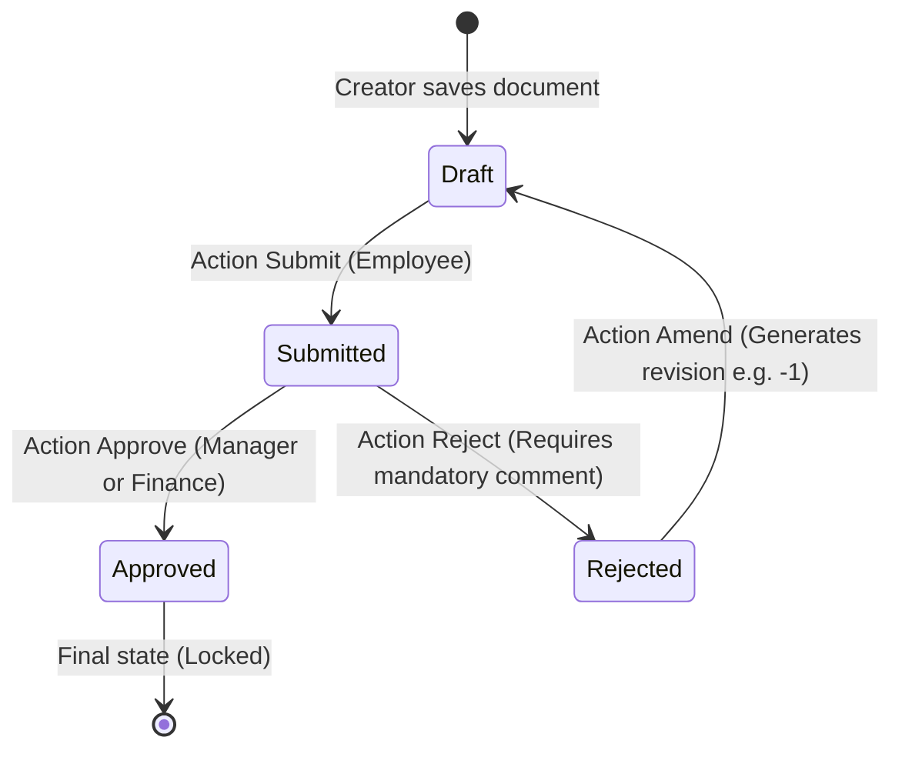

# DocType Modeling & Visual Workflow Guide

This guide covers how to design DocTypes, manage permissions, and configure state-machine workflows using the FrogFramework visual editor and compiler.

---

## 1. Creating a New DocType

System Managers can create DocTypes directly from the web portal at `/admin/metadata/new` without hand-editing raw JSON files.

### Available DocType Templates

| Template | Included Configuration | Best Suited For |
|---|---|---|
| **With Approval Workflow** | Title, Date, Description, child items, approval workflow (`Draft` → `Submitted` → `Approved`/`Rejected`), and document amending enabled. | Purchase requests, expense claims, leave requests. |
| **Simple Document** | Basic fields and standard CRUD permissions without a multi-stage approval workflow. | Master data (e.g., Customers, Vendors, Products). |
| **Blank Document** | Minimal title field; accessible exclusively to System Managers. | Custom internal tables, technical configurations. |

Once created, DocTypes are compiled, assigned an immutable schema version, and automatically categorized under their respective module in the sidebar.

---

## 2. Visual DocType Editor

Accessible at `/admin/metadata/{DocType}/editor`:
- **Drag-and-Drop Layout**: Organize fields into tabs, sections, and 1–3 responsive columns.
- **Real-Time Validation**: Field configurations and expressions are validated continuously using the same AST compiler that executes at server startup.
- **Live Preview**: Preview the interactive form as an end user before publishing changes.
- **Diff & Risk Assessment**: Before publishing, changes are categorized into:
  - **Safe**: Adding non-mandatory fields, non-breaking layout tweaks.
  - **Requires Transformation**: Renaming fields, changing types.
  - **High Risk**: Deleting fields, removing roles, narrowing permissions. High-risk changes require explicit administrator confirmation.

### Field types

| Type | Stored value | Editor (BlazorBlueprint) | Notes |
|---|---|---|---|
| `Data`, `Text`, `Email` | text | input / textarea | |
| `Int`, `Float`, `Currency` | number | numeric input | `min`, `max` |
| `Check` | true/false | checkbox | |
| `Date` | `yyyy-MM-dd` | `BbDatePicker` | |
| `Select` | text | `BbSelect` | `options` required |
| `Link` | document name | `BbCombobox` search | `linkTo`, `linkFilters`, `lookupDialog` |
| `Table` | rows | child table | `childDocType` |
| `Image` | file id | upload | PNG/JPEG/WebP/GIF, 2 MB |
| `Datetime` | UTC `yyyy-MM-ddTHH:mm:ssZ` | `BbDateTimePicker` (24 h) | Shown and entered in Asia/Jakarta (`FieldTypeSettings.DefaultTimeZone`); API input without offset is read in that zone. Reporting column type `timestamptz` |
| `Time` | `HH:mm:ss` | `BbTimeInput` | Reporting column type `time` |
| `Duration` | seconds (number) | text input: `1h 30m`, `01:30:00` or seconds | Shown as `1h 30m` |
| `Percent` | number (2 decimals) | numeric input + `%` | `min`, `max` |
| `Phone` | E.164 `+628123456789` | `tel` input | `0812…` becomes `+62812…` (`FieldTypeSettings.DefaultCountryCode`) |
| `TextEditor` | sanitized HTML | `BbRichTextEditor` (Quill) | Sanitized on the server on every write (HtmlSanitizer), again when rendered. Not usable in list/filter/search or child tables |
| `Markdown` | text | `BbMarkdownEditor` | Not usable in list/filter/search or child tables |
| `Attach` | file id | upload + download | PDF, .docx, .xlsx, CSV, text, images; 10 MB; type detected from content; downloaded with its original name |
| `Password` | encrypted (`enc:v1:…`, ASP.NET Data Protection) | password input | Never returned by reads (UI/API show `********`); empty or `********` on save keeps the stored value; masked in the audit trail; not listed, filtered, reported, imported or printed. Server code reads it with `PasswordFieldType.Reveal` |
| `DynamicLink` | document name | link search on the DocType chosen in `linkToField` | `linkToField` = a Select (options are DocType names) or Data field. Checked for existence and read permission |
| `TableMultiSelect` | list of document names | `BbMultiSelect` with search | `linkTo`. Each name is checked; stored as a JSON array (not a child table) |
| `Rating` | number 0–10, steps of 0.5 | `BbRating` | `max` = number of stars (default 5) |
| `Color` | `#rrggbb` | `BbColorPicker` | |
| `JSON` | compact JSON text | monospace textarea | Accepts a JSON string or object in the API |
| `Signature` | SVG | `BbSignature` (drawn or typed) | Only plain SVG is accepted; always displayed through `` so embedded scripts cannot run |
| `Barcode` | text | input + `BbBarcode` preview | `options[0]` = format: Code128 (default), Code39, Ean13, Ean8, UpcA, Itf, Codabar, Msi. Display only (no camera scanning) |
| `Geolocation` | `lat,lng` | latitude + longitude inputs | Read-only view links to OpenStreetMap |
| `ReadOnly` | text | shown as text | Filled by `fetchFrom`, a formula, or server code |
| `HTML` | – | static block | `content`, sanitized when rendered |
| `Heading` | – | section heading | `label`, optional `content` subtitle |
| `Button` | – | button | `buttonAction` = ActionId of a form action registered for the DocType; runs on the saved document |

`HTML`, `Heading` and `Button` hold no value: anything sent for them is ignored. Child tables cannot use `TextEditor`, `Markdown`, `JSON`, `Signature`, `TableMultiSelect`, `Password` or the layout types.

---

## 3. Workflow State Machine Design

FrogFramework provides a visual state machine designer at `/admin/workflows/{Name}/editor`.



### Key Workflow Rules
1. **Never Downgrade DocStatus**: A document cannot transition backward from locked or cancelled state directly to draft. To revise a rejected or cancelled document, use the **Amend** action, which creates a new draft version (e.g., `PR-2026-00001-1`).
2. **Mandatory Action Comments**: Actions such as "Reject" or "Cancel" require user comments before the transition is accepted.
3. **Role & Condition Guards**: Each transition specifies eligible roles and optional Boolean expressions evaluated safely by the AST interpreter (e.g., `total <= 10000000 && user.department == 'IT'`).

---

## 4. Customizing Application DocTypes (Custom Field / Property Setter)

A DocType that ships with the application (a `*.doctype.json` file under `Metadata/`) is **application-owned**. When an administrator changes it in the DocType Editor (or through the JSON tab, the metadata API, the AI designer, or by linking a workflow), FrogFrame does not publish a new base version. It stores only the difference as a **customization** and applies it on top of the base:

```
effective = base (file, or the stored base version) + customization → compile
```

When the developers deploy a newer file, the new base is used and the customization is applied again, so administrators' work is kept.

| Administrators can | Only developers can (in the file) |
|---|---|
| Add fields. Their names must start with `custom_` so they never clash with fields added later by the developers | Remove an application field, or change its `name`, `type`, `linkTo`, `childDocType`, `compute`, `fetchFrom` |
| Change label, description, tab/section/column, required/visible/read-only rules, default, options, min/max, list and filter settings, permission level, link filters of application fields | Change DocType `name`, `naming`, `storage`, `document` (submit/cancel), `isChild`, `isSingle`, `module`, `api`, data migrations |
| Re-order fields | |
| Change DocType `title`, `description`, `listView`, `permissions`, `printFormat`, `rules`, `hooks`, `import`, `allowAutoRepeat`, linked `workflow` | |

Storage: table `frogframe_customizations` (migration `033_customizations.sql`); every save is a new version, so the history is kept. **Reset to application default** in the editor removes the customization (values of custom fields stay in the documents and reappear if the same field is added again).

After a deploy, parts that no longer fit (for example an override of a field the developers removed) are skipped and listed as warnings in the editor. A customization that no longer compiles at all (for example a custom formula that uses a removed field) is switched off for that DocType instead of stopping the application.

DocTypes created in the UI (no file) are not affected: they keep normal versions, and new fields need no prefix.

Customizations apply to the whole installation: metadata is shared by all tenants.
