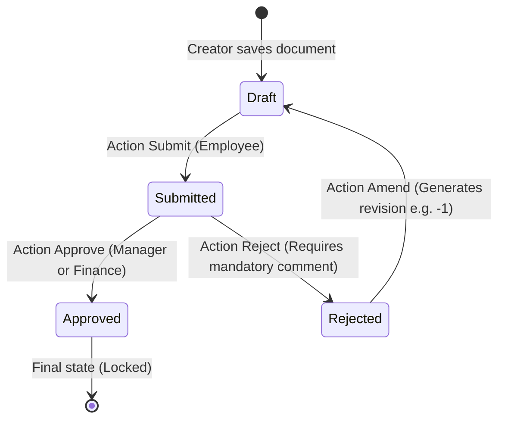

# DocType Modeling & Visual Workflow Guide

This guide covers how to design DocTypes, manage permissions, and configure state-machine workflows using the FrogFrame visual editor and compiler.

---

## 1. Creating a New DocType

System Managers can create DocTypes directly from the web portal at `/admin/metadata/new` without hand-editing raw JSON files.

### Available DocType Templates

| Template | Included Configuration | Best Suited For |
|---|---|---|
| **With Approval Workflow** | Title, Date, Description, child items, approval workflow (`Draft` → `Submitted` → `Approved`/`Rejected`), and document amending enabled. | Purchase requests, expense claims, leave requests. |
| **Simple Document** | Basic fields and standard CRUD permissions without a multi-stage approval workflow. | Master data (e.g., Customers, Vendors, Products). |
| **Blank Document** | Minimal title field; accessible exclusively to System Managers. | Custom internal tables, technical configurations. |

Once created, DocTypes are compiled, assigned an immutable schema version, and automatically categorized under their respective module in the sidebar.

---

## 2. Visual DocType Editor

Accessible at `/admin/metadata/{DocType}/editor`:
- **Drag-and-Drop Layout**: Organize fields into tabs, sections, and 1–3 responsive columns.
- **Real-Time Validation**: Field configurations and expressions are validated continuously using the same AST compiler that executes at server startup.
- **Live Preview**: Preview the interactive form as an end user before publishing changes.
- **Diff & Risk Assessment**: Before publishing, changes are categorized into:
  - **Safe**: Adding non-mandatory fields, non-breaking layout tweaks.
  - **Requires Transformation**: Renaming fields, changing types.
  - **High Risk**: Deleting fields, removing roles, narrowing permissions. High-risk changes require explicit administrator confirmation.

---

## 3. Workflow State Machine Design

FrogFrame provides a visual state machine designer at `/admin/workflows/{Name}/editor`.

### Key Workflow Rules
1. **Never Downgrade DocStatus**: A document cannot transition backward from locked or cancelled state directly to draft. To revise a rejected or cancelled document, use the **Amend** action, which creates a new draft version (e.g., `PR-2026-00001-1`).
2. **Mandatory Action Comments**: Actions such as "Reject" or "Cancel" require user comments before the transition is accepted.
3. **Role & Condition Guards**: Each transition specifies eligible roles and optional Boolean expressions evaluated safely by the AST interpreter (e.g., `total <= 10000000 && user.department == 'IT'`).

