# DocType Data Entry Sequence & Dependencies

When configuring a new tenant or setting up initial master data in the ERP, documents must be entered in an order that respects foreign key (`Link` field) dependencies. Creating documents out of sequence will result in missing reference validation errors or empty lookup dropdowns.

This guide outlines the recommended **6-Phase Data Entry Sequence**, progressing from standalone master records to transactional business documents.

---

## High-Level Dependency Overview

```mermaid
flowchart TD
    subgraph P1["Phase 1: Standalone Master Data"]
        Currency["Currency"]
        HolidayList["HolidayList"]
        Bank["Bank"]
        UOM["UOM"]
        AddressContact["Address & Contact"]
        TaxRates["Tax & Payroll Tables (PtkpRate, TerRate)"]
    end

    subgraph P2["Phase 2: Financial Foundations"]
        Account["Account (COA)"]
        CostCenter["CostCenter"]
        FiscalYear["FiscalYear"]
    end

    subgraph P3["Phase 3: Legal Entity"]
        Company["Company"]
    end

    subgraph P4["Phase 4: Operational Master Data"]
        OrgUnit["OrganizationUnit"]
        JobHierarchy["Job Profiles & Positions"]
        Employee["Employee"]
        BusinessPartners["Customer & Vendor"]
        InventoryMaster["Warehouse, ItemGroup & Item"]
        BankAccount["BankAccount"]
        TaxCode["TaxCode"]
    end

    subgraph P5["Phase 5: Pricing, Policies & Settings"]
        PriceList["PriceList & ItemPrice"]
        AccountingPeriod["AccountingPeriod"]
        HRPolicies["Leave & Salary Policies"]
        Settings["System Settings (GlobalDefaults, StockSettings, etc.)"]
    end

    subgraph P6["Phase 6: Transactional Workflows"]
        SalesFlow["Sales (Quotation -> SalesOrder -> SalesInvoice)"]
        PurchasingFlow["Procurement (PurchaseRequest -> PO -> GR -> Invoice)"]
        GLTransactions["JournalEntry & BankReconciliation"]
        PayrollTx["PayrollRun & Payslips"]
    end

    P1 --> P2
    P1 --> P3
    P2 --> P3
    P3 --> P4
    P4 --> P5
    P5 --> P6
```

---

## Phase 1: Standalone Master Data (Zero Dependencies)

These DocTypes have no required external links to other entities and should be populated first:

| DocType | Key Fields | Purpose |
|---|---|---|
| `Currency` | `currency_code` (e.g., `IDR`, `USD`), `currency_name`, `symbol`, `decimals` | Base currency required by `Company` and transactions. |
| `HolidayList` | `holiday_list_name`, `from_date`, `to_date`, `weekly_off` | Annual calendar for working days, leave calculations, and payroll. |
| `Bank` | `bank_name`, `swift_code` | Bank institution directory used by company and vendor bank accounts. |
| `UOM` | `uom_name`, `must_be_whole_number` | Units of measurement (e.g. `Unit`, `Pcs`, `Kg`, `Box`, `Month`, `Hour`). |
| `Address` | `address_line1`, `city`, `postal_code`, `country` | Reusable physical addresses linked to customers, vendors, and companies. |
| `Contact` | `first_name`, `last_name`, `email`, `phone` | External business and party contacts. |
| `Industry` | `industry_name` | Classification for accounts and customers. |
| `SalesStage` | `stage_name`, `stage_order`, `probability` | CRM sales pipeline stages. |
| `ShiftType` | `shift_name`, `start_time`, `end_time` | Working schedules for attendance. |
| `TaxBracket`, `TerRate`, `PtkpRate` | Tax limits and percentage rates | Indonesian statutory tax calculation tables (PPh 21 TER, PTKP). |

---

## Phase 2: Chart of Accounts & Financial Foundations

Before creating the legal entity, define the chart of accounts and corporate financial structures. In this framework, `Account` is shared across companies within a tenant.

### 1. `Account` (Chart of Accounts)
Create top-level **Group Accounts** first, followed by child ledger accounts:
- **Root Groups**: `Asset`, `Liability`, `Equity`, `Income`, `Expense`.
- **System Accounts**:
  - `Cash` / `Bank` (`account_type`: `Cash` or `Bank`)
  - Trade Receivables (`account_type`: `Receivable`, `is_control_account`: `true`)
  - Trade Payables (`account_type`: `Payable`, `is_control_account`: `true`)
  - Sales Revenue (`root_type`: `Income`)
  - Operating & Administrative Expenses (`root_type`: `Expense`)
  - Retained Earnings (`account_type`: `Retained Earnings`)
  - Foreign Exchange Gain/Loss (`account_type`: `Exchange Gain/Loss`)
  - Round-off Account (`account_type`: `Round-off`)

### 2. `CostCenter`
Define root and sub-cost centers (e.g. `Main Cost Center`, `Operations`, `Sales`, `G&A`).

### 3. `FiscalYear`
Define the annual accounting year (e.g. `FY-2026`, starting `2026-01-01` to `2026-12-31`).

---

## Phase 3: Legal Entity (`Company`)

With Currency, Holiday Calendar, and Accounts defined, create the corporate entity in `Company`.

### Mandatory Fields
- `company_code`: Short code (2–10 uppercase characters, e.g. `ACME`).
- `company_name`: Corporate entity name (e.g. `PT Acme Indonesia`).
- `country`: Country ISO code (`ID`).
- `base_currency`: Functional currency (links to `Currency` from Phase 1).

### Recommended Default Links
Configuring these immediately ensures downstream transactions auto-populate without manual overrides:
- `default_holiday_list`: Links to `HolidayList`.
- `default_receivable_account`: Links to default Trade Debtors `Account`.
- `default_payable_account`: Links to default Trade Creditors `Account`.
- `default_cash_account`: Links to default Cash/Bank `Account`.
- `default_income_account`: Links to default Sales `Account`.
- `default_expense_account`: Links to default Expense `Account`.
- `retained_earnings_account`: Links to Retained Earnings `Account`.
- `default_cost_center`: Links to default `CostCenter`.

---

## Phase 4: Operational Master Data

Once `Company` is active, establish departmental structures, personnel, business partners, and physical facilities.

### A. Human Resources & Organizational Hierarchy
1. **`OrganizationUnit`**: Departments, divisions, and branches (links to `Company`).
2. **`JobFamilyGroup` $\rightarrow$ `JobFamily` $\rightarrow$ `JobProfile`**: Job taxonomy and career ladders.
3. **`Position`**: Headcount seats and reporting hierarchy (links to `OrganizationUnit` and `JobProfile`).
4. **`Employee`**: Personnel records (links to `Company`, `OrganizationUnit`, `JobProfile`, and `Position`).

### B. Customers & Vendors
1. **`CustomerGroup` & `VendorGroup`**: Categories grouping terms and accounts (e.g. `Commercial`, `Government`, `Retail`).
2. **`Customer`**: Client directory (links to `CustomerGroup`, optional `Currency`, `Address`, `Account`).
3. **`Vendor`**: Supplier directory (links to `VendorGroup`, optional `PaymentTerm`, `Account`).

### C. Cash, Inventory & Taxation
1. **`BankAccount`**: Company banking accounts (links to `Company`, `Bank`, `Currency`, and GL `Account`).
2. **`Warehouse`**: Storage locations (links to `Company`, optional `Location`).
3. **`ItemGroup`**: Product categories (links optional income/expense accounts).
4. **`Item`**: Inventory and service items (links to `ItemGroup` and `UOM`).
5. **`TaxCode`**: VAT/Withholding configurations (links to GL `Account`).

---

## Phase 5: Pricing, Policies & System Settings

1. **`PriceList` & `ItemPrice`**: Standard selling and buying price sheets (links to `Item` and `Currency`).
2. **`AccountingPeriod`**: Monthly or quarterly periods within the `FiscalYear`.
3. **Leave Configuration**:
   - `LeaveType` (e.g. Annual, Sick, Maternity)
   - `LeavePolicy` $\rightarrow$ `LeaveAllocation`
4. **Compensation Configuration**:
   - `SalaryComponent` (Basic, Allowance, Overtime, BPJS, PPh 21)
   - `SalaryAssignment` (links to `Employee`)
5. **Singleton Application Settings**:
   - `GlobalDefaults` (Default company, currency)
   - `AccountingSettings`
   - `StockSettings`
   - `CRMSettings`
   - `HRSettings`

---

## Phase 6: Transactional Workflows

After all prerequisite master and configuration records exist, transaction processing can proceed smoothly:

### Sales Workflow (Order to Cash)
$$\text{Lead} \longrightarrow \text{Opportunity} \longrightarrow \text{Quotation} \longrightarrow \text{SalesOrder} \longrightarrow \text{SalesInvoice} \longrightarrow \text{PaymentEntry}$$

### Procurement Workflow (Procure to Pay)
$$\text{PurchaseRequest} \longrightarrow \text{PurchaseOrder} \longrightarrow \text{GoodsReceipt} \longrightarrow \text{PurchaseInvoice} \longrightarrow \text{PaymentEntry}$$

### Inventory Operations
- **`StockEntry`**: Material receipts, transfers, and issues across `Warehouse` locations.
- **`StockReconciliation`**: Periodic stock adjustments and variance reconciliations.

### General Ledger & Financial Operations
- **`JournalEntry`**: Multi-currency general ledger debit/credit postings.
- **`BankStatement` & `BankReconciliation`**: Automated and manual bank transaction matching.
- **`Asset` & `DepreciationRun`**: Fixed asset capitalization and monthly depreciation postings.
- **`Budget`**: Cost center and account spending limits against actuals.

### HR & Payroll
- **`Attendance` & `OvertimeRequest`**: Daily time capture.
- **`LeaveApplication`**: Leave requests against employee allocations.
- **`PayrollRun` $\rightarrow$ `Payslip`**: Automated monthly compensation, deductions, and tax computations.
