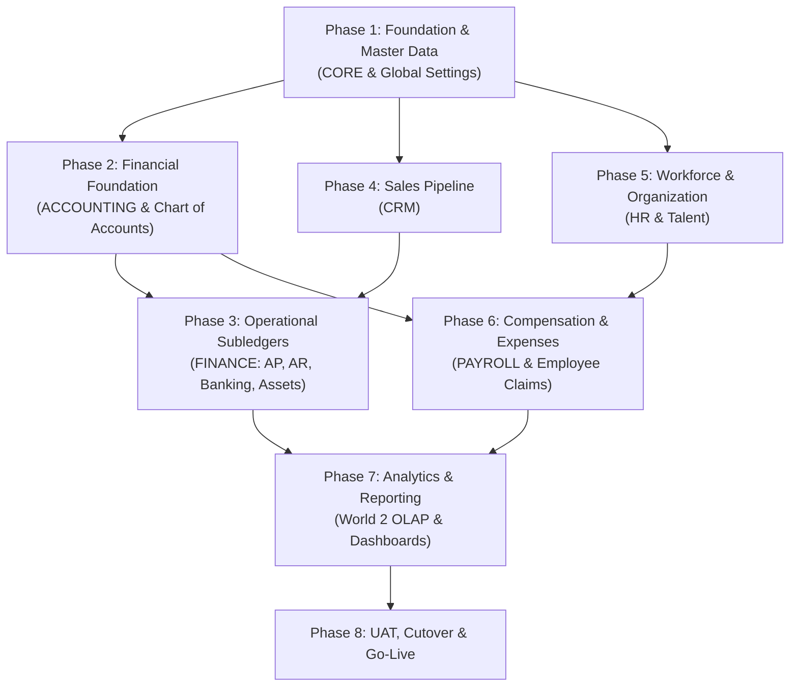
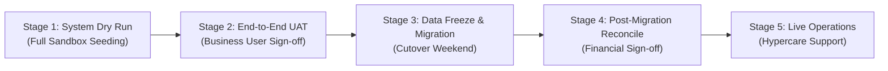

# FrogFramework ERP — End-to-End Implementation Plan

This document outlines the systematic, phased implementation roadmap for deploying **FrogFramework ERP** across enterprise operational environments. It defines the module rollout sequence, required master and transactional data preparation, system behavior expectations, and verifiable acceptance criteria.

---

## 1. Implementation Architecture & Rollout Philosophy

FrogFramework ERP is designed around **The "Two Worlds" Architecture**:
- **World 1 (OLTP)**: Strictly typed, transactional, single-source-of-truth operational data stored in `frogframe_documents` with optimistic locking (`version = @expected`) and real-time schema and lifecycle validation.
- **World 2 (OLAP)**: High-throughput analytical projection engine populating read-replica reporting views (`reporting.*`) asynchronously via the transactional outbox worker.

To achieve clean referential integrity, eliminate cyclical dependencies, and guarantee balanced financial ledgers, the implementation follows a **bottom-up dependency model**:

---

## 2. Phased Implementation Roadmap

---

### Phase 1: Foundation Master Data (CORE & System Defaults)

#### 1. Target Modules & DocTypes
- **Module**: `CORE`
- **Key DocTypes**: `Company`, `Currency`, `CurrencyExchangeRate`, `Location`, `Address`, `Contact`, `CustomerGroup`, `Customer`, `VendorGroup`, `Vendor`, `Item`, `ItemGroup`, `UOM`, `PriceList`, `ItemPrice`, `PaymentTerm`, `Bank`, `HolidayList`.
- **Singletons**: `GlobalDefaults`.

#### 2. Prerequisites & Dependencies
- Fresh database deployment with migrations applied (`001` through `035`).
- System administrative account with `System Manager` privileges.
- Master Roles verified in system (`Finance`, `Purchasing`, `HR`, `Manager`, `Employee`, `Sales`, `Stock`).

#### 3. Data to Prepare
| Data Item | Description | Source / Format | Mandatory Attributes |
|---|---|---|---|
| **Legal Entity Master** | Registered business entities, registration numbers (NPWP, NIK, Business Reg) | Corporate Legal Docs | `company_name`, `country`, `default_currency` |
| **Currencies & Rates** | Operating currencies and initial conversion rates against functional currency | Treasury / Bank Indonesia / Central Bank | `currency_code` (e.g., IDR, USD), `exchange_rate`, `date` |
| **Unit of Measure (UOM)** | Standards of measurement across sales and inventory | Inventory Catalog | `uom_name`, `must_be_whole_number` (Unit, Pcs, Box, Kg, Liter) |
| **Item Master & Categories** | Products, raw materials, physical assets, and service items | Product Master Sheets | `item_code`, `item_name`, `item_group`, `stock_uom`, `is_sales_item`, `is_purchase_item`, `is_stock_item` |
| **Customer Master** | Existing client records, credit terms, and classification groups | CRM / Legacy Billing | `customer_name`, `customer_group`, `currency`, `tax_id` (NPWP/NIK) |
| **Vendor Master** | Approved supplier directory, bank details, payment terms | Procurement / AP Records | `vendor_name`, `vendor_group`, `tax_id`, `payment_term` |
| **Addresses & Contacts** | Physical operating addresses and representative contacts | Existing Address Books | Contact details mapped via `PartyLink` (DynamicLink to Customer/Vendor) |
| **Payment Terms** | Credit schedules and due date definitions (e.g., Net 30, COD, 50/50) | Finance Policy | `term_name`, `due_days`, `percentage_allocation` |

#### 4. System Expectations
- Master records are accessible via global search (Awesomebar: `Ctrl+K`).
- Dynamic party links resolve bidirectionally (viewing a Customer displays all linked Contacts and billing/shipping Addresses).
- Pricing engines automatically resolve the correct sales or purchase price based on active Price Lists and Currency.

#### 5. Success Criteria & Verification Checklist
- [ ] 100% of active Customers and Vendors successfully imported with zero duplicate party keys.
- [ ] Item master correctly isolates inventory items from non-stock service items.
- [ ] Multi-party link tests confirm that updating an address or contact propagates correctly to linked parties.
- [ ] Currency conversion simulator returns expected exchange values for multi-currency transactions.

---

### Phase 2: General Ledger & Financial Structure (ACCOUNTING)

#### 1. Target Modules & DocTypes
- **Module**: `ACCOUNTING`
- **Key DocTypes**: `Account`, `CostCenter`, `Project`, `AccountingDimension`, `FiscalYear`, `AccountingPeriod`, `JournalEntry`, `PeriodClosingVoucher`, `Budget`.
- **Singletons**: `AccountingSettings`.

#### 2. Prerequisites & Dependencies
- Completion of Phase 1 (`Company`, `Currency`, `GlobalDefaults`).
- Defined Chart of Accounts hierarchy approved by Chief Financial Officer (CFO) / Controller.

#### 3. Data to Prepare
| Data Item | Description | Source / Format | Mandatory Attributes |
|---|---|---|---|
| **Chart of Accounts (COA)** | Hierarchical account structure (Group vs. Leaf accounts) | Certified Audited Financial Statements | `account_code`, `account_name`, `parent_account`, `root_type` (Asset, Liability, Equity, Revenue, Expense), `account_type` (Receivable, Payable, Bank, Cash, Tax, Fixed Asset, Accumulated Depreciation, Equity) |
| **Cost Centers & Dimensions** | Operational cost centers, business units, departments, and project tags | Financial Management Structure | `cost_center_code`, `cost_center_name`, `is_group`, `parent_cost_center` |
| **Fiscal Calendars** | Fiscal years and monthly accounting periods | Corporate Finance Calendar | `fiscal_year_name`, `start_date`, `end_date`, `status` (`Open` / `Closed`) |
| **Opening Trial Balance** | Balance Sheet and Profit & Loss cutoff balances as of the cutover date | Audited Legacy GL Trial Balance | Balances per leaf account; total Debit must equal total Credit down to the smallest currency unit (0.00 difference) |
| **Default System Accounts** | Default mapping for Round-off, Currency Exchange Gain/Loss, and Retained Earnings | Finance Configuration | Account codes linked in `Company` and `AccountingSettings` |

#### 4. System Expectations
- System strictly blocks posting to group accounts (`is_group == true`).
- Posting to locked or non-existent accounting periods is blocked.
- Opening balances imported via opening `JournalEntry` balance out precisely ($Debit - Credit = 0.00$).
- Real-time balances and ledger lines compile without performance degradation.

#### 5. Success Criteria & Verification Checklist
- [ ] Trial balance report generated in FrogFramework matches legacy audited trial balance down to $0.00$ variance.
- [ ] System rejects unbalanced journal entries with standard HTTP 422 / validation error.
- [ ] Posting locks successfully prevent transactions backdated to closed fiscal periods.
- [ ] Budget limits trigger notifications or hard stops when cost center allocations are exceeded.

---

### Phase 3: Operational Subledgers & Commercial Transactions (FINANCE)

#### 1. Target Modules & DocTypes
- **Module**: `FINANCE`
- **Key DocTypes**: `TaxCode`, `BankAccount`, `SalesInvoice`, `SalesCreditNote`, `PurchaseInvoice`, `PurchaseDebitNote`, `PaymentEntry`, `BankStatement`, `BankReconciliation`, `PaymentReconciliation`, `PaymentRun`, `PurchaseRequest`, `PurchaseOrder`, `GoodsReceipt`, `TaxInvoice`, `AssetCategory`, `Asset`, `DepreciationRun`, `AssetDisposal`.
- **Singletons**: `FinanceSettings`.

#### 2. Prerequisites & Dependencies
- Phase 1 (Customers, Vendors, Items, Payment Terms) and Phase 2 (COA, Fiscal Periods).
- Registered bank and tax configurations.

#### 3. Data to Prepare
| Data Item | Description | Source / Format | Mandatory Attributes |
|---|---|---|---|
| **Tax Codes & Rules** | PPN (VAT) rates (11%, 12%), withholding taxes (PPh 21, 23, 4(2)), DPP factor definitions | Tax Advisor / Tax Law Catalog | `tax_code`, `tax_type`, `rate`, `account`, `dpp_factor` |
| **Bank Account Masters** | Corporate bank accounts and company-linked GL clearing accounts | Treasury Dept | `bank_account_name`, `bank`, `account_number`, `gl_account`, `currency` |
| **Open Accounts Receivable (AR)** | Outstanding, unpaid customer invoices up to the cutover date | Legacy AR Subledger | Customer, original invoice date, due date, outstanding balance, invoice lines |
| **Open Accounts Payable (AP)** | Outstanding, unpaid vendor bills up to the cutover date | Legacy AP Subledger | Vendor, bill number, bill date, due date, remaining payable amount |
| **Fixed Asset Register** | In-service physical assets, historical gross book value, accumulated depreciation | Fixed Asset Schedule | Asset name, category, purchase date, cost, salvage value, depreciation method, useful life in months |
| **Bank Statement Feeds** | Bank statement closing balance as of cutover date | Bank Statement Export | Date, transaction reference, amount, withdrawal/deposit |

#### 4. System Expectations
- Subledger-to-GL parity: AR subledger balance equals GL control account `11300 Accounts Receivable`; AP subledger equals `21100 Accounts Payable`.
- Payment allocation engine matches incoming/outgoing payments against open invoices (`PaymentEntryReference`) and automatically recalculates `outstanding_amount` and `payment_status` (`Unpaid`, `Partially Paid`, `Paid`).
- Automated monthly depreciation calculations correctly generate ledger lines debiting `Depreciation Expense` and crediting `Accumulated Depreciation`.
- Bank reconciliation matches bank statement lines against posted GL entries, computing exact unreconciled variance.

#### 5. Success Criteria & Verification Checklist
- [ ] AR Aging and AP Aging reports in FrogFramework match legacy subledger aging schedules 1:1.
- [ ] Automated payment execution creates valid balanced journal entries including tax deduction lines (`deductions`).
- [ ] Fixed asset depreciation schedule matches financial amortization tables down to the cent.
- [ ] Bank reconciliation tool verifies zero unexplained discrepancy against physical bank statements.

---

### Phase 4: Sales Pipeline & Commercial Management (CRM)

#### 1. Target Modules & DocTypes
- **Module**: `CRM`
- **Key DocTypes**: `LeadSource`, `Industry`, `LostReason`, `SalesStage`, `Territory`, `Campaign`, `Lead`, `Opportunity`, `Quotation`, `SalesOrder`, `CustomerContract`, `CommissionPlan`, `CommissionStatement`, `Activity`.
- **Singletons**: `CRMSettings`.

#### 2. Prerequisites & Dependencies
- Phase 1 (Customers, Items, Price Lists, Contacts).
- Active Sales team accounts and sales territories defined.

#### 3. Data to Prepare
| Data Item | Description | Source / Format | Mandatory Attributes |
|---|---|---|---|
| **Sales Stages & Probabilities** | Qualification stages and stage win probabilities | Sales Operations | `stage_name`, `probability` (e.g., Prospecting 10%, Proposal 60%, Won 100%), `forecast_category` |
| **Lead Sources & Industries** | Attribution channels (Website, Referral, Trade Show) and verticals | Marketing & Sales Ops | `source_name`, `industry_name` |
| **Active Leads & Pipeline** | Current active leads and unqualified contacts | CRM / Spreadsheet | Name, organization, email, phone, source, assigned `sales_rep` |
| **Open Opportunities** | Live deals in progress with projected closing dates and values | Sales Rep Pipeline | Opportunity title, stage, customer/lead, expected closing date, opportunity lines/items |
| **Price Books & Commission Rules** | Commission tiers, percentages, and territory quota matrices | Commercial Policy | `plan_name`, `commission_rate`, `sales_rep` |

#### 4. System Expectations
- Seamless Lead-to-Order conversion:
  $$\text{Lead} \xrightarrow{\text{Qualify}} \text{Opportunity} \xrightarrow{\text{Quote}} \text{Quotation} \xrightarrow{\text{Win}} \text{Sales Order} \xrightarrow{\text{Bill}} \text{Sales Invoice}$$
- Opportunity weighted amount calculated automatically ($\text{Weighted Amount} = \text{Total Amount} \times \text{Probability}$).
- Sales reps only see their assigned deals via record scoping (`match:sales_rep=employee`), while sales managers see departmental pipelines.

#### 5. Success Criteria & Verification Checklist
- [ ] Lead conversion action creates Customer, Contact, and Opportunity in a single atomic transaction.
- [ ] Quotation approval lifecycle (`Draft` $\rightarrow$ `Sent` $\rightarrow$ `Accepted`) converts to Sales Order without data re-entry.
- [ ] Weighted sales forecast dashboard displays accurate projections per sales stage.
- [ ] Commission statement runs accurately calculate rep payables based on closed/paid sales invoices.

---

### Phase 5: Workforce Organization, Time & Talent (HR & TALENT)

#### 1. Target Modules & DocTypes
- **Modules**: `HR`, `TIME`, `RECRUITING`, `TALENT`
- **Key DocTypes**: `OrganizationUnit`, `JobFamilyGroup`, `JobFamily`, `JobProfile`, `Grade`, `Position`, `Employee`, `EmploymentContract`, `JobChange`, `EmployeeSeparation`, `ShiftType`, `HolidayList`, `LeaveType`, `LeavePolicy`, `LeaveAllocation`, `LeaveApplication`, `Attendance`, `OvertimeRequest`, `JobRequisition`, `JobApplicant`, `Interview`, `JobOffer`, `AppraisalCycle`, `Appraisal`.
- **Singletons**: `HRSettings`.

#### 2. Prerequisites & Dependencies
- Phase 1 (`Company`, `HolidayList`, User Accounts for employees).
- HR policy documentation (leave policies, shift rules, organizational chart).

#### 3. Data to Prepare
| Data Item | Description | Source / Format | Mandatory Attributes |
|---|---|---|---|
| **Organizational Hierarchy** | Department and supervisory unit tree | HR Org Chart | `unit_name`, `parent_unit`, `manager_position` |
| **Job Profiles & Positions** | Job templates, salary grade bands, and specific position headcounts | Job Architecture | `job_title`, `grade`, `position_code`, `reports_to_position` |
| **Employee Master Records** | Core employee personal and employment information | HRIS / Personal Dossiers | `employee_number`, `first_name`, `last_name`, `date_of_joining`, `reports_to`, `leave_approver`, `expense_approver`, `organization_unit`, `position` |
| **Confidential / Privacy Data (`permLevel 1`)** | NIK (ID), NPWP (Tax ID), PTKP status, BPJS numbers, bank accounts, emergency contacts | Confidential HR Files | Restricted access fields for compliance with UU PDP and data privacy |
| **Leave Types & Balances** | Annual leave, sick leave, maternity leave, and cutover remaining leave balances | HR Leave Balance Sheet | `leave_type_name`, `max_days_allowed`, `is_carry_forward`, `allocated_days` |
| **Work Shifts & Calendars** | Working hours, grace periods, shift rotations, and national holidays | Operations Roster | `shift_name`, `start_time`, `end_time`, `holiday_list` |

#### 4. System Expectations
- Supervisory approval workflows function declaratively without custom code (`user.employee == leave_approver`).
- Strict privacy enforcement: regular employees cannot read colleague confidential attributes (`permLevel 1`).
- Employee lifecycle changes (promotion, transfer, termination) are executed strictly via `JobChange` and `EmployeeSeparation` events rather than unversioned field mutations.

#### 5. Success Criteria & Verification Checklist
- [ ] Interactive Organizational Tree (`OrgTree`) accurately renders reporting lines across all departments.
- [ ] Employee submits leave request $\rightarrow$ immediate notification to supervisor $\rightarrow$ approved request immediately decrements `LeaveAllocation`.
- [ ] Privacy audit verifies that non-HR users receive access denied exceptions when querying sensitive personal columns.
- [ ] Biometric attendance logs or manual time records compile into verified daily attendance summaries.

---

### Phase 6: Compensation & Benefits (PAYROLL & Expenses)

#### 1. Target Modules & DocTypes
- **Modules**: `PAYROLL`, `FINANCE` (Expense Subledger)
- **Key DocTypes**: `SalaryComponent`, `SalaryAssignment`, `Payslip`, `PayrollRun`, `ExpenseClaimType`, `ExpenseClaim`, `EmployeeAdvance`.
- **Singletons**: `PayrollSettings`.

#### 2. Prerequisites & Dependencies
- Phase 2 (Chart of Accounts & Bank Accounts), Phase 5 (Employee Records & Contracts).
- Indonesian Tax rules (PPh 21 TER, PTKP tables, BPJS Ketenagakerjaan & Kesehatan rates).

#### 3. Data to Prepare
| Data Item | Description | Source / Format | Mandatory Attributes |
|---|---|---|---|
| **Salary Components** | Earnings (Basic, Transport, Meal, Position) and Deductions (BPJS, Loan, Tax) | Compensation Matrix | `component_name`, `component_type` (Earning/Deduction), `is_tax_applicable`, `expense_account`, `payable_account` |
| **Tax Reference Tables** | PTKP categories (TK/0, K/1, etc.), TER monthly brackets (Category A, B, C), progressive brackets | Indonesian Tax Regulation (UU HPP) | `ptkp_code`, `threshold_amount`, `ter_percentage` |
| **Employee Salary Assignments** | Individual recurring compensation packages | Employment Contracts | `employee`, `from_date`, `base_amount`, child salary details |
| **Expense Categories** | Reimbursable corporate expense items and budget accounts | Finance Travel Policy | `expense_type_name`, `default_account` |

#### 4. System Expectations
- One-click `PayrollRun` aggregates active employees, calculates gross salary, evaluates tax formulas (PPh 21 TER / progressive), deducts employee contributions, and outputs draft `Payslip` documents.
- Payroll submission automatically generates balanced compound journal entries:
  $$\text{Dr. Salary & Allowance Expense} \quad \text{Cr. BPJS Payable} \quad \text{Cr. Tax Payable (PPh 21)} \quad \text{Cr. Net Payroll Clearing}$$
- Expense claims follow supervisor $\rightarrow$ finance multi-tier approval workflows before generating payment entries.

#### 5. Success Criteria & Verification Checklist
- [ ] Payroll simulation test on 100 sample employees produces net pay calculations matching manual spreadsheet benchmarks to 100% precision.
- [ ] Tax deductions comply with official PPh 21 TER validation tables.
- [ ] Automated payroll disbursement entry balances to $0.00$ discrepancy.
- [ ] Payslips are visible exclusively to the recipient employee and authorized payroll officers.

---

### Phase 7: Analytics, Dashboards & Reporting (World 2 OLAP)

#### 1. Target Architecture & Components
- **Architecture**: `World 2 OLAP Reporting Engine`
- **Key Artifacts**: Transactional Outbox Worker, Read Replica (`frogframe_ro`), Saved Query REST APIs, SQL Dashboards, OpenXML Template Reports (`.xlsx`, `.docx`).

#### 2. Prerequisites & Dependencies
- Phases 1 through 6 deployed with live or mock operational transactions.
- PostgreSQL read-replica configured with read-only connection credentials.

#### 3. Data & Artifacts to Prepare
| Artifact | Description | Target Subsystem | Mandatory Attributes |
|---|---|---|---|
| **SQL Dashboards** | Executive KPI widgets (Sales Pipeline, Cash Flow, Expense Trends, Headcount) | Blazor Analytics Dashboard | SQL query against `reporting.*` views, refresh interval, chart type (Bar, Donut, Line, Table) |
| **Financial Statements** | Standard P&L, Balance Sheet, Cash Flow, and General Ledger inquiries | Saved Queries / UI Views | Fast aggregation queries running exclusively on `frogframe_ro` |
| **OpenXML Templates** | Corporate-formatted Excel and Word reports (Invoice Print, Purchase Order, Payslip, Tax Report) | Document Reporting Engine | Pre-designed `.xlsx` / `.docx` templates with XML binding tags |
| **Scheduled Analytical Jobs** | Periodic materialized view refreshes and outbox event vacuuming | Distributed Cron Worker | Cron schedule, advisory locking keys |

#### 4. System Expectations
- Zero query locks on World 1 operational tables (`frogframe_documents`) during large analytical queries or spreadsheet exports.
- Transactional outbox processes events in near real-time ($< 500\text{ ms}$ replication latency).
- Complex multi-join reporting queries complete within the p95 latency target ($< 400\text{ ms}$).

#### 5. Success Criteria & Verification Checklist
- [ ] High-volume financial report generation runs smoothly under 100 concurrent virtual users without impacting transactional checkout performance.
- [ ] Read-only database user permissions verify that mutating queries (`INSERT`, `UPDATE`, `DELETE`) are strictly denied on the read replica.
- [ ] Export to Excel and Word generates pixel-perfect corporate documents without third-party desktop dependencies.

---

### Phase 8: User Acceptance Testing (UAT), Cutover & Go-Live

#### 1. Stages of Go-Live Execution

#### 2. Cutover Preparation Checklist
- **System Freeze Schedule**: Formal announcement of legacy system data entry freeze date and hour.
- **Delta Migration Scripts**: Automated extraction of transactions recorded between final snapshot and cutover freeze.
- **Rollback Runbook**: Defined rollback criteria, database snapshot restore scripts, and rollback decision deadlines.
- **Production Environment Hardening**:
  - `ASPNETCORE_ENVIRONMENT=Production`
  - `Demo:SeedData=false` and `Demo:ShowAccounts=false`
  - Explicit `AllowedHosts` and verified TLS/SSL certificates
  - PostgreSQL advisory lock verified for multi-instance deployments.

#### 3. Final Go-Live Success Criteria & Sign-Off Matrix
| Sign-off Domain | Approver | Acceptance Threshold |
|---|---|---|
| **Master Data Completeness** | Business Operations Head | 100% of verified customers, vendors, items, and employees migrated |
| **General Ledger Reconciliation** | Finance Director / CFO | Opening Trial Balance matches audited figures with \$0.00 difference |
| **Operational Subledgers** | Financial Controller | Open AR, AP, and Bank balances match physical statements |
| **Security & Privacy** | CISO / Security Officer | Role RBAC and `permLevel 1` privacy access controls verified |
| **System Performance** | Lead Architect | Peak API response time p95 $< 400\text{ ms}$; health checks green |

---

## 3. Data Migration Best Practices & Quality Controls

1. **Pre-Import Scrubbing**:
   - Cleanse and standardize phone numbers, tax IDs (NPWP 16 digits), and email addresses.
   - Strip trailing whitespace, normalize customer and vendor names to avoid duplicate parties.
2. **Simulation Mode Execution**:
   - Always run the FrogFramework Excel/CSV Data Import in **Simulation Mode** (`Dry Run`) prior to committing mutations to detect schema constraint violations, missing Link foreign keys, and type mismatches.
3. **Transaction Atomic Batches**:
   - Execute opening balance journal entries and subledger invoices in manageable batch sizes (max 500 documents per batch) with outbox processing monitored.
4. **Audit Trail Verification**:
   - Confirm that all initial migration documents are stamped with an identifiable migration user (`system_migration`) and accompanied by clear reference tags for historical traceability.

---

## 4. Post Go-Live Hypercare & Operational Governance

- **Day 1 to 14 (Hypercare)**:
  - Daily standup between functional ERP leads and technical engineering team.
  - Continuous monitoring of OpenTelemetry error rates, PostgreSQL slow query logs, and outbox queue backlog.
- **Month-End 1 Closing (Milestone)**:
  - Guided first financial month-end closing using `PeriodClosingVoucher`.
  - Reconcile first automated `PayrollRun` and first VAT (`PPN`) tax return.
  - Formal handover to standard operational maintenance team.
