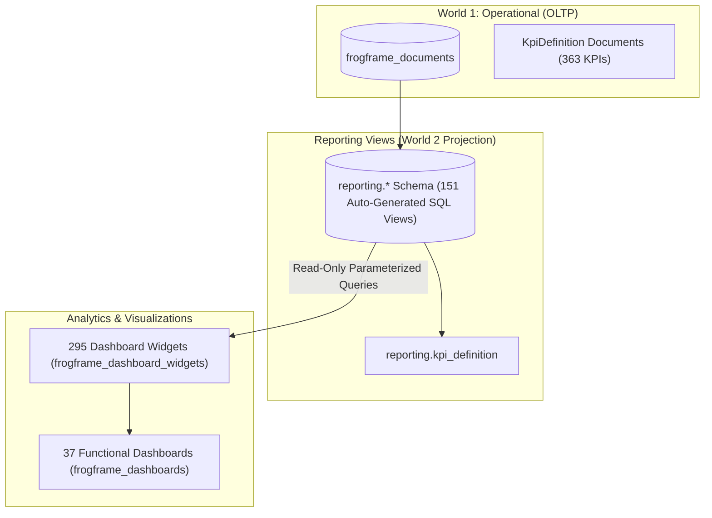

# KPI Catalog & Analytics Dashboards Guide

FrogFramework includes a comprehensive enterprise **KPI Catalog** and **Analytics Dashboard Suite** comprising **363 standardized KPIs**, **295 interactive dashboard widgets**, and **37 functional dashboards** spanning 7 core ERP domains.

---

## 1. Overview & Architecture

The KPI and Dashboard system bridges the operational transactional layer (World 1 OLTP) with high-performance analytical views (World 2 OLAP):



### Key Pillars
- **Single Source of Truth (`KpiDefinition`)**: Each KPI is declared as a `KpiDefinition` document containing standard formulas, target directions, measurement frequencies, source DocTypes, platform equivalents, and implementation links.
- **Reporting Schema Projection**: Analytical widgets execute exclusively against the dedicated `reporting.*` schema using the non-privileged `frogframe_ro` PostgreSQL role with per-session tenant locks and statement timeouts (5s max).
- **Out-of-the-Box Coverage**: 295 pre-built widgets compute real-time metrics across Human Resources, Finance, Accounting, Procurement, Stock, CRM, and Master Data Management.

---

## 2. The `KpiDefinition` DocType

Located in the `CORE` module (accessible via **Settings & Regional → KPI Catalog**), `KpiDefinition` stores full metadata for all organizational indicators.

### Schema Fields

| Field Name | Type | Options / Constraints | Description |
|---|---|---|---|
| `kpi_code` | Data | Required, Max 20, Unique | Standard identifier (e.g., `HR-001`, `FIN-002`, `ACC-025`, `CRM-018`). |
| `kpi_name` | Data | Required, Max 140 | Official KPI title in professional English. |
| `kpi_module` | Select | `HR`, `FINANCE`, `ACCOUNTING`, `PROCUREMENT`, `STOCK`, `CRM`, `CORE` | Business domain module. |
| `sub_area` | Data | Max 60 | Functional area (e.g., `Workforce`, `General Ledger`, `Accounts Receivable (AR)`). |
| `is_active` | Check | Default: `true` | Active status indicator. |
| `definition` | Text | — | Clear definition and business objective of the KPI. |
| `formula` | Text | — | Mathematical calculation formula and filter criteria. |
| `unit` | Data | Max 30 | Measurement unit (e.g., `%`, `Persons`, `Days`, `IDR`, `Ratio`). |
| `direction` | Select | `Up`, `Down`, `Range` | Target trajectory (`Up` = higher is better, `Down` = lower is better, `Range` = target window). |
| `target` | Data | Max 140 | Benchmark or strategic target value. |
| `frequency` | Select | `Daily`, `Weekly`, `Monthly`, `Quarterly`, `Annual`, `Per cycle`, `Per campaign`, `Per event` | Review and recalculation cadence. |
| `owner_role` | Data | Max 60 | Responsible organizational persona (e.g., `HR Manager`, `CFO`, `Controller`). |
| `source_doctypes` | Data | Max 140 | Underlying transactional DocTypes (e.g., `Employee`, `SalesInvoice`, `PaymentEntry`). |
| `key_fields` | Data | Max 140 | Key transactional fields analyzed. |
| `platform_equivalent` | Data | Max 140 | Industry benchmarks in SAP S/4HANA, Workday, NetSuite, and Microsoft 365. |
| `implementation` | Select | `Dashboard widget`, `Built-in report`, `Not available` | Availability mode in FrogFramework. |
| `widget_id` | Data | Max 40 | Foreign key ID to `frogframe_dashboard_widgets` (e.g., `w_kpi_hr_001`). |
| `builtin_report` | Data | Max 60 | Name of built-in C# report provider when widget is unavailable. |
| `implementation_note` | Text | — | Execution notes, parameter requirements, or schema limitations. |
| `widget_sql` | Text | Max 5000 | The exact parameterized SQL query executed against `reporting.*`. |

---

## 3. Catalog Distribution by Module

The 363 KPIs are distributed across enterprise domains as follows:

```text
Enterprise KPI Catalog (363 Indicators)
├── Human Resources (HR) — 133 KPIs
│   ├── Workforce (15 KPIs)
│   ├── Organization (5 KPIs)
│   ├── Job Changes & Career (6 KPIs)
│   ├── Employment Contracts (3 KPIs)
│   ├── Recruitment & Selection (19 KPIs)
│   ├── Attendance (9 KPIs)
│   ├── Leave (9 KPIs)
│   ├── Overtime (6 KPIs)
│   ├── Payroll (17 KPIs)
│   ├── Performance & Talent (10 KPIs)
│   ├── Training & Development (6 KPIs)
│   └── Turnover & Offboarding (11 KPIs)
├── Finance (FIN) — 84 KPIs
│   ├── Accounts Receivable / AR (18 KPIs)
│   ├── Accounts Payable / AP (15 KPIs)
│   ├── Cash & Bank (13 KPIs)
│   ├── Expense & Advance (13 KPIs)
│   ├── Tax (PPN & PPh) (12 KPIs)
│   └── Fixed Assets (13 KPIs)
├── Accounting (ACC) — 48 KPIs
│   ├── General Ledger (15 KPIs)
│   ├── Period Close (8 KPIs)
│   ├── Financial Ratios & P&L (14 KPIs)
│   ├── Budget & Anggaran (6 KPIs)
│   └── Project Accounting (5 KPIs)
├── CRM & Sales (CRM) — 55 KPIs
│   ├── Leads & Inbound (9 KPIs)
│   ├── Marketing Campaigns (5 KPIs)
│   ├── Opportunity Pipeline (15 KPIs)
│   ├── Quotations (5 KPIs)
│   ├── Sales Orders (6 KPIs)
│   ├── Customers & Retention (4 KPIs)
│   ├── Revenue Contracts (5 KPIs)
│   ├── Sales Activities (3 KPIs)
│   └── Sales Commission (3 KPIs)
├── Procurement (PRC) — 21 KPIs
│   ├── Purchase Requests (5 KPIs)
│   ├── Purchase Orders (8 KPIs)
│   ├── Goods Receipts (6 KPIs)
│   └── Vendor Performance (2 KPIs)
├── Stock & Inventory (STK) — 12 KPIs
│   └── Inventory Valuation, Accuracy & Turnover (12 KPIs)
└── Core & Master Data (MDM) — 10 KPIs
    └── Data Completeness, Quality & Hygiene (10 KPIs)
```

---

## 4. Pre-Built Dashboards (37 Dashboards)

All 37 dashboards are registered in `frogframe_dashboards` with role-based visibility:

| Dashboard ID | Dashboard Title | Role Access | Widget Count | Key Metrics |
|---|---|---|---|---|
| `d_kpi_hr_workforce` | KPI HR · Workforce | `HR` | 15 | Headcount, Vacancy Rate, Span of Control, Gender Mix, Tenure |
| `d_kpi_hr_organisasi` | KPI HR · Organization | `HR` | 5 | Unassigned Managers, Cost Center Mapping, Org Depth, Dotted Lines |
| `d_kpi_hr_mutasi_dan_karier` | KPI HR · Job Changes & Career | `HR` | 6 | Promotion Rate, Mobility Rate, Demotions, Status Conversions |
| `d_kpi_hr_kontrak_kerja` | KPI HR · Employment Contracts | `HR` | 3 | Expiring Contracts, Expired Without Follow-up, Renewal Rate |
| `d_kpi_hr_rekrutmen` | KPI HR · Recruitment | `HR` | 19 | Time to Hire, Time to Start, Requisition Fill Rate, Offer Acceptance |
| `d_kpi_hr_kehadiran` | KPI HR · Attendance | `HR` | 9 | Attendance Rate, Absenteeism, Tardiness, WFH Ratio, Geolocation |
| `d_kpi_hr_cuti` | KPI HR · Leave | `HR` | 9 | Leave Utilization, Average Balance, Liability, Rejection Rate |
| `d_kpi_hr_lembur` | KPI HR · Overtime | `HR` | 6 | Total Hours, Hours per Employee, Overtime % Salary, Limit Breaches |
| `d_kpi_hr_payroll` | KPI HR · Payroll | `HR` | 17 | Gross Payroll, Employer Cost, PPh 21 Effective Rate, BPJS Costs |
| `d_kpi_hr_kinerja` | KPI HR · Performance | `HR` | 10 | Appraisal Completion, Rating Distribution, High Performer Ratio |
| `d_kpi_hr_pelatihan` | KPI HR · Training | `HR` | 6 | Training Hours/Employee, Attendance Rate, Spend % Payroll |
| `d_kpi_hr_turnover` | KPI HR · Turnover | `HR` | 11 | Voluntary/Involuntary Turnover, 1st Year Attrition, Retention Rate |
| `d_kpi_fin_piutang_ar` | KPI Finance · Accounts Receivable (AR) | `Finance` | 16 | Outstanding AR, DSO, Overdue %, Aging > 90d, Credit Note Ratio |
| `d_kpi_fin_utang_ap` | KPI Finance · Accounts Payable (AP) | `Finance` | 10 | Outstanding AP, DPO, On-time Payment Rate, PO-backed % |
| `d_kpi_fin_kas_dan_bank` | KPI Finance · Cash & Bank | `Finance` | 12 | Cash Balance, Net Cash Flow, Bank Reconciliation Discrepancy |
| `d_kpi_fin_expense_dan_advance` | KPI Finance · Expense & Advance | `Finance` | 11 | Expense Claims, Per Employee Spend, Outstanding Advances |
| `d_kpi_fin_pajak` | KPI Finance · Tax | `Finance` | 11 | Output/Input VAT, VAT Payable, Tax Invoices Pending Upload |
| `d_kpi_fin_aset_tetap` | KPI Finance · Fixed Assets | `Finance` | 13 | Net Book Value, Period Depreciation, Unposted Schedules, Capex |
| `d_kpi_acc_general_ledger` | KPI Accounting · General Ledger | `Finance` | 10 | Manual Journal Count & Ratio, Unbalanced Journals, FX Gain/Loss |
| `d_kpi_acc_period_close` | KPI Accounting · Period Close | `Finance` | 8 | Days to Close, Overdue Periods, Subledger Lock Compliance |
| `d_kpi_acc_budget` | KPI Accounting · Budget | `Finance` | 1 | Cost Center Budget Coverage |
| `d_kpi_acc_proyek` | KPI Accounting · Project | `Finance` | 3 | Project Billing Progress, Over-schedule Projects, Projects on Hold |
| `d_kpi_prc_purchase_request` | KPI Procurement · Purchase Request | `Purchasing`, `Finance` | 4 | PR to PO Cycle Time, Conversion Rate, Rejection Rate, Overdue PRs |
| `d_kpi_prc_purchase_order` | KPI Procurement · Purchase Order | `Purchasing`, `Finance` | 8 | Total Spend, Open PO Value, Spend Under Management, Price Variance |
| `d_kpi_prc_goods_receipt` | KPI Procurement · Goods Receipt | `Purchasing`, `Finance` | 6 | Vendor On-Time Delivery, In-Full Delivery, OTIF, Quality Rejections |
| `d_kpi_prc_vendor` | KPI Procurement · Vendor | `Purchasing`, `Finance` | 2 | Active Vendors, Vendors on Hold |
| `d_kpi_stk_persediaan` | KPI Stock · Inventory | `Stock` | 5 | Stock Accuracy, Inventory Discrepancy Value, Write-offs, Transfers |
| `d_kpi_crm_lead` | KPI CRM · Lead | `Sales`, `Manager` | 9 | Lead Volume, Conversion Rate, Qualification Rate, Response Time |
| `d_kpi_crm_campaign` | KPI CRM · Campaign | `Sales`, `Manager` | 5 | Campaign ROI, Cost per Lead, Budget Variance, Revenue Attainment |
| `d_kpi_crm_opportunity` | KPI CRM · Opportunity | `Sales`, `Manager` | 13 | Pipeline Value, Weighted Pipeline, Win Rate, Deal Size, Cycle Length |
| `d_kpi_crm_quotation` | KPI CRM · Quotation | `Sales`, `Manager` | 4 | Quote-to-Order Conversion, Expired Quotes, Average Discount |
| `d_kpi_crm_sales_order` | KPI CRM · Sales Order | `Sales`, `Manager` | 5 | Bookings, Backlog (Unbilled), Order-to-Invoice Time, Sales/Rep |
| `d_kpi_crm_customer` | KPI CRM · Customer | `Sales`, `Manager` | 4 | Active Customers, New Logo Acquisition, Customer Retention Rate |
| `d_kpi_crm_contract` | KPI CRM · Contract | `Sales`, `Manager` | 5 | Active Contract Value, Expiring Contracts, Renewal Rate, Churn |
| `d_kpi_crm_activity` | KPI CRM · Activity | `Sales`, `Manager` | 3 | Activities per Rep, Completion Rate, Overdue Activities |
| `d_kpi_crm_komisi` | KPI CRM · Commission | `Sales`, `Manager` | 2 | Total Sales Commission Earned, Commission % Revenue |
| `d_kpi_mdm_master_data` | KPI Master Data · Master Data | `Finance`, `Purchasing`, `Sales` | 9 | Customer/Vendor Completeness, Duplicate Tax IDs, Missing Accounts |

---

## 5. Deployment & Seeding

The KPI package is deployed through standard idempotent SQL scripts:

### A. Seeding Documents
Seed all 363 KPI definitions into `frogframe_documents`:
```bash
docker cp deploy/sql/seed-kpi-definitions.sql frogframe-postgres:/tmp/seed-kpi-definitions.sql
docker exec frogframe-postgres psql -U frogframe -d frogframe -v tenant=acme -v owner=admin -f /tmp/seed-kpi-definitions.sql
```

### B. Seeding Widgets & Dashboards
Create or update all 295 widgets and 37 dashboards:
```bash
docker cp deploy/sql/kpi_widgets_dashboards.sql frogframe-postgres:/tmp/kpi_widgets_dashboards.sql
docker exec frogframe-postgres psql -U frogframe -d frogframe -v tenant=acme -v owner=admin -f /tmp/kpi_widgets_dashboards.sql
```

### C. Removal / Rollback
To cleanly remove all KPI widgets and dashboards without deleting underlying ERP data:
```bash
docker cp deploy/sql/kpi_widgets_dashboards_remove.sql frogframe-postgres:/tmp/kpi_widgets_dashboards_remove.sql
docker exec frogframe-postgres psql -U frogframe -d frogframe -v tenant=acme -f /tmp/kpi_widgets_dashboards_remove.sql
```

### D. Excel Import Template
Administrators can export, edit, and re-import KPI definitions via Excel:
- File path: [`deploy/data/KpiDefinition_import.xlsx`](file:///d:/Side%20Projects/DocFrame/deploy/data/KpiDefinition_import.xlsx)
- Contains full metadata dropdown constraints (`Up,Down,Range`, `Daily,Weekly,...`, `Dashboard widget,Built-in report,Not available`) and guidance notes.
