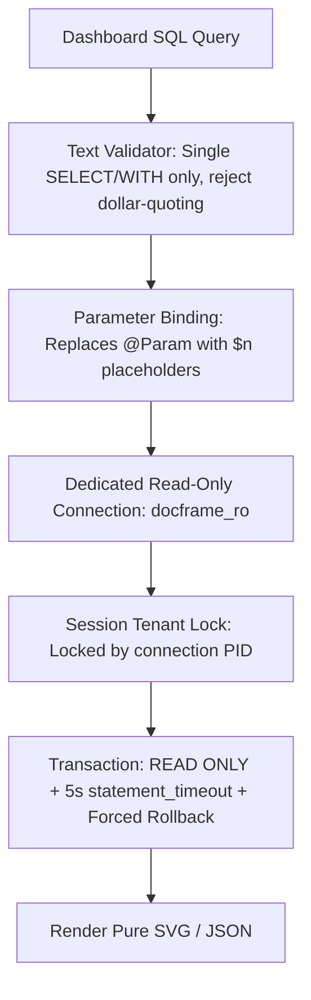

# SQL Dashboards & Analytical Widgets Guide

DocFrame enables administrators to build real-time visual dashboards by querying dedicated analytical PostgreSQL views.

---

## 1. Widget Creation Wizard

System Managers create widgets using a 4-step wizard at `Administration → Widgets → New widget` (`/admin/widgets/new`):

1. **SQL Query**: Enter a single `SELECT` or `WITH` query targeting views in the `reporting` schema (e.g., `reporting.purchase_request`).
2. **Parameters & Preview**: Map `@ParameterName` tokens to default values, dashboard date filters, or user context bindings (`user:department`). Preview results in an interactive grid.
3. **Visual Formatting**: Select visualization type:
   - **Bar Chart**
   - **Line Chart**
   - **Pie Chart / Doughnut**
   - **Single Value (KPI Card)**
   - **Data Grid Table**
4. **Permissions & Placement**: Specify allowed roles (empty = visible to all roles) and pin to the dashboard.

---

## 2. Multi-Layer Security Model

Analytical query execution employs multiple defense-in-depth safeguards:

### Safety Rules
- **Dedicated Read-Only User**: Runs under `docframe_ro`. If this user has superuser status or `INSERT`/`UPDATE`/`DELETE` privileges, DocFrame blocks query execution.
- **Tenant Isolation**: Reporting views filter by `tenant_id` populated from application session state. Because `docframe_ro` lacks table modification rights, tenant boundaries cannot be bypassed via `SET` or `set_config`.
- **Pure SVG Rendering**: Visual charts render as standards-compliant SVGs without client-side JavaScript execution, seamlessly adapting to Light and Dark themes.

