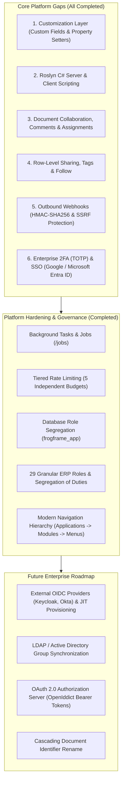

# High-Priority Platform Gaps: Frappe Parity & Enterprise Extensibility

This document details the architectural gap analysis between **FrogFrame** and mature metadata-driven application frameworks such as **Frappe Framework**. All six core architectural gaps—spanning customization, scripting, collaboration, ad-hoc sharing, outbound webhooks, and enterprise authentication—have been fully implemented and verified in the codebase.

*Last updated: November 2026*

---

## Executive Summary

| # | Gap Area | Implementation in FrogFrame | Target (Frappe Parity) | Impact | Status |
|---|---|---|---|---|---|
| **1** | **Customization Layer** *(Custom Field & Property Setter)* | Dedicated non-destructive tenant customization table (`frogframe_customizations`) in `033_customizations.sql` with overlay merge in `Compiler.cs`. Mandates `custom_` prefix; supports `InsertAfter` positioning. | Base definitions belong to app code; tenant Custom Fields & Property Setters are layered on top and preserved across upgrades. | Zero-loss tenant customization without developer dependency. | **Completed** |
| **2** | **Server & Client Scripting** | Sandboxed C# Roslyn scripting (`029_server_scripts.sql`) compiled to memory, cached as delegates, with compile-time AST analyzer rejecting forbidden namespaces and enforcing a statement budget. | Sandboxed C# Roslyn scripting with compile-time AST analyzer and statement budget rewriter. Client scripts unified via Blazor Server. | Rapid custom business logic authoring directly from the web interface. | **Completed** |
| **3** | **Document Collaboration & Activity Timeline** | Unified timeline with user discussions, `@mentions`, assignments (`frogframe_assignments`), and real-time presence indicators via `DocSocialBar.razor` and `/tasks` workspace. | Combined activity timeline with rich comments, `@mentions`, internal notifications, and task assignments (ToDos). | Operational teamwork and accountability within documents. | **Completed** |
| **4** | **Per-Document Sharing & Tagging** | Row-level sharing (`frogframe_doc_shares`) supporting `can_read`, `can_write`, `can_share` integrated into `PermissionService.ScopeFor`. GIN-indexed `tags text[]` with tag filter pills, bookmarks, and document followers. | Explicit row-level document sharing (`can_read`, `can_write`, `can_share`), combined with GIN-indexed document tags. | Granular ad-hoc access control and fast categorization. | **Completed** |
| **5** | **Webhooks & Integration Events** | Declarative Webhook metadata (`027_webhooks.sql`) with HMAC-SHA256 signatures, exponential backoff retries, strict SSRF blocker, and delivery logs. | Declarative Webhook metadata with HMAC-SHA256 signatures, exponential backoff retries, SSRF protection, and audit logs. | Native system-to-system integration and real-time data sync. | **Completed** |
| **6** | **Enterprise Authentication (2FA & SSO)** | TOTP 2FA (`042_two_factor.sql`) with QR enrolment, hashed recovery codes, per-role requirement, lockout protection, and admin reset. Google and Microsoft Entra ID single sign-on for existing accounts via PKCE authorization code flow. | TOTP Two-Factor Authentication, OIDC/OAuth2 Single Sign-On (Entra ID, Google), and identity federation. | Enterprise security compliance, identity federation, and seamless login experience. | **Completed** *(Core 2FA & Google/Entra SSO)* |

---

## 1. Customization Layer (Custom Fields & Property Setters)

### Architecture & Implementation
In FrogFrame, base DocType schemas are immutable properties of the application codebase (`*.doctype.json`). User alterations—such as adding tenant-specific fields or overriding field behaviors—are stored separately as **Custom Fields** and **Property Setters** in the PostgreSQL table `frogframe_customizations` (`033_customizations.sql`) and dynamically layered on top of the base schema at compile time.

```
+---------------------------------------+
| Base DocType (from *.doctype.json)   |
+---------------------------------------+
                   +
+---------------------------------------+
| Custom Fields (custom_* definitions)  |
| Property Setters (labels, visibility) |
+---------------------------------------+
                   ||  (Layered Merge in Compiler.cs)
                   v
+---------------------------------------+
| CompiledDocType (Tenant Runtime)      |
+---------------------------------------+
```

1. **Customization Schema & Storage (`033_customizations.sql`)**:
   ```sql
   CREATE TABLE frogframe_customizations (
       tenant_id  VARCHAR(64)  NOT NULL,
       doctype    VARCHAR(128) NOT NULL,
       kind       VARCHAR(32)  NOT NULL, -- 'custom_field' | 'property_setter'
       target     VARCHAR(128) NOT NULL, -- Field name or property key
       value      JSONB        NOT NULL,
       version    INT          NOT NULL DEFAULT 1,
       updated_at TIMESTAMPTZ  NOT NULL DEFAULT CURRENT_TIMESTAMP,
       updated_by VARCHAR(64)  NOT NULL,
       PRIMARY KEY (tenant_id, doctype, kind, target)
   );
   ```

2. **Overlay Compilation (`Compiler.cs`)**:
   - Compilation sequence: `Base Metadata (File) -> Apply Tenant Overlays (Customizations) -> Validate & Compile`.
   - Application deployments only update the base layer.
   - The UI `DocTypeEditor` writes to `frogframe_customizations` for core application DocTypes rather than altering base files.

3. **Mandatory Naming Prefix & Ordering**:
   - Custom fields mandate a `custom_` prefix (e.g. `custom_npwp_number`, `custom_tax_id`) to prevent naming collisions with upstream DocType releases.
   - `InsertAfter` ordering positions custom fields deterministically within existing sections and tab layouts.

4. **Conflict & Orphan Detection in `MetadataDiff`**:
   - Detects when an upstream DocType update deletes or renames a field targeted by an active Property Setter or `InsertAfter`, surfacing warnings in the administrative dashboard.

---

## 2. Server & Client Scripting (Roslyn C# Scripting)

### Architecture & Implementation
Custom business logic in FrogFrame is powered by high-performance sandboxed Roslyn C# scripting (`029_server_scripts.sql`), executing alongside compiled application hooks with sub-millisecond overhead:

1. **Execution Model & Caching**:
   - Powered by `Microsoft.CodeAnalysis.CSharp.Scripting`.
   - Scripts are compiled once per version, cached in memory as delegates (`ScriptRunner<object>`), and loaded into collectible `AssemblyLoadContext` instances for clean garbage collection upon script updates.

2. **Compilation-Time Security Sandbox**:
   - Assemblies restricted to `FrogFrame.Scripting.Facade` and core primitive types (`System.Text`, `System.Linq`, `System.Collections.Generic`).
   - Roslyn AST Analyzer categorically rejects forbidden namespaces (`System.IO`, `System.Net`, `System.Reflection`, `System.Diagnostics.Process`, `System.Environment`) as well as `unsafe` blocks, P/Invoke, and runtime reflection.
   - Statement budget rewriter injects counter checks into loops to prevent infinite execution loops.

3. **Runtime Protection**:
   - Enforces strict execution timeout (2000 ms) via `CancellationToken`.
   - Isolated script context (`ScriptContext`) exposes safe APIs (`doc.Get()`, `doc.Set()`, `ff.GetDoc()`, `ff.Log()`) without leaking raw `IServiceProvider`.

4. **Supported Script Triggers**:
   - **DocEvent Scripts**: Hooked to document lifecycle events (`BeforeValidate`, `BeforeInsert`, `AfterSave`, `OnSubmit`, `OnCancel`).
   - **Custom API Scripts**: Registered dynamically under `/api/method/{name}`.
   - **Scheduled Scripts**: Triggered periodically by `ScheduledJobRunner` via cron expressions.
   - **Unified Client Scripting via Blazor Server**: Client-side form events evaluated interactively over Blazor WebSocket connections using the same C# syntax.

---

## 3. Document Collaboration & Activity Timeline

### Architecture & Implementation
Document collaboration transforms static forms into interactive workspaces directly inside `FormPage.razor`:

1. **Unified Discussion & Commenting**:
   - Document comments (`frogframe_communications` / `030_communications.sql`) rendered in the form timeline.
   - Tagging colleagues via `@username` automatically parses user mentions and triggers in-app notification alerts.

2. **Assignments & ToDo Management (`036_assignments.sql`)**:
   ```sql
   CREATE TABLE frogframe_assignments (
       id          BIGSERIAL PRIMARY KEY,
       tenant_id   VARCHAR(64) NOT NULL,
       doctype     VARCHAR(128) NOT NULL,
       doc_name    VARCHAR(128) NOT NULL,
       assignee_id VARCHAR(64) NOT NULL,
       status      VARCHAR(32) NOT NULL DEFAULT 'Open',
       due_date    DATE NULL,
       assigned_by VARCHAR(64) NOT NULL,
       created_at  TIMESTAMPTZ NOT NULL DEFAULT CURRENT_TIMESTAMP,
       completed_at TIMESTAMPTZ NULL
   );
   ```
   - Assignment modal widget directly in the form header.
   - Centralized tracking via the `/tasks` page and the "My Tasks" widget on the desk home screen.

3. **Document Followers & Social Bar (`DocSocialBar.razor`)**:
   - Users can "Follow" individual records to receive notifications upon status changes.
   - Colour-coded document tags and personal bookmark toggles.

---

## 4. Per-Document Sharing & Tagging

### Architecture & Implementation
Extends standard role-based access control with granular record-level permissions:

1. **Ad-Hoc Record Sharing (`037_doc_shares.sql`)**:
   ```sql
   CREATE TABLE frogframe_doc_shares (
       tenant_id   VARCHAR(64) NOT NULL,
       doctype     VARCHAR(128) NOT NULL,
       doc_name    VARCHAR(128) NOT NULL,
       user_id     VARCHAR(64) NOT NULL,
       can_read    BOOLEAN NOT NULL DEFAULT TRUE,
       can_write   BOOLEAN NOT NULL DEFAULT FALSE,
       can_share   BOOLEAN NOT NULL DEFAULT FALSE,
       shared_by   VARCHAR(64) NOT NULL,
       created_at  TIMESTAMPTZ NOT NULL DEFAULT CURRENT_TIMESTAMP,
       PRIMARY KEY (tenant_id, doctype, doc_name, user_id)
   );
   ```
   - **Permission Enforcement**: Seamlessly integrated into `PermissionService.ScopeFor`, appending sharing grants into SQL query scopes (`RowScope.AnyOf`).

2. **Document Tagging**:
   - GIN-indexed `tags text[]` across transactional document tables for millisecond tag lookups.
   - Interactive tag selector and filter pills on `ListPage.razor` and `FormPage.razor`.

---

## 5. Webhooks & Outbound Integration Events

### Architecture & Implementation
Enables real-time, event-driven integration with third-party software and external APIs:

1. **Declarative Webhook Metadata (`027_webhooks.sql`)**:
   - Per-tenant configuration of trigger DocType, event (`Insert`, `Update`, `Submit`, `Cancel`, `Delete`, `WorkflowTransition`), optional filter condition, target URL, and custom HTTP headers.

2. **Guaranteed Delivery via Outbox**:
   - Dispatched asynchronously through `OutboxProcessor` with exponential backoff retries and at-least-once delivery semantics.

3. **Cryptographic Payload Signing**:
   - Every outgoing request includes an `X-FrogFrame-Signature: sha256={computed_hmac_hex}` header computed over the JSON payload using the webhook's secret key.

4. **SSRF Mitigation & Audit Logging**:
   - Validates destination URLs against a strict SSRF blocker: private IP ranges (RFC 1918), loopback, link-local, and container network hostnames are rejected.
   - Full delivery telemetry recorded in `frogframe_webhook_logs` (status code, execution latency, response snippet).

---

## 6. Enterprise Authentication: 2FA & SSO

### Architecture & Implementation
Robust enterprise-grade identity and access security (`042_two_factor.sql`):

1. **Two-Factor Authentication (TOTP 2FA)**:
   - Self-service QR code enrollment (`/account/two-factor`) compatible with Google Authenticator, Microsoft Authenticator, and 1Password.
   - Hashed single-use recovery codes.
   - Configurable mandatory enforcement per role (`Security:TwoFactor:RequiredForRoles`).
   - Brute-force protection: failed password confirmations and invalid OTP attempts count toward the 15-minute account lockout threshold.
   - Administrative reset capability with audit logging.

2. **Single Sign-On (Google & Microsoft Entra ID)**:
   - OpenID Connect authorization-code flow with PKCE (`SingleSignOn.cs`).
   - "Continue with Google" and "Continue with Microsoft" available on `/account/login`.
   - Matches existing accounts by verified email address; preserves strict role assignments without unauthorized elevation.
   - Optional domain restriction (`Authentication:AllowedEmailDomains`).

---

## 7. Additional Enterprise Platform Enhancements

Beyond the six original gaps, FrogFrame has implemented major enterprise capabilities:

1. **Background Tasks & Asynchronous Bulk Operations (`041_background_tasks.sql`)**:
   - Dedicated `/jobs` dashboard tracking background imports (automatically offloaded for datasets $\ge 500$ rows) and bulk actions (Submit, Cancel, Delete).
2. **Tiered Rate Limiting (`RateLimitTiers.cs`)**:
   - Independent rate limiting budgets: Sign-in (1200/min per IP), Password reset (20/min per IP), Write (120/min per user/key), Heavy/Reports (60/min), and Read (300/min).
3. **Database Role Segregation (`frogframe_app`)**:
   - Hardened PostgreSQL role separation: runtime HTTP requests connect as restricted `frogframe_app` (DML only, no DDL/DROP/TRUNCATE), while schema migrations run under `frogframe`.
4. **29 Granular ERP Roles & Role Groups (`ErpRoles.cs`, `RoleGroups.cs`)**:
   - Fine-grained access control across HR, CRM, Finance, Accounting, Procurement, and Stock modules with automated segregation of duties checks (e.g. Payable vs Cashier).
5. **Modern Navigation Architecture**:
   - Hierarchical structure: **Applications** (HRM, CRM, Finance, Accounting, IT) $\rightarrow$ **Workspace Modules** $\rightarrow$ **Navigation Menu Groups** $\rightarrow$ **Navigation Menus**.
6. **DocType Visual Editor Enhancements**:
   - Native tab-in-section visual designer and multilingual keyword search in the control palette.

---

## Parity Roadmap Status



With all six core platform gaps resolved and enterprise security hardening in place, FrogFrame achieves full functional and architectural parity with Frappe Framework, delivering a high-performance, secure, and developer-friendly ERP foundation.
