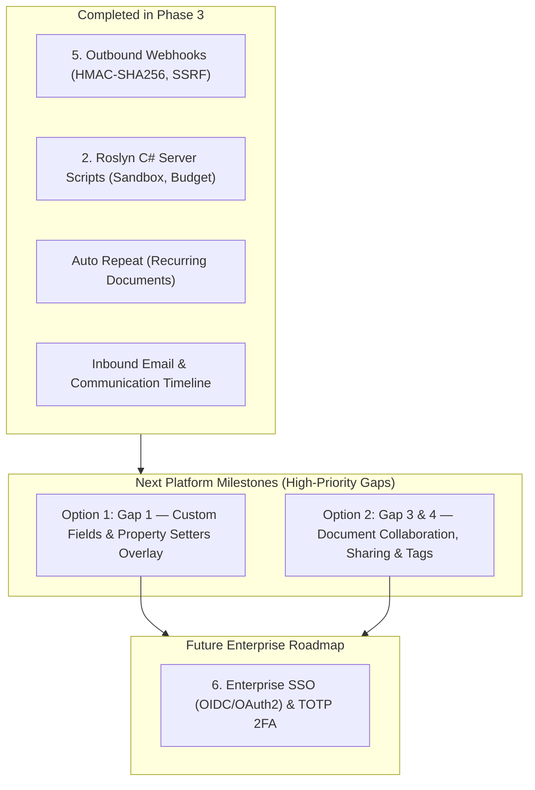

# High-Priority Platform Gaps: Frappe Parity & Enterprise Extensibility

This document outlines the six high-priority architectural gaps between **FrogFrame** and mature metadata-driven application frameworks like **Frappe Framework**. Addressing these gaps determines whether FrogFrame can be freely customized by non-developer administrators, effectively utilized for team collaboration, and integrated seamlessly with external enterprise systems.

*Last updated: November 2026*

---

## Executive Summary

| # | Gap Area | Current FrogFrame State | Target (Frappe Parity) | Impact | Status |
|---|---|---|---|---|---|
| **1** | **Customization Layer** *(Custom Field & Property Setter)* | Non-destructive tenant customization layer (`frogframe_customizations`) in `033_customizations.sql` with overlay compilation in `Compiler.cs`. | Base definitions belong to app code; tenant Custom Fields & Property Setters are layered on top and preserved across upgrades. | Zero-loss tenant customization without developer dependency. | **Completed** |
| **2** | **Server & Client Scripting** | Sandboxed C# Roslyn scripting compiled to memory, cached as delegates, and executed for DocEvents, APIs, and Cron jobs. | Sandboxed C# Roslyn scripting with compile-time AST analyzer and statement budget rewriter. Client scripts unified via Blazor Server. | Rapid custom business logic authoring directly from the web interface. | **Completed (Phase 3-C)** |
| **3** | **Document Collaboration & Activity Timeline** | FormPage offers attachments, audit timeline, and presence, but lacks interactive discussions and task handoffs. | Combined activity timeline with rich comments, `@mentions`, internal notifications, and task assignments (ToDos). | Operational teamwork and accountability within documents. | **Next Milestone (Option 2)** |
| **4** | **Per-Document Sharing & Tagging** | Document access is strictly governed by global role definitions; no ad-hoc record sharing or tag-based organization. | Explicit row-level document sharing (`can_read`, `can_write`, `can_share`), combined with GIN-indexed document tags. | Granular ad-hoc access control and fast categorization. | **Next Milestone (Option 2)** |
| **5** | **Webhooks & Integration Events** | Declarative Webhook metadata with HMAC-SHA256 signatures, exponential backoff retries, SSRF protection callback, and delivery logs. | Declarative Webhook metadata with HMAC-SHA256 signatures, exponential backoff retries, SSRF protection, and audit logs. | Native system-to-system integration and real-time data sync. | **Completed (Phase 3-A)** |
| **6** | **Enterprise Authentication (2FA & SSO)** | Authentication is limited to username/password (ASP.NET Core Identity) and internal API keys. | TOTP Two-Factor Authentication, OIDC/OAuth2 Single Sign-On (Entra ID, Google, Keycloak), LDAP/AD, and Bearer token auth via OpenIddict. | Enterprise security compliance, identity federation, and seamless API integrations. | Planned (Phase 4) |

---

## Next Platform Milestones (High-Priority Gaps)

Based on the High-Priority Gaps Roadmap, two major initiatives remain:

### Option 1: Gap 1 — Customization Layer (Custom Fields & Property Setters Overlay)

Enables non-developer administrators to customize standard application DocTypes without having their changes overwritten during code updates or new version deploys:

- **Database Schema (`031_customizations.sql`)**:
  `frogframe_customizations` table (`tenant_id`, `doctype`, `kind`, `target`, `value jsonb`, `version`, `updated_at`, `updated_by`).
- **Overlay Compilation in `Compiler.cs`**:
  Compilation pipeline: `Base DocTypeDef (file/app) -> Apply Tenant Customizations -> CompiledDocType`.
  Developer deployments only update base definitions; tenant customizations persist seamlessly across upgrades.
- **Custom Field Engine**:
  Enforce mandatory `custom_` prefix to prevent naming collisions with future upstream DocType releases.
  `InsertAfter` ordering to position custom fields deterministically within existing form and list layouts.
- **Property Setter Engine**:
  Overrides field and DocType properties (e.g. `Label`, `Visible`, `RequiredWhen`, `Options`, `InListView`, `PermLevel`, `ReadOnly`).
- **Conflict & Orphan Detection in `MetadataDiff`**:
  Detects when an upstream DocType update deletes or renames a field targeted by an active Property Setter or `InsertAfter`.
- **UI & Admin**:
  Custom Field & Property Setter admin interface (`/admin/customizations`), plus overlay mode in `DocTypeEditor.razor` for application DocTypes.

### Option 2: Gap 3 — Document Collaboration & Activity Timeline

Enhances teamwork inside documents:

- **Discussions & Comments (`frogframe_comments`)**:
  Rich comments with `@mentions` triggering in-app notifications and email outbox alerts.
- **Assignments & ToDo (`frogframe_assignments`)**:
  Assign documents to users with due dates, integrated into the "My Tasks / Inbox" view.
- **Per-Document Row Sharing (`frogframe_doc_shares`)**:
  Ad-hoc access grants (`can_read`, `can_write`, `can_share`) integrated directly into `PermissionService.ScopeFor`.
- **Document Tagging**:
  GIN-indexed `tags text[]` with tag filter pills on list pages and forms.
- **Document Followers**:
  Follow/unfollow records with automated notification digests on status changes.

---

## 1. Customization Layer (Custom Fields & Property Setters)

### Current State
In `Compiler.cs` (lines 834–848), `MetadataRegistry` determines active DocType schemas using a winner-takes-all strategy: the database version is preferred unless the file version (`*.doctype.json`) has a newer version number, in which case the file version is published wholesale.
Consequently, custom fields added by tenant administrators through `DocTypeEditor` are completely overwritten and lost when developers deploy a new release of standard DocTypes.

### Target Architecture (Frappe Parity)
In Frappe, base DocType schemas are immutable properties of the application codebase. User alterations—such as adding tenant-specific fields or overriding field behaviors—are stored separately as **Custom Fields** and **Property Setters** and dynamically layered on top of the base schema at compile time.

```
+---------------------------------------+
| Base DocType (from *.doctype.json)   |
+---------------------------------------+
                   +
+---------------------------------------+
| Custom Fields (custom_* definitions)  |
| Property Setters (labels, visibility) |
+---------------------------------------+
                   ||  (Layered Merge)
                   v
+---------------------------------------+
| CompiledDocType (Tenant Runtime)      |
+---------------------------------------+
```

### Proposed Solution for FrogFrame

1. **Customization Schema & Storage**:
   Introduce a dedicated database table `frogframe_customizations`:
   ```sql
   CREATE TABLE frogframe_customizations (
       tenant_id VARCHAR(64) NOT NULL,
       doctype   VARCHAR(128) NOT NULL,
       kind      VARCHAR(32) NOT NULL, -- 'custom_field' | 'property_setter'
       target    VARCHAR(128) NOT NULL, -- Field name or property key
       value     JSONB NOT NULL,
       version   INT NOT NULL DEFAULT 1,
       updated_at TIMESTAMPTZ NOT NULL DEFAULT CURRENT_TIMESTAMP,
       updated_by VARCHAR(64) NOT NULL,
       PRIMARY KEY (tenant_id, doctype, kind, target)
   );
   ```

2. **Compilation Pipeline**:
   - Compiler sequence: `Base Metadata (File) -> Apply Tenant Overlays (Customizations) -> Validate & Compile`.
   - Application deployments only update the base layer.
   - The UI `DocTypeEditor` is restricted: for core application DocTypes, it writes only to `frogframe_customizations` rather than altering the base schema.

3. **Mandatory Naming Prefix**:
   - Custom fields must require a `custom_` prefix (e.g. `custom_npwp_number`, `custom_cost_center`) to prevent naming collisions with future upstream DocType releases.

4. **Conflict Detection in MetadataDiff**:
   - When base metadata changes during an upgrade, `MetadataDiff` must detect orphaned Property Setters (overrides targeting fields deleted or renamed in upstream) and flag them in the administrative dashboard instead of silently ignoring or corrupting schemas.

---

## 2. Server Scripting & Client Scripting

### Current State
Custom business logic in FrogFrame was previously restricted to:
- Declarative expressions (`Compute`, `RuleDef`).
- Predefined declarative hooks (e.g. `Reject`, `SetField`, `EmitEvent`).
- Hardcoded C# implementations in `Apps.Erp/Hooks`, which require code modification, compilation, and application redeployment.

### Target Architecture (Frappe Parity)
Frappe provides **Server Scripts** (restricted Python executed on document events, API endpoints, and scheduled cron jobs) and **Client Scripts** (browser-side JavaScript controlling form behavior and UI interactions).

### Proposed Solution for FrogFrame (Roslyn C# Scripting)

1. **Execution Model**:
   - Use `Microsoft.CodeAnalysis.CSharp.Scripting`.
   - Scripts are compiled once per version, cached in memory as compiled delegates (`ScriptRunner<object>`), and executed with sub-millisecond overhead.
   - Assemblies are loaded into collectible `AssemblyLoadContext` instances so outdated script versions can be garbage-collected cleanly upon publication.

2. **Compilation-Time Security Sandbox**:
   Roslyn does not provide a native execution sandbox. Security must be enforced before compilation:
   - Restrict assembly references exclusively to `FrogFrame.Scripting.Facade` and core primitive types (`System.Text`, `System.Linq`, `System.Collections.Generic`).
   - Run a Roslyn AST Analyzer / Semantic Model checker to categorically reject:
     - `System.IO`, `System.Net`, `System.Net.Http`, `System.Net.Sockets`.
     - `System.Reflection`, `System.Diagnostics.Process`, `System.Environment`.
     - `unsafe` code blocks, P/Invoke (`DllImport`), and runtime reflection (`dynamic`, emit).

3. **Runtime Protection**:
   - Enforce a strict execution timeout (e.g., 2000 ms) using `CancellationToken`.
   - Isolate CPU and memory limits: for high-security environments, delegate script execution to an out-of-process worker process with OS-level sandboxing (AppContainer / cgroups).

4. **Script Facade & Scoping (No ServiceProvider Leak)**:
   - Scripts do NOT receive raw `IServiceProvider`.
   - Provide a safe global context object (e.g., `ScriptContext`) exposing safe APIs:
     - `doc.Get(field)`, `doc.Set(field, val)`.
     - `ff.GetDoc(doctype, name)` — resolves through `DocumentService` under the caller's credentials, preserving tenant isolation, row scopes, and permissions.
     - `ff.Log(message)` — routed to OpenTelemetry and tenant error logs.

5. **Supported Script Types**:
   - **DocEvent Scripts**: Bound to `DocHookStage` (e.g. `BeforeValidate`, `BeforeInsert`, `AfterSave`, `OnSubmit`).
   - **Custom API Scripts**: Registered dynamically under `/api/method/{name}` as custom endpoints.
   - **Scheduled Scripts**: Triggered by `ScheduledJobRunner` using cron expressions.

6. **Unified Client Scripting via Blazor Server**:
   - Because Blazor Server operates interactively over a persistent WebSocket connection, client-side form events (`OnFieldChanged`, `BeforeSave`, `OnLoad`) can also be evaluated by server-side C# scripts, offering non-developer administrators a single language (C#) across both client and server logic.

---

## 3. Document Collaboration & Activity Timeline

### Current State
`FormPage.razor` currently features an **Attachments** tab, an **Audit Timeline** (read-only system audit log), and real-time **User Presence** indicators. However, it lacks collaborative teamwork features: no internal discussions, no user assignments, and no notification triggers on mentions.

### Target Architecture (Frappe Parity)
In Frappe, every document includes a sidebar for **Assigned To**, **Attachments**, **Tags**, **Shared With**, and **Followers**. The main timeline unifies audit entries, user comments, system notifications, and email correspondences.

### Proposed Solution for FrogFrame

1. **Unified Discussion & Commenting**:
   - Database table `frogframe_comments`:
     ```sql
     CREATE TABLE frogframe_comments (
         id          BIGSERIAL PRIMARY KEY,
         tenant_id   VARCHAR(64) NOT NULL,
         doctype     VARCHAR(128) NOT NULL,
         doc_name    VARCHAR(128) NOT NULL,
         author_id   VARCHAR(64) NOT NULL,
         author_name VARCHAR(128) NOT NULL,
         body        TEXT NOT NULL,
         mentions    TEXT[] NOT NULL DEFAULT '{}',
         created_at  TIMESTAMPTZ NOT NULL DEFAULT CURRENT_TIMESTAMP
     );
     CREATE INDEX ix_frogframe_comments_doc ON frogframe_comments(tenant_id, doctype, doc_name);
     ```
   - Render comments inline with audit trail events in `FormPage.razor`.
   - Parsing `@username` triggers automated in-app notifications through `NotificationRuleEngine` and dispatches alert emails via the email outbox.

2. **Assignments & ToDo Management**:
   - Database table `frogframe_assignments`:
     ```sql
     CREATE TABLE frogframe_assignments (
         id          BIGSERIAL PRIMARY KEY,
         tenant_id   VARCHAR(64) NOT NULL,
         doctype     VARCHAR(128) NOT NULL,
         doc_name    VARCHAR(128) NOT NULL,
         assignee_id VARCHAR(64) NOT NULL,
         status      VARCHAR(32) NOT NULL DEFAULT 'Open', -- 'Open' | 'Completed' | 'Cancelled'
         due_date    DATE NULL,
         assigned_by VARCHAR(64) NOT NULL,
         created_at  TIMESTAMPTZ NOT NULL DEFAULT CURRENT_TIMESTAMP,
         completed_at TIMESTAMPTZ NULL
     );
     CREATE INDEX ix_frogframe_assignments_user ON frogframe_assignments(tenant_id, assignee_id, status);
     ```
   - Add an **Assigned To** management widget on the form header.
   - Display active assignments under an expanded **My Tasks / Inbox** dashboard widget.

---

## 4. Per-Document Sharing & Tagging

### Current State
Document access is determined strictly at the role and department level (`RowScope.Department` / `SystemManager`). There is no mechanism to share individual records with specific colleagues or organize records with arbitrary tags.

### Proposed Solution for FrogFrame

1. **Ad-Hoc Record Sharing**:
   - Database table `frogframe_doc_shares`:
     ```sql
     CREATE TABLE frogframe_doc_shares (
         tenant_id   VARCHAR(64) NOT NULL,
         doctype     VARCHAR(128) NOT NULL,
         doc_name    VARCHAR(128) NOT NULL,
         user_id     VARCHAR(64) NOT NULL,
         can_read    BOOLEAN NOT NULL DEFAULT TRUE,
         can_write   BOOLEAN NOT NULL DEFAULT FALSE,
         can_share   BOOLEAN NOT NULL DEFAULT FALSE,
         shared_by   VARCHAR(64) NOT NULL,
         created_at  TIMESTAMPTZ NOT NULL DEFAULT CURRENT_TIMESTAMP,
         PRIMARY KEY (tenant_id, doctype, doc_name, user_id)
     );
     CREATE INDEX ix_frogframe_doc_shares_lookup ON frogframe_doc_shares(tenant_id, user_id, doctype);
     ```
   - **Permission Enforcement**: Integrate sharing directly into `PermissionService.ScopeFor`:
     - Append `name IN (SELECT doc_name FROM frogframe_doc_shares WHERE tenant_id = @t AND user_id = @u AND doctype = @dt)` into `RowScope.AnyOf`.
     - Single-document queries in `InScope` check the sharing table alongside normal role boundaries.

2. **Document Tagging**:
   - Store tags directly on document instances (`tags text[]`) or via an indexed relation.
   - Support fast GIN index filtering on PostgreSQL:
     ```sql
     CREATE INDEX ix_doc_tags ON {table} USING GIN (tags);
     ```
   - Add a Tag filter pill and tag selector to `ListPage.razor` and `FormPage.razor`.

3. **Followers & Subscription Updates**:
   - Enable users to "Follow" documents; followers automatically receive change summaries in their inbox or email whenever a document status changes or new comments are posted.

---

## 5. Webhooks & Outbound Integration Events

### Current State
Domain events are queued into the PostgreSQL outbox table (`Event(doc, "document.updated", user)`), but they are currently processed only by internal application event handlers. There is no configurable mechanism to dispatch events to external REST endpoints without writing compiled C# code.

### Proposed Solution for FrogFrame

1. **Webhook Metadata Schema**:
   Define `WebhookDef` stored per tenant:
   - `DocType`: Document schema triggering the webhook.
   - `Event`: Event types (`Insert`, `Update`, `Submit`, `Cancel`, `Delete`, `WorkflowTransition`).
   - `Condition`: Optional expression evaluating the document payload (e.g., `doc.total_amount > 10000000`).
   - `EndpointUrl`: Destination HTTP URL.
   - `Headers`: Custom request headers (Authorization, content-type).
   - `Fields`: Field subset to transmit (or empty for full document).
   - `Secret`: Secret key used for signing payloads.

2. **Outbox Processor Integration**:
   - Implement an `IEventHandler<DocumentEvent>` within `OutboxProcessor`.
   - Automatically inherits at-least-once delivery, exponential retry backoff, and idempotency guarantees.

3. **Cryptographic Payload Signing**:
   - Generate an HMAC-SHA256 signature over the raw JSON payload using the webhook's secret key:
     ```http
     X-FrogFrame-Signature: sha256={computed_hmac_hex}
     X-FrogFrame-Event: document.submitted
     X-FrogFrame-DocType: PurchaseRequest
     ```

4. **SSRF Mitigation & Security Auditing**:
   - Validate destination URLs against a strict SSRF blocker: disallow RFC 1918 private IP ranges, loopback (`127.0.0.1`, `localhost`), link-local (`169.254.169.254`), and internal Docker network hostnames.
   - Log webhook delivery attempts in `frogframe_webhook_logs` (HTTP status code, response time, response snippet, failure reason).

---

## 6. Enterprise Authentication: 2FA & SSO

### Current State
Authentication is currently restricted to:
- Username and password verification via ASP.NET Core Identity.
- API keys using `X-API-Key` headers.
- No Multi-Factor Authentication (MFA/2FA), Single Sign-On (SAML 2.0 / OIDC), or Directory Services integration (LDAP / Active Directory) are implemented.

### Proposed Solution for FrogFrame

1. **Two-Factor Authentication (TOTP 2FA)**:
   - Implement `IUserAuthenticatorKeyStore<UserAccount>` and `IUserTwoFactorStore<UserAccount>` in `Framework.Persistence.PostgreSql`.
   - Provide an enrollment UI in `/account/manage/2fa` generating standard QR codes (compatible with Google Authenticator, Microsoft Authenticator, and 1Password).
   - Generate single-use recovery codes stored hashed in the account database.
   - Introduce an administrator policy setting: **Mandatory 2FA** per role (e.g. required for `System Manager` and `Accounts Manager`).

2. **Single Sign-On (OIDC / OAuth2)**:
   - Integrate `Microsoft.AspNetCore.Authentication.OpenIdConnect`.
   - Support common enterprise identity providers:
     - Microsoft Entra ID (Azure AD).
     - Google Workspace.
     - Keycloak / Okta / Auth0.
   - Automatic account provisioning / JIT (Just-In-Time) provisioning option mapping token claims (`email`, `groups`, `roles`) into FrogFrame roles and tenants.

3. **Directory Services (LDAP / Active Directory)**:
   - Provide an optional LDAP authentication provider using `System.DirectoryServices.Protocols`.
   - Secure LDAP bind authentication with periodic background group synchronization to FrogFrame user roles.

4. **OAuth 2.0 Authorization Server (Bearer Tokens)**:
   - Integrate **OpenIddict** into `Framework.Web` to turn FrogFrame into an OAuth2 identity provider.
   - Allow third-party partner applications to authenticate API calls using standard `Authorization: Bearer <access_token>` flows, complementing fixed API keys.

---

## Roadmap & Prioritization Matrix



By completing these six strategic initiatives, FrogFrame attains full architectural and functional parity with Frappe Framework, enabling organizations to deploy, customize, and scale mission-critical enterprise applications with complete developer independence.

